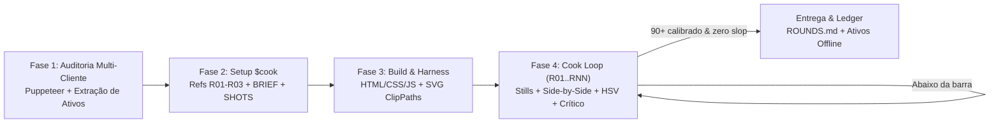

# Client Cook Pipeline (Discovery -> Asset Audit -> Cook Loop)

Esta skill sistematiza o fluxo ponta a ponta para transformar empresas reais com presença digital defasada em protótipos web autônomos de nível Awwwards ("Show, Don't Tell"), unindo **qualificação orientada a ativos reais** com **convergência visual mensurada via `$cook`**.

---

## Fase 1: Avaliação Multi-Cliente e Auditoria de Extratibilidade

Antes de escrever código para um cliente, avalie de 2 a 5 candidatos do mesmo nicho com inspeção real via navegador headless.

### 1.1 Protocolo Técnico de Coleta (Puppeteer / Chrome Headless)
Em ambientes Linux com limite de comprimento em `SingletonSocket` ou bloqueio HTTP 406 em fetches simples:
- Defina `TMPDIR=/tmp`, `userDataDir: '/tmp/cprofile_audit_' + Date.now()`, `executablePath: '/usr/bin/google-chrome'` e flags `['--no-sandbox', '--disable-setuid-sandbox', '--disable-gpu', '--window-size=1600,1000']`.
- Aplique `User-Agent` padrão de desktop e role a página gradualmente até o fim para disparar imagens *lazy-loaded*.
- Extraia em JSON estruturado: `innerText`, `links` (WhatsApp `wa.me`, `tel:`, `mailto:`, Instagram, subpáginas), `imgs` (`naturalWidth`, `naturalHeight`, `src`), `bgImages`, `videos` (`.mp4` e `poster`) e `svgs`.
- Capture screenshots `hero` (`scrollY = 0`) e `mid` (`scrollY = 1000`) de cada candidato.

### 1.2 Matriz de Decisão (`referencias/discovery/<cliente>-evaluation.md`)
Pontue e documente os candidatos em 4 eixos objetivos:
1. **Autenticidade e Narrativa (ICP):** O negócio possui história real, métricas concretas (ano de fundação, capacidade física, diferenciais técnicos) e dados completos de contato/localização sem depender de invenção?
2. **Riqueza de Ativos Extraíveis:** Há vídeo MP4 nativo, fotos landscape de alta resolução (1000px+), logotipos nítidos e ausência de dependência de imagens stock genéricas ou `.heic`?
3. **Dor Visual / Gap de Redesign:** O site atual sofre de templates datados, baixo contraste ou má arquitetura de informação que tornam o salto visual evidente?
4. **Aderência ao Benchmark Alvo:** A natureza física do negócio sustenta a linguagem estética escolhida (ex.: minimalismo arquitetônico Wally Yachts para marinas e estaleiros)?

---

## Fase 2: Setup do `$cook` e Download Local de Ativos

1. **Espelhamento Offline Obrigatório:** Baixe todos os ativos reais do cliente vencedor (fotos, vídeos MP4, logos) para `assets/img/` e `assets/video/` dentro da pasta do projeto (`projetos/<cliente>/`).
   - Dica Wix/CDN: URLs com `/v1/fill/w_...` frequentemente entregam o arquivo original em resolução integral ao remover o sufixo de transformação.
   - Converta PNGs gigantes (>5 MB) em JPEGs `2400px` (`quality=92`) mantendo os originais para renderização instantânea no harness.
2. **Estrutura `cook/`:**
   - `cook/refs/R01.png` .. `R03.png`: cópias das telas do benchmark (ex.: `05_wally_1.png`, `05_wally_2.png`, `05_wally_3.png`).
   - `cook/BRIEF.md`: modo `same quality, own style` no idioma do cliente, meta `95+` por dimensão, `Time: hard cap 1.5h` (ou `floor 8h` para produções longas) e **Slop Ban List** explícita (sem eyebrow labels, sem monospace uppercase, sem purple/beige, sem contadores 01/02/03, sem glowing orbs, sem partículas decorativas, sem em dashes).
   - `cook/SHOTS.md`: mapeamento exato de `S01`, `S02`, `S03` em viewport `1600x1000` com âncoras de scroll e checklist de tomada/observação.
   - `cook/ROUNDS.md`: copiado de `cook/templates/ROUNDS.md`.

---

## Fase 3: Engenharia Visual & Harness Reutilizável

### 3.1 Padrões Arquitetônicos para Benchmark Wally / Quiet Luxury
- **Formas Geométricas Chanfradas com Vértices Suavizados:** Para replicar cards trapezoidais inclinados com cantos arredondados perfeitos sem distorcer a fotografia, defina `<clipPath clipPathUnits="objectBoundingBox">` em SVG inline com curvas Bézier quadráticas (`Q`) nos 4 cantos.
- **Hierarquia Cromática:** Hero widescreen `100vh` com grade oceânica controlada (`saturate`, `hue-rotate` e `linear-gradient` sutil evitando céus estourados), transicionando para fundo editorial `#FFFFFF` puro, títulos geométricos `#232629`, botões pílula `#333738` e header sticky translúcido `#9AA0A4`.
- **Interatividade Real de Negócio:** Inclua menu overlay fullscreen, alternância de câmera/vídeo no hero, seletor dinâmico de serviços/vagas com especificações reais, FAQ em acordeão e modal concierge que gera mensagem pré-preenchida para o WhatsApp oficial do cliente.

### 3.2 Construção do Harness (`cook/harness.mjs` + `cook/color_check.py`)
Construa o harness uma única vez antes da Rodada 1:
- Servidor HTTP local efêmero servindo a pasta do projeto (evita bloqueios CORS de vídeo/SVG em `file://`).
- Captura automatizada de `S01.png`, `S02.png`, `S03.png` em `1600x1000`.
- Verificação programática de estados interativos (abertura do menu, troca de abas, `naturalWidth > 0` em todas as imagens, `readyState === 4` nos vídeos, zero erros JS e zero em dashes no DOM).
- Geração do comparativo via `side-by-side.mjs --aspect 16:10 --height 540`.
- Medição HSV em grade `4x4` via `cook/color_check.py` (redimensionamento `256x160` para proporção `16:10`) imprimindo `saturation mean/worst delta` e `brightness mean/worst delta`.

---

## Fase 4: Execução do Cook Loop (Mínimo 2 a 3 Rodadas)

Em cada rodada `rNN`:
1. **Render & Telemetria:** Rode `TMPDIR=/tmp node cook/harness.mjs rNN`.
2. **Crítica Zero-Context:**
   - Invoque 2 subagentes críticos (`invoke_subagent` com `TypeName: "self"`) enviando **exclusivamente** `cook/compare/rNN/all.jpg` e a rubrica (`composition, light, color, materials, detail density`).
   - *Regra de Contingência:* Se você já estiver rodando dentro de um subagente e o ambiente retornar `maximum subagent nesting depth (1) exceeded`, aplique a regra de fallback de `cook/references/loop-and-critics.md`: realize a autoavaliação cega rigorosa sobre `all.jpg`, marque explicitamente como `self-scored` no `cook/ROUNDS.md` e ancore as correções nos deltas HSV medidos.
3. **Priorização Cirúrgica de Correções:**
   - **R01 -> R02:** Corrija estrutura de composição, sujeito focal do hero, substituição de fotos desbotadas/ruins, sangria dos cards até a borda inferior do viewport e purificação de fundos nos cards gráficos.
   - **R02 -> R03:** Calibre saturação e temperatura cromática (usando os deltas do `color_check.py`), remova intrusões de borda (objetos cortados nas extremidades), suavize curvas SVG dos chanfros e ajuste o alinhamento vertical entre colunas.
4. **Critério de Parada:** Encerre somente após registrar todas as rodadas em `cook/ROUNDS.md`, confirmar `0` imagens quebradas, `0` erros de console, cumprimento integral da Ban List e entrega visual consistente (90+/100 em todas as dimensões).
