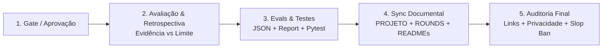

# Delivery Eval & Docs (Avaliação, Evals e Consolidação Documental)

Esta skill padroniza o fechamento rigoroso de entregas (sites, protótipos `$cook`, sistemas web ou pacotes de showroom), garantindo que **avaliação de processo/produto**, **evals reproduzíveis** e **sincronização documental** ocorram juntos e com honestidade metodológica.



---

## Regras Inegociáveis

1. **Separar evidência técnica, observação visual e aprovação humana:**
   - Aprovação do usuário ("aprovado para apresentação/fechamento") valida o gate de entrega, **não** equivale a certificação WCAG integral, teste com usuário final, ROI comercial ou superação de limites fotográficos/de infraestrutura.
   - Nunca inflar notas para `100/100` se houver pilares parciais ou tetos conhecidos (ex.: medianas de críticos cegos abaixo da meta ou ausência de `prefers-reduced-motion`).
2. **Portabilidade obrigatória:**
   - Todo script de eval, teste ou auditoria usa `Path(__file__).resolve()` ou `import.meta.url`. Zero caminhos hardcoded de máquina pessoal (`/home/...`, `/Users/...`).
3. **Preservar a *Slop Ban List* do projeto:**
   - Se o projeto proibir em dashes (`—`), placeholders ou tokens específicos, o script de eval e a auditoria devem validar e falhar caso sejam introduzidos nos documentos ou código.
4. **Não reescrever histórico:**
   - Registros passados (`R01..R04`) permanecem fiéis ao que ocorreu; atualize o estado corrente, o gate e os próximos passos.

---

## Fluxo de Execução em 5 Passos

### Passo 1: Registrar o Gate e Inventariar Evidências Reais
- Confirme nos registros do projeto (ex.: `cook/ROUNDS.md` ou `STATUS.md`) a aprovação recebida, a data/hora e o escopo exato aprovado (`fechamento/apresentação`).
- Liste apenas comandos e métricas realmente executados nesta entrega (testes, capturas, deltas HSV, medianas de críticos cegos, verificações mobile/desktop).

### Passo 2: Produzir `docs/EVALUATION-AND-RETROSPECTIVE.md`
Use a estrutura de referência em [`references/retro-and-eval-rubric.md`](references/retro-and-eval-rubric.md):
1. **Parecer sobre o produto entregue:** síntese factual separando o que está comprovado do que tem evidência parcial ou fora de escopo.
2. **Matriz por dimensão (`Dimensão | Estado | Evidência e limite`):** cobrindo identidade/composição, interatividade/lógica, mobile, acessibilidade, performance/autonomia offline, governança de ativos e documentação.
3. **O que funcionou** vs **Falhas e melhorias de processo (`Ocorrência real | Consequência | Melhoria aplicada | Verificação / limite`)**.
4. **Skills e ferramentas avaliadas:** registre o que ajudou, o que precisou de ajuste ou nova skill.
5. **Pendências priorizadas com critério de aceite:** backlog claro sem prometer execução não autorizada.

### Passo 3: Criar / Rodar Evals Determinísticos (`evals/` + `tests/`)
1. Implemente um harness reproduzível em `evals/eval_<projeto>.py` (ou `.mjs`) que meça objetivamente os pilares aplicáveis:
   - **Pilar 1 — Integridade de Ativos & Autonomia Offline:** arquivos locais referenciados existem e não estão vazios; zero dependências externas quebradas em runtime.
   - **Pilar 2 — Semântica, Acessibilidade & Mobile:** meta viewport, landmarks, controles de teclado/ARIA, taxas de contraste calculadas diretamente sobre os hexes do CSS e regras mobile (`@media`, touch targets, `scroll-margin-top`).
   - **Pilar 3 — Slop Ban, Dados Reais & Segurança:** verificação de placeholders/lorem, em dashes (quando proibido), caminhos pessoais/segredos e presença de canais verificados.
   - **Pilar 4 — Convergência Visual & Telemetria:** presença de stills/comparativos de todas as rodadas, execução ou conferência de métricas objetivas (ex.: `color_check.py`) e registro fiel das medianas de críticos zero-context.
   - **Pilar 5 — Consistência Documental & Links:** links relativos válidos e coerência de métricas/gate entre documentos.
2. Gere saída estruturada em `evals/saida/eval_results.json` e relatório legível em `evals/saida/EVAL-REPORT.md`.
3. Crie suíte de testes determinísticos em `tests/test_eval_<projeto>.py` e execute (`python3 -m pytest` ou `python3 -m unittest`).

### Passo 4: Sincronizar Toda a Documentação Corrente
Atualize em conjunto para não deixar números ou status defasados:
- Ledger do processo (`cook/ROUNDS.md` ou `STATUS.md`): gate aprovado + resumo de fechamento.
- Documentação técnica (`docs/PROJETO.md` / `docs/ARCHITECTURE.md`): status das etapas, referências ao eval e à retrospectiva.
- `README.md` do projeto: resumo atualizado, comando para rodar o site, o harness visual, o eval e os testes, mais árvore de arquivos completa.
- `README.md` da raiz do repositório (quando for catálogo/showroom): atualizar rodada final, notas reais e status do gate.

### Passo 5: Auditoria Automatizada e Commit Local
1. Execute o auditor portável desta skill:
   ```bash
   python3 .claude/skills/delivery-eval-docs/scripts/audit_docs_and_links.py <diretorio-do-projeto> --no-em-dash
   ```
   (remova `--no-em-dash` apenas se o projeto permitir travessões em documentação).
2. Confirme zero links relativos quebrados, zero vazamentos de caminhos pessoais/chaves nos arquivos entregues e todos os testes/evals verdes.
3. Faça commit local limpo na branch de trabalho (não execute `git push` salvo instrução explícita).
