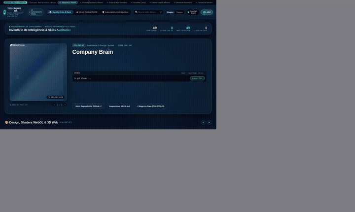
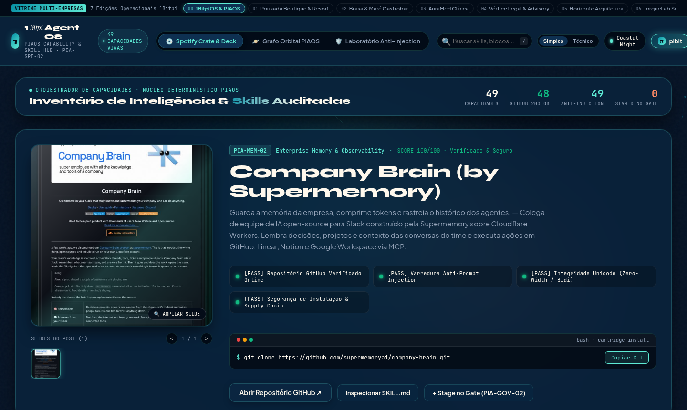
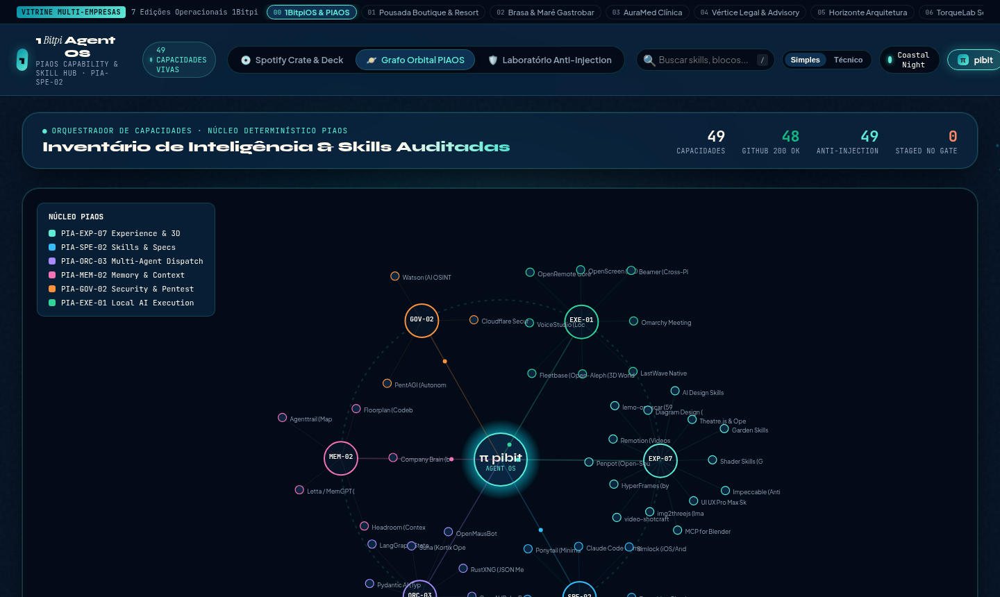

# 00 · Core Enterprise & Agent OS (1BitpiOS & PIAOS)

> **Marca Demonstrativa**: **1BitpiOS & PIAOS — Coastal Tech Edition**  
> **Segmentos Atendidos**: Engenharia de Software, Operações de IA, Consultorias de Tecnologia & DevSecOps  
> **Proposta de Valor**: *Hub Operacional de Agentes, Auditoria Anti-Prompt Injection e Catálogo Visual de Skills*

[-f26a4b?style=for-the-badge)](https://raw.githack.com/1bitpi-labs/showroom/main/player.html?id=00)

---

## 1. Visão Geral do Produto

Design oficial da **1Bitpi Labs** para o ecossistema **1BitpiOS / PIAOS**. Transforma coleções técnicas, repositórios GitHub e automações corporativas em uma central visual estilo Spotify + Apple Spatial UI, com inspeção de segurança contra Prompt Injection e orquestração via agente `pibit`.

- **Identidade Visual & Paleta (AetherForge Tokens)**: Deep Ocean `#06131a` · Electric Cyan `#0891a6` · Coral Reef `#f26a4b` · Warm Sand `#fbf6ec`
- **Público-Alvo Ideal**: Software Houses, Startups de IA, Consultorias de Tecnologia, Times de Engenharia/DevSecOps e Operações Internas.
- **Arquitetura de Entrega**: HTML5 + CSS3 + Canvas 60fps + Agente `pibit` (Zero dependências pesadas, hospedável em qualquer domínio ou integrado via API/WhatsApp Business).

---

## 2. Demonstração em Vídeo & Capturas de Tela

### 🎬 Vídeo da Experiência Completa (Carrossel 3D + Catálogo + Grafo Orbital)

- [**▶ Abrir no Cinema Player HD (MP4 com controles)**](https://raw.githack.com/1bitpi-labs/showroom/main/player.html?id=00) · [**⬇ Download Direto do MP4**](https://raw.githack.com/1bitpi-labs/showroom/main/00-core-enterprise-os/media/demo.mp4)

### 📸 Fotos em Alta Resolução (`1440×900`)

| Vista Principal: 3D Vinyl Sleeve Spotlight & Catálogo | Vista de Topologia: Grafo Orbital (`PIA-EXP-06`) & Palco `pibit` |
| :---: | :---: |
|  |  |

---

## 3. Especificação de Features Exclusivas deste Site

- **3D Vinyl Sleeve Spotlight & Carrossel Multi-Slide**: Capa estilo álbum de vinil com inclinação física 3D e navegador integrado de todos os slides técnicos de cada capacidade.
- **Grafo de Topologia Orbital HTML5 (`PIA-EXP-06`)**: Mapa interativo de 60fps conectando o núcleo `π pibit` aos 6 domínios arquitetônicos (Memória, Orquestração, Segurança, Execução, Especialistas e Experiência).
- **Matriz LED de Segurança Anti-Prompt Injection**: Painel de auditoria em tempo real que escaneia repositórios e prompts em busca de exfiltração de credenciais, comandos destrutivos ou jailbreaks.
- **Palco Holográfico `pibit` com Terminal de Instalação**: Barra de comando persistente com gerador de comandos CLI (`git clone`, `npx skills add`, `mcp install`) prontos para copiar em 1 clique.
- **Busca Instantânea & Filtros por Domínio PIAOS**: Pesquisa full-text combinada com chips de filtragem por domínio arquitetônico e selo de repositório verificado.
- **Fila de Governança com Gates P6**: Fluxo formal de revisão onde nenhuma skill externa entra em produção sem assinatura do revisor humano.

---

## 4. Casos de Uso Reais & Exemplos de Aplicação nas Empresas

Abaixo estão **3 cenários práticos** de como uma empresa deste setor utiliza este sistema no dia a dia para gerar receita, reduzir custos operacionais e encantar clientes:

### Caso de Uso 1: Curadoria e Auditoria de Ferramentas de IA para Times de Engenharia
- **Dor / Problema Real da Empresa**: Desenvolvedores salvam dezenas de links de agentes, MCPs e skills em redes sociais ou chats, mas ninguém sabe quais são seguros ou como instalá-los no padrão da empresa.
- **Como o Site + Agente `pibit` Resolve**: O pipeline extrai automaticamente os links salvos, localiza os repositórios GitHub originais via OCR/heurística, executa a varredura Anti-Prompt Injection e publica apenas os pacotes aprovados no Hub visual.
- **Exemplo Prático no Dia a Dia**: *O CTO salva um post sobre `ai-design-skills` no Instagram → O extrator identifica `github.com/elayadesign/ai-design-skills` → O scanner valida 100/100 em segurança → A equipe instala em 1 clique pelo painel do `pibit`.*

### Caso de Uso 2: Central de Comando Multi-Agentes (Claude, Codex, AGY, Hermes)
- **Dor / Problema Real da Empresa**: Empresas que utilizam múltiplos agentes de IA perdem visibilidade sobre qual agente domina qual capacidade e quais aprovações humanas (Gates) estão pendentes.
- **Como o Site + Agente `pibit` Resolve**: O Grafo Orbital (`PIA-EXP-06`) mapeia visualmente cada capacidade ao seu domínio e exibe a fila de Governança P6 para aprovação rápida.
- **Exemplo Prático no Dia a Dia**: *Durante a daily técnica, o Tech Lead abre a vista Orbital, filtra por `PIA-GOV-02` e aprova a entrada de 3 novos conectores MCP auditados.*

### Caso de Uso 3: Portal de Onboarding Técnico & Catálogo Interno de Automação
- **Dor / Problema Real da Empresa**: Novos engenheiros ou analistas levam semanas para descobrir as ferramentas internas, scripts e prompts homologados pela empresa.
- **Como o Site + Agente `pibit` Resolve**: O Hub funciona como um 'Spotify de Capacidades Internas' onde qualquer colaborador busca por tarefa (ex: 'Design', 'Scraping', 'Segurança') e copia o comando exato de execução.
- **Exemplo Prático no Dia a Dia**: *Um novo engenheiro precisa configurar o design system da empresa, pesquisa `UI` na barra superior, abre os 5 slides visuais do pacote e roda o comando gerado pelo `pibit`.*

---

## 5. Impacto Esperado no Negócio (ROI)

- Redução de **80% no tempo de triagem e homologação** de bibliotecas e agentes open-source.
- **Zero incidentes de Prompt Injection** ou execução de código malicioso vindo de skills externas não auditadas.
- Padronização de **100% do catálogo de ferramentas de IA** em uma interface única e auditável.

---

## 6. Como Contratar ou Personalizar este Modelo para sua Empresa

Este site faz parte do **Portfólio Oficial 1Bitpi Labs**. Você pode adquirir ou contratar este sistema em **3 modalidades**:

1. **Pacote Turnkey White-Label (Implantação Rápida em 7 dias)**:
   - Personalização completa com a **marca, cores, fotos reais, serviços/produtos e WhatsApp** da sua empresa.
   - Hospedagem de alta velocidade com domínio próprio (`suaempresa.com.br`).
2. **Pacote Agente `pibit` + Automação WhatsApp 24/7**:
   - Inclui o site interativo + integração do assistente de IA no WhatsApp oficial da empresa para triagem, agendamento, reservas ou orçamentos automáticos.
3. **Licenciamento Enterprise / Multi-Unidades (Franquias, Redes e Agências)**:
   - Geração automatizada de múltiplas unidades com painel central de governança P6 e integração com ERP/CRM próprio.

👉 **[Clique aqui para testar o site ao vivo no navegador](https://raw.githack.com/1bitpi-labs/showroom/main/00-core-enterprise-os/00-1bitpios-piaos.html)** ou volte para o **[Catálogo Principal do Showroom](../README.md)**.
