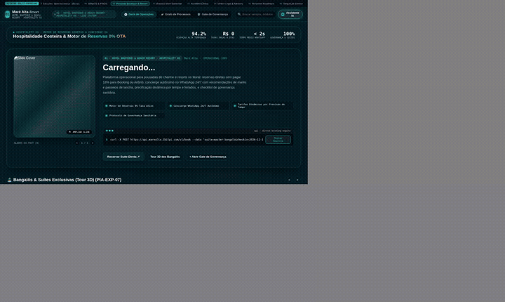
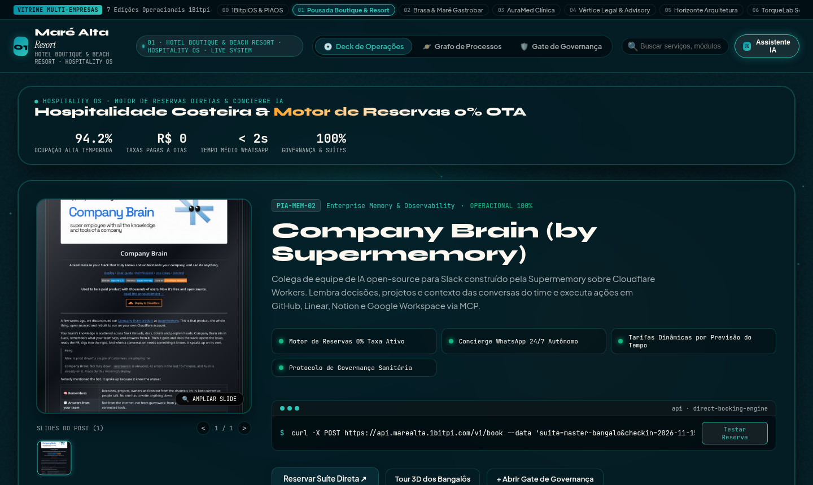
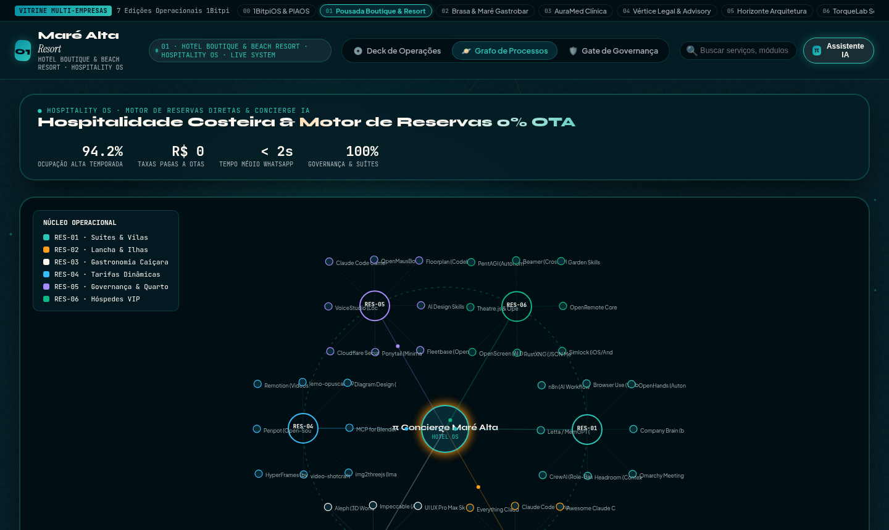

# 01 · Hospitalidade, Pousadas Boutique & Turismo (Hospitality OS)

> **Marca Demonstrativa**: **Maré Alta Resort — Hotel Boutique & Beach Resort**  
> **Segmentos Atendidos**: Pousadas de Charme, Hotéis Boutique, Resorts Costeiros, Eco-Lodges & Aluguel de Temporada Premium  
> **Proposta de Valor**: *Motor de Reservas Diretas 0% OTA, Concierge WhatsApp 24/7 e Governança de Suítes*

[-f26a4b?style=for-the-badge)](https://raw.githack.com/1bitpi-labs/showroom/main/player.html?id=01)

---

## 1. Visão Geral do Produto

Solução completa para **pousadas, hotéis boutique e resorts** que desejam eliminar a dependência de 15% a 20% de comissão das OTAs (Booking/Airbnb), oferecendo uma vitrine sensorial de suítes e experiências costeiras integrada a um Concierge de IA 24/7 no WhatsApp.

- **Identidade Visual & Paleta (AetherForge Tokens)**: Deep Lagoon `#041c24` · Turquoise `#2ec4b6` · Sunset Gold `#ff9f1c` · Pearl Sand `#fdf8f0`
- **Público-Alvo Ideal**: Pousadas Boutique, Hotéis de Charme, Resorts de Praia/Campo, Vilas de Luxo e Administradoras de Casas de Temporada.
- **Arquitetura de Entrega**: HTML5 + CSS3 + Canvas 60fps + Agente `pibit` (Zero dependências pesadas, hospedável em qualquer domínio ou integrado via API/WhatsApp Business).

---

## 2. Demonstração em Vídeo & Capturas de Tela

### 🎬 Vídeo da Experiência Completa (Carrossel 3D + Catálogo + Grafo Orbital)

- [**▶ Abrir no Cinema Player HD (MP4 com controles)**](https://raw.githack.com/1bitpi-labs/showroom/main/player.html?id=01) · [**⬇ Download Direto do MP4**](https://raw.githack.com/1bitpi-labs/showroom/main/01-hospitalidade-e-turismo/media/demo.mp4)

### 📸 Fotos em Alta Resolução (`1440×900`)

| Vista Principal: 3D Vinyl Sleeve Spotlight & Catálogo | Vista de Topologia: Grafo Orbital (`PIA-EXP-06`) & Palco `pibit` |
| :---: | :---: |
|  |  |

---

## 3. Especificação de Features Exclusivas deste Site

- **Vitrine Sensorial 3D de Suítes & Bangalôs**: Apresentação estilo capa de álbum com carrossel de fotos reais da suíte, vista da varanda, piscina privativa e amenidades.
- **Motor de Reserva Direta (0% Comissão OTA)**: Botão de checkout direto integrado ao WhatsApp/Pix/Cartão com cálculo imediato de pacotes e estadias.
- **Concierge IA 24/7 (`π Concierge Maré Alta`)**: Assistente virtual que responde em menos de 2 segundos sobre disponibilidade, tábua de marés, passeios de lancha e jantar pé na areia.
- **Precificação Dinâmica por Clima e Feriados**: Painel de regras que ajusta tarifas automaticamente conforme previsão de sol, feriados prolongados e taxa de ocupação.
- **Mapa Orbital de Experiências do Hóspede**: Visualização interativa conectando Suítes, Passeios de Lancha, Gastronomia Caiçara, Tarifas e Hóspedes VIP.
- **Gate P6 de Governança & Liberação de Quartos**: Checklist fotográfico assinado pela governanta antes de liberar o check-in do hóspede.

---

## 4. Casos de Uso Reais & Exemplos de Aplicação nas Empresas

Abaixo estão **3 cenários práticos** de como uma empresa deste setor utiliza este sistema no dia a dia para gerar receita, reduzir custos operacionais e encantar clientes:

### Caso de Uso 1: Conversão de Hóspedes do Instagram Direto para Reserva sem Taxa do Booking
- **Dor / Problema Real da Empresa**: O turista vê a pousada no Instagram, mas acaba reservando pelo Booking ou Airbnb, fazendo a pousada perder até 18% do valor da diária em comissões.
- **Como o Site + Agente `pibit` Resolve**: O link na bio abre o Showroom interativo da pousada com tour visual pelos bangalôs e botão de reserva direta com benefício exclusivo (ex: passeio de caiaque ou welcome drink cortesia).
- **Exemplo Prático no Dia a Dia**: *Um casal clica no link do Instagram às 23h30, navega pelas fotos do *Bangalô Master*, pergunta ao Concierge IA se aceita pet e fecha 4 diárias no Pix sem nenhuma taxa de intermediação.*

### Caso de Uso 2: Venda Automática de Experiências Extras (Upsell de Lancha, Spa e Jantar)
- **Dor / Problema Real da Empresa**: A recepção fica sobrecarregada fazendo check-in/check-out e esquece de oferecer passeios de barco, massagens e jantares especiais aos hóspedes.
- **Como o Site + Agente `pibit` Resolve**: A prateleira de experiências no site e o Concierge no WhatsApp oferecem proativamente passeios conforme a previsão de tempo e maré do dia seguinte.
- **Exemplo Prático no Dia a Dia**: *Na véspera de um dia de sol sem vento, o sistema envia mensagem aos hóspedes alojados sugerindo a *Saída de Lancha para as Ilhas às 9h*, preenchendo 100% das vagas da embarcação.*

### Caso de Uso 3: Padronização de Limpeza e Inspeção Fotográfica de Suítes (Governança P6)
- **Dor / Problema Real da Empresa**: Reclamações no TripAdvisor/Google por detalhes esquecidos na arrumação do quarto (frigobar incompleto, toalha faltando ou ar-condicionado desligado).
- **Como o Site + Agente `pibit` Resolve**: A camareira envia 4 fotos padronizadas pelo celular e a governanta aprova no Gate Operacional P6 antes de o sistema notificar que a suíte está pronta para o hóspede.
- **Exemplo Prático no Dia a Dia**: *Hóspede solicita early check-in às 12h → Governanta valida o checklist fotográfico no painel → Sistema envia a chave digital e boas-vindas automaticamente.*

---

## 5. Impacto Esperado no Negócio (ROI)

- Economia imediata de **15% a 20% em comissões de OTAs** nas reservas migradas para o canal direto.
- Aumento de **+32% na receita extra por hóspede (RevPAR/TRevPAR)** com venda automatizada de passeios e gastronomia.
- Tempo médio de resposta no WhatsApp reduzido de **45 minutos para menos de 2 segundos** (24 horas por dia).

---

## 6. Como Contratar ou Personalizar este Modelo para sua Empresa

Este site faz parte do **Portfólio Oficial 1Bitpi Labs**. Você pode adquirir ou contratar este sistema em **3 modalidades**:

1. **Pacote Turnkey White-Label (Implantação Rápida em 7 dias)**:
   - Personalização completa com a **marca, cores, fotos reais, serviços/produtos e WhatsApp** da sua empresa.
   - Hospedagem de alta velocidade com domínio próprio (`suaempresa.com.br`).
2. **Pacote Agente `pibit` + Automação WhatsApp 24/7**:
   - Inclui o site interativo + integração do assistente de IA no WhatsApp oficial da empresa para triagem, agendamento, reservas ou orçamentos automáticos.
3. **Licenciamento Enterprise / Multi-Unidades (Franquias, Redes e Agências)**:
   - Geração automatizada de múltiplas unidades com painel central de governança P6 e integração com ERP/CRM próprio.

👉 **[Clique aqui para testar o site ao vivo no navegador](https://raw.githack.com/1bitpi-labs/showroom/main/01-hospitalidade-e-turismo/01-pousada-boutique-litoral.html)** ou volte para o **[Catálogo Principal do Showroom](../README.md)**.
