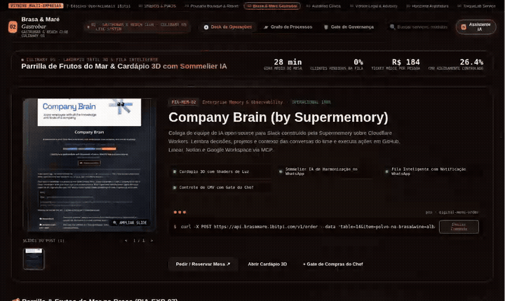
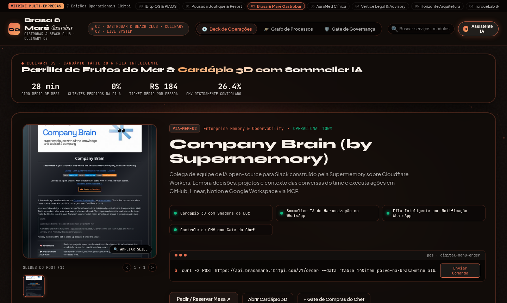
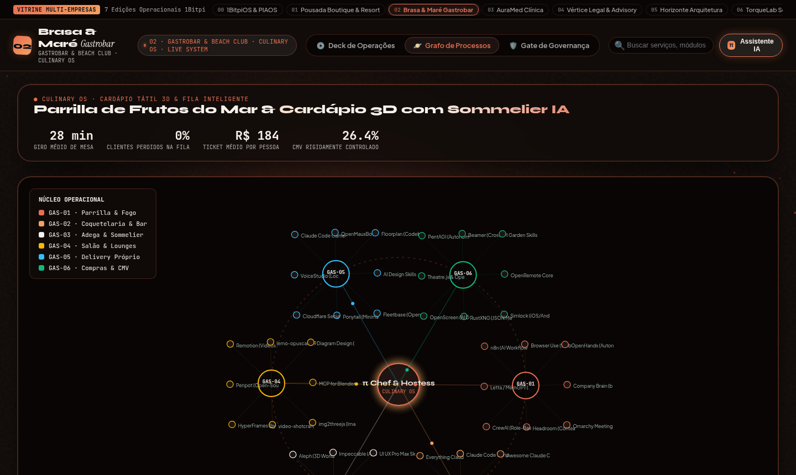

# 02 · Gastronomia, Restaurantes & Beach Clubs (Culinary OS)

> **Marca Demonstrativa**: **Brasa & Maré Gastrobar — Culinary OS**  
> **Segmentos Atendidos**: Restaurantes Autorais, Gastrobares, Beach Clubs, Parrillas, Adegas & Dark Kitchens Premium  
> **Proposta de Valor**: *Cardápio 3D Tátil, Sommelier Virtual no WhatsApp, Fila Inteligente e Controle de CMV*

[-f26a4b?style=for-the-badge)](https://1bitpi-labs.github.io/showroom/player.html?id=02)

---

## 1. Visão Geral do Produto

Plataforma gastronômica desenhada para **restaurantes, gastrobares e beach clubs** que querem substituir cardápios em PDF estáticos por uma experiência visual apetitosa em 3D, aumentar o ticket médio com harmonização por IA e acabar com a desistência de clientes na fila de espera.

- **Identidade Visual & Paleta (AetherForge Tokens)**: Charcoal Ember `#110c0a` · Terracotta Flame `#e76f51` · Amber Gold `#f4a261` · Linen Cream `#f8f1ea`
- **Público-Alvo Ideal**: Restaurantes, Beach Clubs, Bares de Coquetelaria, Steakhouses/Parrillas, Bistrôs e Operações Gastronômicas.
- **Arquitetura de Entrega**: HTML5 + CSS3 + Canvas 60fps + Agente `pibit` (Zero dependências pesadas, hospedável em qualquer domínio ou integrado via API/WhatsApp Business).

---

## 2. Demonstração em Vídeo & Capturas de Tela

### 🎬 Vídeo da Experiência Completa (Carrossel 3D + Catálogo + Grafo Orbital)

- [**▶ Abrir no Cinema Player HD (MP4 com controles)**](https://1bitpi-labs.github.io/showroom/player.html?id=02) · [**⬇ Download Direto do MP4**](https://1bitpi-labs.github.io/showroom/02-gastronomia-e-beach-clubs/media/demo.mp4)

### 📸 Fotos em Alta Resolução (`1440×900`)

| Vista Principal: 3D Vinyl Sleeve Spotlight & Catálogo | Vista de Topologia: Grafo Orbital (`PIA-EXP-06`) & Palco `pibit` |
| :---: | :---: |
|  |  |

---

## 3. Especificação de Features Exclusivas deste Site

- **Cardápio Tátil 3D com Carrossel de Pratos e Drinks**: Cada prato assinatura exibe múltiplas fotos de alta resolução, notas de preparo na brasa, ingredientes e alertas de alérgenos.
- **Sommelier & Hostess IA (`π Chef & Hostess`)**: Recomenda automaticamente o vinho ou drink autoral perfeito para acompanhar o prato selecionado pelo cliente.
- **Fila de Espera Inteligente Pé na Areia**: O cliente entra na fila pelo celular, pede drinks enquanto aguarda na praia ou no bar e recebe alerta no WhatsApp quando a mesa está pronta.
- **Giro de Salão & Reserva de Lounges VIP**: Mapa orbital integrando Parrilla, Coquetelaria, Adega, Lounges na Praia, Delivery Próprio e Compras.
- **Gate Culinário P6 de Controle de CMV e Pescados**: Validação diária de fichas técnicas e aprovação de recebimento de insumos frescos pelo Chef Executivo.

---

## 4. Casos de Uso Reais & Exemplos de Aplicação nas Empresas

Abaixo estão **3 cenários práticos** de como uma empresa deste setor utiliza este sistema no dia a dia para gerar receita, reduzir custos operacionais e encantar clientes:

### Caso de Uso 1: Aumento de Ticket Médio com Harmonização Automática de Vinhos e Drinks
- **Dor / Problema Real da Empresa**: Garçons corridos no horário de pico apenas anotam o pedido do prato principal e deixam de sugerir entradas, vinhos de maior margem ou sobremesas.
- **Como o Site + Agente `pibit` Resolve**: Ao abrir o cardápio interativo na mesa (via QR Code ou link no WhatsApp), o Sommelier IA sugere instantaneamente a harmonização ideal para cada prato.
- **Exemplo Prático no Dia a Dia**: *O cliente seleciona o *Polvo Grelhado na Brasa* → O painel destaca na hora o vinho *Albariño Rías Baixas* em taça ou garrafa e a entrada de *Ostras Frescas*, elevando o ticket da mesa em +28%.*

### Caso de Uso 2: Zero Desistência na Fila de Espera em Finais de Semana de Sol
- **Dor / Problema Real da Empresa**: Quando o restaurante lota às 14h de sábado, 30% dos clientes desistem de esperar na porta e vão para o concorrente.
- **Como o Site + Agente `pibit` Resolve**: O cliente escaneia o QR Code na recepção, entra na fila digital e já recebe no WhatsApp um cupom para pedir o primeiro drink no bar/areia enquanto aguarda sua mesa.
- **Exemplo Prático no Dia a Dia**: *Grupo de 6 pessoas entra na fila virtual → Faz o pedido de 6 caipirinhas autorais direto pelo celular → Recebe notificação automática no WhatsApp assim que a mesa 14 é liberada.*

### Caso de Uso 3: Reserva Antecipada de Lounges e Day-Use com Sinal via Pix
- **Dor / Problema Real da Empresa**: Grupos reservam lounges ou mesas grandes para aniversários/pôr do sol e não aparecem (no-show), gerando prejuízo de faturamento.
- **Como o Site + Agente `pibit` Resolve**: O sistema exige confirmação automática com pré-pagamento de consumação mínima via Pix direto pelo assistente no WhatsApp.
- **Exemplo Prático no Dia a Dia**: *Cliente solicita reserva de Lounge VIP para sábado → O agente envia o mapa dos lounges, cobra R$ 500 de consumação antecipada via Pix e emite o voucher QR Code automaticamente.*

---

## 5. Impacto Esperado no Negócio (ROI)

- Elevação de **+22% a +35% no ticket médio por pessoa** com sugestões ativas de harmonização e entradas.
- **0% de clientes perdidos na fila de espera**, transformando o tempo de espera em consumo ativo de bebidas.
- Redução do **CMV para a faixa meta de 26%–28%** com fichas técnicas auditadas no Gate do Chef.

---

## 6. Como Contratar ou Personalizar este Modelo para sua Empresa

Este site faz parte do **Portfólio Oficial 1Bitpi Labs**. Você pode adquirir ou contratar este sistema em **3 modalidades**:

1. **Pacote Turnkey White-Label (Implantação Rápida em 7 dias)**:
   - Personalização completa com a **marca, cores, fotos reais, serviços/produtos e WhatsApp** da sua empresa.
   - Hospedagem de alta velocidade com domínio próprio (`suaempresa.com.br`).
2. **Pacote Agente `pibit` + Automação WhatsApp 24/7**:
   - Inclui o site interativo + integração do assistente de IA no WhatsApp oficial da empresa para triagem, agendamento, reservas ou orçamentos automáticos.
3. **Licenciamento Enterprise / Multi-Unidades (Franquias, Redes e Agências)**:
   - Geração automatizada de múltiplas unidades com painel central de governança P6 e integração com ERP/CRM próprio.

👉 **[Clique aqui para testar o site ao vivo no navegador](https://1bitpi-labs.github.io/showroom/02-gastronomia-e-beach-clubs/02-gastronomia-beach-club.html)** ou volte para o **[Catálogo Principal do Showroom](../README.md)**.
