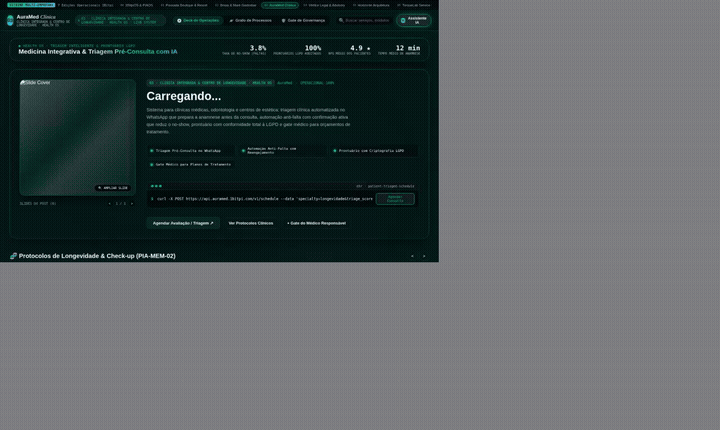
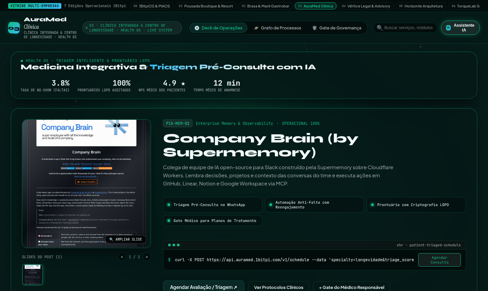
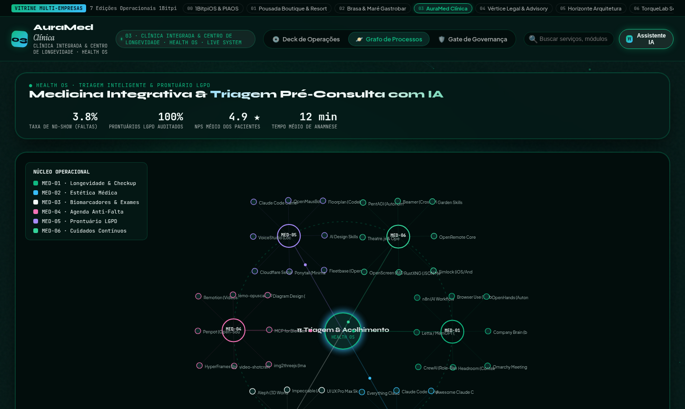

# 03 · Saúde, Clínicas Médicas, Odonto & Wellness (Health OS)

> **Marca Demonstrativa**: **AuraMed Clínica — Medicina Integrativa & Longevidade**  
> **Segmentos Atendidos**: Clínicas Médicas, Consultórios Odontológicos, Dermatologia, Estética Avançada, Nutrologia & Spas Médicos  
> **Proposta de Valor**: *Triagem Pré-Consulta com IA, Agenda Anti-Falta (No-Show Zero) e Prontuário LGPD*

[-f26a4b?style=for-the-badge)](https://1bitpi-labs.github.io/showroom/player.html?id=03)

---

## 1. Visão Geral do Produto

Plataforma digital para **clínicas médicas, odontológicas e centros de estética/longevidade** que desejam encantar pacientes de alto padrão, realizar a pré-anamnese automatizada pelo WhatsApp antes da consulta e reduzir drasticamente as faltas (no-show) na agenda dos especialistas.

- **Identidade Visual & Paleta (AetherForge Tokens)**: Deep Emerald `#051917` · Bio Mint `#10b981` · Clinical Sky `#38bdf8` · Pure Ivory `#f2fbf9`
- **Público-Alvo Ideal**: Clínicas Médicas, Consultórios Odontológicos, Clínicas de Dermatologia/Estética, Centros de Longevidade, Fisioterapia e Psicologia.
- **Arquitetura de Entrega**: HTML5 + CSS3 + Canvas 60fps + Agente `pibit` (Zero dependências pesadas, hospedável em qualquer domínio ou integrado via API/WhatsApp Business).

---

## 2. Demonstração em Vídeo & Capturas de Tela

### 🎬 Vídeo da Experiência Completa (Carrossel 3D + Catálogo + Grafo Orbital)

- [**▶ Abrir no Cinema Player HD (MP4 com controles)**](https://1bitpi-labs.github.io/showroom/player.html?id=03) · [**⬇ Download Direto do MP4**](https://1bitpi-labs.github.io/showroom/03-saude-clinicas-e-wellness/media/demo.mp4)

### 📸 Fotos em Alta Resolução (`1440×900`)

| Vista Principal: 3D Vinyl Sleeve Spotlight & Catálogo | Vista de Topologia: Grafo Orbital (`PIA-EXP-06`) & Palco `pibit` |
| :---: | :---: |
|  |  |

---

## 3. Especificação de Features Exclusivas deste Site

- **Vitrine de Protocolos Clínicos & Especialidades**: Apresentação ética, clara e sofisticada de check-ups, procedimentos estéticos, implantes e programas de longevidade.
- **Triagem Pré-Consulta Inteligente (`π Triagem & Acolhimento`)**: Coleta histórico, sintomas e exames anteriores pelo WhatsApp e entrega o resumo pronto para o médico antes de o paciente entrar na sala.
- **Automação Anti-Falta (No-Show Killer)**: Confirmação ativa em 48h e 24h via WhatsApp com reagendamento em 1 clique e preenchimento automático de horários vagos via lista de espera.
- **Conformidade e Auditoria LGPD Nativa**: Painel de segurança garantindo isolamento de dados sensíveis de saúde e rastreabilidade de acesso a laudos.
- **Gate Clínico P6 do Especialista**: Nenhum plano terapêutico, orçamento cirúrgico ou orientação pós-procedimento é disparado sem validação do profissional responsável.

---

## 4. Casos de Uso Reais & Exemplos de Aplicação nas Empresas

Abaixo estão **3 cenários práticos** de como uma empresa deste setor utiliza este sistema no dia a dia para gerar receita, reduzir custos operacionais e encantar clientes:

### Caso de Uso 1: Anamnese Prévia no WhatsApp Economizando 15 Minutos por Consulta
- **Dor / Problema Real da Empresa**: O médico ou dentista gasta os primeiros 15 a 20 minutos da consulta preenchendo perguntas básicas no computador em vez de dar atenção olho no olho ao paciente.
- **Como o Site + Agente `pibit` Resolve**: Um dia antes da consulta, o assistente da clínica envia um link conversacional acolhedor onde o paciente informa queixas, medicamentos em uso e anexa exames em PDF.
- **Exemplo Prático no Dia a Dia**: *O paciente agenda avaliação de Longevidade → Responde 5 perguntas no WhatsApp em 3 minutos → O médico abre o painel e já vê o resumo clínico estruturado e os biomarcadores destacados.*

### Caso de Uso 2: Eliminação de Horários Ociosos por Falta de Paciente (No-Show)
- **Dor / Problema Real da Empresa**: Pacientes esquecem da consulta ou desmarcam em cima da hora, deixando a cadeira do especialista vazia e gerando perda de R$ 500 a R$ 3.000 por horário perdido.
- **Como o Site + Agente `pibit` Resolve**: O motor Anti-Falta confirma a presença 48h antes; se o paciente precisar remarcar, o sistema aciona automaticamente o primeiro paciente da lista de espera para ocupar a vaga.
- **Exemplo Prático no Dia a Dia**: *Paciente de quinta às 15h clica em 'Preciso reagendar' na quarta-feira → O sistema oferece nova data para a semana seguinte e preenche o horário das 15h em 4 minutos com outro paciente.*

### Caso de Uso 3: Acompanhamento Pós-Procedimento e Renovação de Protocolos Recorrentes
- **Dor / Problema Real da Empresa**: Após um procedimento estético, implante ou protocolo injetável, a clínica esquece de acompanhar a recuperação do paciente e perde o momento exato do retorno.
- **Como o Site + Agente `pibit` Resolve**: Réguas de cuidado contínuo enviam orientações pós-consulta e avisam automaticamente quando chega o período de manutenção semestral/anual.
- **Exemplo Prático no Dia a Dia**: *5 meses após aplicação dermatológica, a paciente recebe mensagem personalizada com o histórico do seu protocolo e agenda o retorno em 2 cliques.*

---

## 5. Impacto Esperado no Negócio (ROI)

- Queda da taxa de **No-Show (faltas) de ~18% para menos de 3.8%**.
- Ganho de **12 a 15 minutos por atendimento**, permitindo atender mais pacientes com muito mais qualidade humana.
- Aumento de **+40% na taxa de retorno e recorrência** de procedimentos preventivos e estéticos.

---

## 6. Como Contratar ou Personalizar este Modelo para sua Empresa

Este site faz parte do **Portfólio Oficial 1Bitpi Labs**. Você pode adquirir ou contratar este sistema em **3 modalidades**:

1. **Pacote Turnkey White-Label (Implantação Rápida em 7 dias)**:
   - Personalização completa com a **marca, cores, fotos reais, serviços/produtos e WhatsApp** da sua empresa.
   - Hospedagem de alta velocidade com domínio próprio (`suaempresa.com.br`).
2. **Pacote Agente `pibit` + Automação WhatsApp 24/7**:
   - Inclui o site interativo + integração do assistente de IA no WhatsApp oficial da empresa para triagem, agendamento, reservas ou orçamentos automáticos.
3. **Licenciamento Enterprise / Multi-Unidades (Franquias, Redes e Agências)**:
   - Geração automatizada de múltiplas unidades com painel central de governança P6 e integração com ERP/CRM próprio.

👉 **[Clique aqui para testar o site ao vivo no navegador](https://1bitpi-labs.github.io/showroom/03-saude-clinicas-e-wellness/03-clinica-saude-wellness.html)** ou volte para o **[Catálogo Principal do Showroom](../README.md)**.
