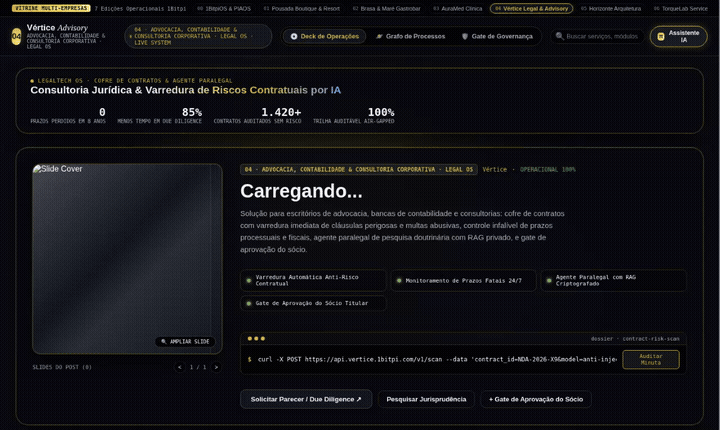
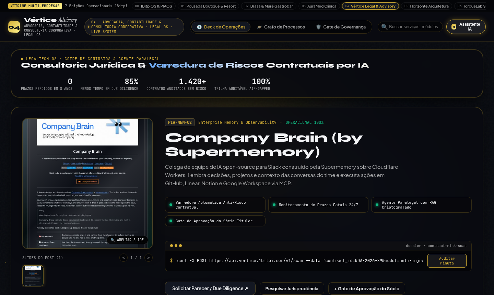
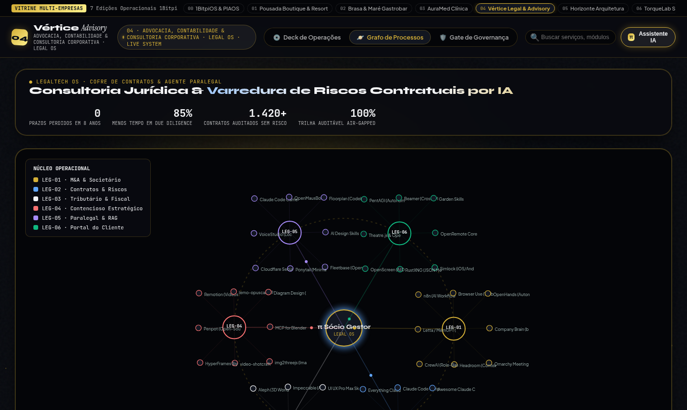

# 04 · Advocacia, Contabilidade & Consultoria B2B (Legal & Advisory OS)

> **Marca Demonstrativa**: **Vértice Advisory — Advocacia, Contabilidade & Consultoria Corporativa**  
> **Segmentos Atendidos**: Escritórios de Advocacia, Bancas de Contabilidade Consultiva, Auditorias, Consultorias Financeiras & B2B  
> **Proposta de Valor**: *Cofre de Contratos com Varredura de Riscos por IA, Controle de Prazos e Agente Paralegal*

[-f26a4b?style=for-the-badge)](https://raw.githack.com/1bitpi-labs/showroom/main/player.html?id=04)

---

## 1. Visão Geral do Produto

Ambiente executivo de alta credibilidade para **escritórios de advocacia, contabilidades consultivas e empresas de assessoria B2B**. Combina apresentação institucional de portfólio societário/tributário com automação de auditoria contratual (Due Diligence), pesquisa paralegal privada e portal transparente para clientes corporativos.

- **Identidade Visual & Paleta (AetherForge Tokens)**: Obsidian Slate `#090b10` · Sovereign Gold `#d4af37` · Royal Sapphire `#60a5fa` · Platinum `#f3f4f6`
- **Público-Alvo Ideal**: Escritórios de Advocacia, Contabilidades Consultivas, Consultorias Empresariais, Assessorias de M&A, Compliance e BPO Financeiro.
- **Arquitetura de Entrega**: HTML5 + CSS3 + Canvas 60fps + Agente `pibit` (Zero dependências pesadas, hospedável em qualquer domínio ou integrado via API/WhatsApp Business).

---

## 2. Demonstração em Vídeo & Capturas de Tela

### 🎬 Vídeo da Experiência Completa (Carrossel 3D + Catálogo + Grafo Orbital)

- [**▶ Abrir no Cinema Player HD (MP4 com controles)**](https://raw.githack.com/1bitpi-labs/showroom/main/player.html?id=04) · [**⬇ Download Direto do MP4**](https://raw.githack.com/1bitpi-labs/showroom/main/04-juridico-contabil-e-b2b/media/demo.mp4)

### 📸 Fotos em Alta Resolução (`1440×900`)

| Vista Principal: 3D Vinyl Sleeve Spotlight & Catálogo | Vista de Topologia: Grafo Orbital (`PIA-EXP-06`) & Palco `pibit` |
| :---: | :---: |
|  |  |

---

## 3. Especificação de Features Exclusivas deste Site

- **Cofre de Contratos & Scanner Anti-Risco**: Varredura automatizada de minutas contratuais apontando cláusulas abusivas, multas desproporcionais, riscos trabalhistas e brechas de LGPD.
- **Agente Paralegal & Consultor Fiscal (`π Sócio Gestor`)**: Responde dúvidas preliminares de clientes no WhatsApp/Portal e pesquisa jurisprudência e normas fiscais com RAG isolado (air-gapped).
- **Monitoramento 24/7 de Prazos Fatais e Obrigações Fiscais**: Painel de conformidade com alerta antecipado de publicações judiciais e vencimentos tributários.
- **Grafo Orbital de Áreas de Prática**: Conexão visual entre Societário/M&A, Contratos, Tributário, Contencioso Estratégico, Paralegal IA e Portal do Cliente.
- **Gate P6 de Assinatura do Sócio Titular**: Trava de governança garantindo que nenhuma minuta, petição ou parecer saia do escritório sem revisão final e token ICP-Brasil do sócio.

---

## 4. Casos de Uso Reais & Exemplos de Aplicação nas Empresas

Abaixo estão **3 cenários práticos** de como uma empresa deste setor utiliza este sistema no dia a dia para gerar receita, reduzir custos operacionais e encantar clientes:

### Caso de Uso 1: Pré-Auditoria de Contratos (Due Diligence) em Segundos para Clientes Corporativos
- **Dor / Problema Real da Empresa**: Empresas clientes enviam contratos de fornecedores ou locação pelo WhatsApp pedindo revisão urgente, travando a agenda dos advogados seniores com leituras repetitivas.
- **Como o Site + Agente `pibit` Resolve**: O Agente Paralegal faz a primeira leitura em 15 segundos, destaca as 3 cláusulas críticas em vermelho e entrega o quadro comparativo pronto para o advogado apenas validar no Gate do Sócio.
- **Exemplo Prático no Dia a Dia**: *Cliente envia um contrato de prestação de serviços de 25 páginas → O sistema detecta multa rescisória unilateral de 50% e ausência de foro → O sócio aprova o parecer revisado em 5 minutos.*

### Caso de Uso 2: Captação e Qualificação Executiva de Novos Clientes B2B (Planejamento Tributário / M&A)
- **Dor / Problema Real da Empresa**: Sites tradicionais de advocacia e contabilidade são estáticos ('Quem Somos / Áreas de Atuação') e não demonstram tangivelmente a capacidade tecnológica do escritório.
- **Como o Site + Agente `pibit` Resolve**: O Showroom apresenta teses tributárias, cases anonimizados e ferramentas interativas onde o empresário entende imediatamente o valor da banca e solicita diagnóstico.
- **Exemplo Prático no Dia a Dia**: *Diretor Financeiro visita o site da Vértice, interage com o módulo de *Recuperação de Créditos Tributários*, simula o enquadramento pelo assistente e agenda reunião com o sócio.*

### Caso de Uso 3: Portal do Cliente sem 'Juridiquês' no WhatsApp (Redução de Ligações de Status)
- **Dor / Problema Real da Empresa**: Advogados e contadores perdem horas toda semana respondendo 'Como está meu processo?' ou 'Me manda a segunda via do imposto/contrato'.
- **Como o Site + Agente `pibit` Resolve**: O assistente traduz movimentações processuais e contábeis para linguagem executiva simples e entrega documentos auditados sob demanda.
- **Exemplo Prático no Dia a Dia**: *O cliente pergunta pelo andamento da alteração contratual na Junta Comercial → O assistente informa a etapa atual e envia o protocolo em PDF instantaneamente.*

---

## 5. Impacto Esperado no Negócio (ROI)

- Redução de **85% no tempo operacional de triagem e revisão inicial de minutas**.
- **Zero prazos judiciais ou fiscais perdidos** com monitoramento redundante automatizado.
- Aumento na **conversão de propostas de honorários B2B** pela demonstração prática de governança e tecnologia.

---

## 6. Como Contratar ou Personalizar este Modelo para sua Empresa

Este site faz parte do **Portfólio Oficial 1Bitpi Labs**. Você pode adquirir ou contratar este sistema em **3 modalidades**:

1. **Pacote Turnkey White-Label (Implantação Rápida em 7 dias)**:
   - Personalização completa com a **marca, cores, fotos reais, serviços/produtos e WhatsApp** da sua empresa.
   - Hospedagem de alta velocidade com domínio próprio (`suaempresa.com.br`).
2. **Pacote Agente `pibit` + Automação WhatsApp 24/7**:
   - Inclui o site interativo + integração do assistente de IA no WhatsApp oficial da empresa para triagem, agendamento, reservas ou orçamentos automáticos.
3. **Licenciamento Enterprise / Multi-Unidades (Franquias, Redes e Agências)**:
   - Geração automatizada de múltiplas unidades com painel central de governança P6 e integração com ERP/CRM próprio.

👉 **[Clique aqui para testar o site ao vivo no navegador](https://raw.githack.com/1bitpi-labs/showroom/main/04-juridico-contabil-e-b2b/04-escritorio-servicos-b2b.html)** ou volte para o **[Catálogo Principal do Showroom](../README.md)**.
