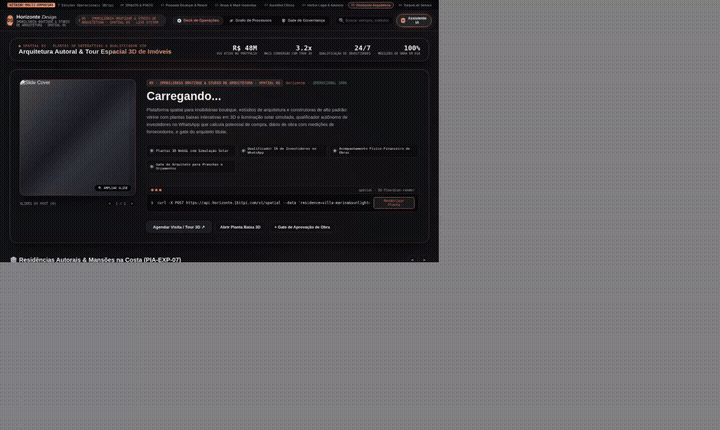
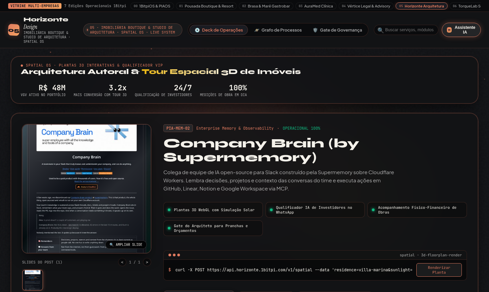
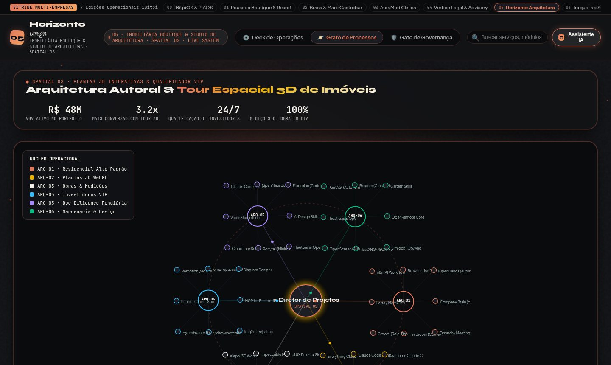

# 05 · Imobiliárias Boutique, Incorporadoras & Arquitetura (Spatial OS)

> **Marca Demonstrativa**: **Horizonte Design — Imobiliária Boutique & Studio de Arquitetura**  
> **Segmentos Atendidos**: Imobiliárias de Alto Padrão, Incorporadoras, Construtoras, Estúdios de Arquitetura & Interiores  
> **Proposta de Valor**: *Vitrine de Imóveis e Projetos Autorais, Plantas 3D, Qualificador VIP e Diário de Obra*

[-f26a4b?style=for-the-badge)](https://1bitpi-labs.github.io/showroom/player.html?id=05)

---

## 1. Visão Geral do Produto

Plataforma espacial e comercial para **imobiliárias boutique, corretores private, estúdios de arquitetura e construtoras**. Une a apresentação cinematográfica de residências e plantas baixas com qualificação automática de investidores e acompanhamento físico-financeiro de obras.

- **Identidade Visual & Paleta (AetherForge Tokens)**: Architectural Graphite `#121316` · Terracotta Clay `#e07a5f` · Solar Ochre `#eab308` · Travertine `#f4f1ea`
- **Público-Alvo Ideal**: Imobiliárias de Alto Padrão, Corretores de Imóveis de Luxo, Estúdios de Arquitetura e Design de Interiores, Incorporadoras e Construtoras.
- **Arquitetura de Entrega**: HTML5 + CSS3 + Canvas 60fps + Agente `pibit` (Zero dependências pesadas, hospedável em qualquer domínio ou integrado via API/WhatsApp Business).

---

## 2. Demonstração em Vídeo & Capturas de Tela

### 🎬 Vídeo da Experiência Completa (Carrossel 3D + Catálogo + Grafo Orbital)

- [**▶ Abrir no Cinema Player HD (MP4 com controles)**](https://1bitpi-labs.github.io/showroom/player.html?id=05) · [**⬇ Download Direto do MP4**](https://1bitpi-labs.github.io/showroom/05-imobiliario-e-arquitetura/media/demo.mp4)

### 📸 Fotos em Alta Resolução (`1440×900`)

| Vista Principal: 3D Vinyl Sleeve Spotlight & Catálogo | Vista de Topologia: Grafo Orbital (`PIA-EXP-06`) & Palco `pibit` |
| :---: | :---: |
|  |  |

---

## 3. Especificação de Features Exclusivas deste Site

- **Galeria Cinematográfica 3D de Imóveis e Projetos Autorais**: Capas interativas com carrossel de fachadas, interiores, plantas humanizadas e memorial descritivo.
- **Consultor Espacial & Qualificador de Investidores (`π Diretor de Projetos`)**: Identifica o perfil de compra/investimento no WhatsApp, calcula rentabilidade estimada (yield) e agenda visitas.
- **Diário de Obra & Cronograma Físico-Financeiro**: Acompanhamento transparente de etapas construtivas, marcenaria e medições de empreiteiros.
- **Grafo Orbital do Ecossistema Imobiliário**: Integra Residencial Alto Padrão, Plantas 3D, Obras & Medições, Investidores VIP, Due Diligence Fundiária e Marcenaria.
- **Gate P6 do Arquiteto / Engenheiro Fiscal**: Aprovação formal de pranchas executivas e medições de obra antes da liberação de pagamentos a fornecedores.

---

## 4. Casos de Uso Reais & Exemplos de Aplicação nas Empresas

Abaixo estão **3 cenários práticos** de como uma empresa deste setor utiliza este sistema no dia a dia para gerar receita, reduzir custos operacionais e encantar clientes:

### Caso de Uso 1: Qualificação Automática de Compradores e Investidores de Alto Padrão 24/7
- **Dor / Problema Real da Empresa**: Corretores demoram para responder leads de portais/Instagram ou gastam horas levando curiosos sem perfil financeiro para visitar imóveis de R$ 3M a R$ 15M.
- **Como o Site + Agente `pibit` Resolve**: O Consultor IA atende instantaneamente, apresenta as plantas e fotos detalhadas, responde sobre documentação/rentabilidade de locação e filtra apenas os compradores reais para visita presencial.
- **Exemplo Prático no Dia a Dia**: *Investidor vê anúncio de uma mansão pé na areia no domingo à noite → Interage com o Showroom, consulta o yield projetado de 12% a.a. em locação de temporada e agenda visita com o corretor sênior.*

### Caso de Uso 2: Apresentação de Projetos de Arquitetura que Encanta e Fecha Contratos Executivos
- **Dor / Problema Real da Empresa**: Estúdios de arquitetura enviam propostas em PDFs longos e frios que não transmitem a sofisticação do projeto arquitetônico.
- **Como o Site + Agente `pibit` Resolve**: O escritório entrega ao cliente um Showroom exclusivo com os estudos preliminares, referências de materiais, simulação de insolação e cronograma claro de etapas.
- **Exemplo Prático no Dia a Dia**: *Cliente abre o link do estúdio em reunião, navega pelos slides de cada ambiente projetado e aprova o avanço para o Projeto Executivo na mesma hora.*

### Caso de Uso 3: Transparência Total no Acompanhamento de Obra para Clientes à Distância
- **Dor / Problema Real da Empresa**: Proprietários que constroem casas de praia ou campo moram em outra cidade e ficam inseguros sobre o avanço real da obra e os pedidos de medição dos empreiteiros.
- **Como o Site + Agente `pibit` Resolve**: Toda sexta-feira o engenheiro valida a medição fotográfica no Gate P6 e o proprietário visualiza o progresso exato pelo painel.
- **Exemplo Prático no Dia a Dia**: *Etapa de fundação e estrutura concluída → Engenheiro aprova o checklist fotográfico no Gate P6 → Cliente recebe o relatório visual no celular e autoriza a liberação da parcela.*

---

## 5. Impacto Esperado no Negócio (ROI)

- Aumento de **3.2x na conversão de leads qualificados** para visitas presenciais e propostas de compra.
- Redução de **60% em visitas improdutivas**, focando a equipe comercial em clientes com real potencial de fechamento.
- **100% de rastreabilidade nas medições de obra**, eliminando aditivos surpresa e retrabalho.

---

## 6. Como Contratar ou Personalizar este Modelo para sua Empresa

Este site faz parte do **Portfólio Oficial 1Bitpi Labs**. Você pode adquirir ou contratar este sistema em **3 modalidades**:

1. **Pacote Turnkey White-Label (Implantação Rápida em 7 dias)**:
   - Personalização completa com a **marca, cores, fotos reais, serviços/produtos e WhatsApp** da sua empresa.
   - Hospedagem de alta velocidade com domínio próprio (`suaempresa.com.br`).
2. **Pacote Agente `pibit` + Automação WhatsApp 24/7**:
   - Inclui o site interativo + integração do assistente de IA no WhatsApp oficial da empresa para triagem, agendamento, reservas ou orçamentos automáticos.
3. **Licenciamento Enterprise / Multi-Unidades (Franquias, Redes e Agências)**:
   - Geração automatizada de múltiplas unidades com painel central de governança P6 e integração com ERP/CRM próprio.

👉 **[Clique aqui para testar o site ao vivo no navegador](https://1bitpi-labs.github.io/showroom/05-imobiliario-e-arquitetura/05-imobiliaria-arquitetura.html)** ou volte para o **[Catálogo Principal do Showroom](../README.md)**.
