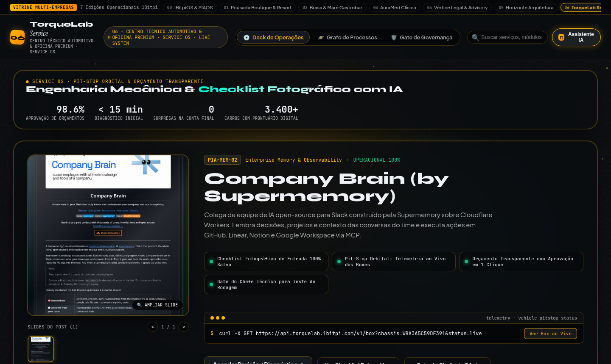
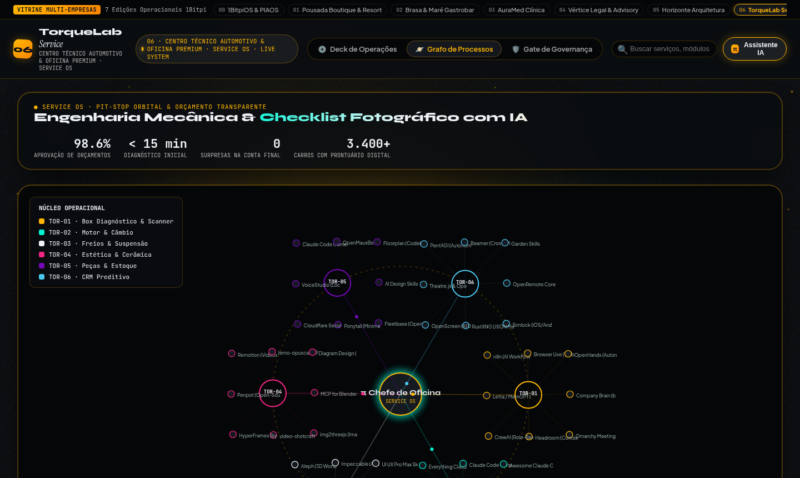

# 06 · Centros Técnicos Automotivos, Oficinas Premium & Serviços (Service OS)

> **Marca Demonstrativa**: **TorqueLab Service — Centro Técnico Automotivo & Oficina Premium**  
> **Segmentos Atendidos**: Oficinas Mecânicas Premium, Estética Automotiva (Detailing), Concessionárias, Náutica & Energia Solar  
> **Proposta de Valor**: *Checklist Fotográfico de Entrada, Pit-Stop Orbital dos Boxes ao Vivo e Orçamento em 1 Clique*

[-f26a4b?style=for-the-badge)](https://1bitpi-labs.github.io/showroom/player.html?id=06)

---

## 1. Visão Geral do Produto

Sistema de transparência radical e alta conversão para **oficinas mecânicas premium, centros de estética automotiva (detailing), manutenção náutica e integradores técnicos**. Elimina a desconfiança do cliente através de evidências fotográficas e acompanhamento ao vivo do veículo no box.

- **Identidade Visual & Paleta (AetherForge Tokens)**: Carbon Garage `#0b0d10` · Racing Amber `#ffb703` · Telemetry Cyan `#00f5d4` · Titanium `#eef2f6`
- **Público-Alvo Ideal**: Oficinas Mecânicas Premium, Centros de Estética Automotiva (Detailing/PPF), Oficinas de Motos/Náutica, Empresas de Energia Solar e Assistências Técnicas.
- **Arquitetura de Entrega**: HTML5 + CSS3 + Canvas 60fps + Agente `pibit` (Zero dependências pesadas, hospedável em qualquer domínio ou integrado via API/WhatsApp Business).

---

## 2. Demonstração em Vídeo & Capturas de Tela

### 🎬 Vídeo da Experiência Completa (Carrossel 3D + Catálogo + Grafo Orbital)

- [**▶ Abrir no Cinema Player HD (MP4 com controles)**](https://1bitpi-labs.github.io/showroom/player.html?id=06) · [**⬇ Download Direto do MP4**](https://1bitpi-labs.github.io/showroom/06-oficinas-e-servicos-tecnicos/media/demo.mp4)

### 📸 Fotos em Alta Resolução (`1440×900`)

| Vista Principal: 3D Vinyl Sleeve Spotlight & Catálogo | Vista de Topologia: Grafo Orbital (`PIA-EXP-06`) & Palco `pibit` |
| :---: | :---: |
|  |  |

---

## 3. Especificação de Features Exclusivas deste Site

- **Catálogo Visual de Serviços & Pacotes de Revisão**: Apresentação clara de diagnóstico por scanner, revisão de freios/suspensão, câmbio automático e vitrificação cerâmica com fotos do antes/depois.
- **Pit-Stop Orbital (Telemetria de Boxes ao Vivo)**: Grafo interativo mostrando em qual etapa o veículo está (Diagnóstico, Motor/Câmbio, Freios, Estética, Peças ou Pronto para Entrega).
- **Orçamento Transparente com Evidência Fotográfica**: O cliente visualiza no celular a foto da peça desgastada ao lado da peça nova original e aprova o orçamento em 1 clique no WhatsApp.
- **Consultor Técnico IA (`π Chefe de Oficina`)**: Tira dúvidas sobre sintomas do carro, agenda revisões e envia alertas preditivos de troca de óleo/correia por quilometragem.
- **Gate Técnico P6 de Teste de Rodagem**: Nenhuma Ordem de Serviço é encerrada sem o checklist final de torque, teste de rua e assinatura do Chefe de Oficina.

---

## 4. Casos de Uso Reais & Exemplos de Aplicação nas Empresas

Abaixo estão **3 cenários práticos** de como uma empresa deste setor utiliza este sistema no dia a dia para gerar receita, reduzir custos operacionais e encantar clientes:

### Caso de Uso 1: Aprovação Rápida de Orçamentos pelo WhatsApp com Fotos da Peça (Fim da Desconfiança)
- **Dor / Problema Real da Empresa**: O cliente acha que a oficina está 'inventando peça para trocar' e demora horas para aprovar o orçamento, deixando o carro parado ocupando o elevador.
- **Como o Site + Agente `pibit` Resolve**: O mecânico sobe 3 fotos/vídeo curto da peça gasta no carrossel da OS; o cliente recebe o link visual no WhatsApp separando mão de obra e peças e clica em 'Aprovar Serviço'.
- **Exemplo Prático no Dia a Dia**: *Durante revisão de uma BMW, o técnico identifica pastilha de freio no limite → Envia o card visual com foto real da pastilha → O cliente aprova o adicional de R$ 1.450 em 3 minutos pelo celular.*

### Caso de Uso 2: Status ao Vivo do Veículo ('Uber da Oficina') Reduzindo Ligações na Recepção
- **Dor / Problema Real da Empresa**: Donos de carros ligam 3 ou 4 vezes por dia perguntando 'Meu carro já ficou pronto?', interrompendo os consultores técnicos.
- **Como o Site + Agente `pibit` Resolve**: A cada mudança de fase no Box, o cliente pode consultar o assistente ou receber notificação automática (Em Diagnóstico → Aguardando Peça → Em Montagem → Em Teste de Rua → Lavado e Pronto).
- **Exemplo Prático no Dia a Dia**: *O cliente clica em 'Status do meu carro na oficina' no WhatsApp e recebe na hora: *Box 3 — Troca concluída, iniciando teste de rodagem final*.*

### Caso de Uso 3: CRM Preditivo de Manutenção Preventiva (Retorno Garantido da Frota)
- **Dor / Problema Real da Empresa**: Depois que o carro sai da oficina, o cliente esquece quando deve fazer a próxima troca de óleo, fluido de câmbio ou reaplicação de proteção cerâmica.
- **Como o Site + Agente `pibit` Resolve**: O sistema calcula a média mensal de km rodados daquele veículo e envia um lembrete automático 15 dias antes do vencimento da revisão preventiva.
- **Exemplo Prático no Dia a Dia**: *6 meses após a revisão, o proprietário recebe mensagem do `TorqueLab` avisando que atingiu a janela estimada de 10.000 km e oferecendo agendamento prioritário para terça-feira.*

---

## 5. Impacto Esperado no Negócio (ROI)

- Taxa de **aprovação de orçamentos adicionais de 98.6%** graças à transparência fotográfica.
- Giro **35% mais rápido dos elevadores/boxes** com aprovação de orçamento em menos de 15 minutos.
- Aumento de **+45% na recorrência de clientes** através dos alertas automáticos de revisão preditiva.

---

## 6. Como Contratar ou Personalizar este Modelo para sua Empresa

Este site faz parte do **Portfólio Oficial 1Bitpi Labs**. Você pode adquirir ou contratar este sistema em **3 modalidades**:

1. **Pacote Turnkey White-Label (Implantação Rápida em 7 dias)**:
   - Personalização completa com a **marca, cores, fotos reais, serviços/produtos e WhatsApp** da sua empresa.
   - Hospedagem de alta velocidade com domínio próprio (`suaempresa.com.br`).
2. **Pacote Agente `pibit` + Automação WhatsApp 24/7**:
   - Inclui o site interativo + integração do assistente de IA no WhatsApp oficial da empresa para triagem, agendamento, reservas ou orçamentos automáticos.
3. **Licenciamento Enterprise / Multi-Unidades (Franquias, Redes e Agências)**:
   - Geração automatizada de múltiplas unidades com painel central de governança P6 e integração com ERP/CRM próprio.

👉 **[Clique aqui para testar o site ao vivo no navegador](https://1bitpi-labs.github.io/showroom/06-oficinas-e-servicos-tecnicos/06-oficina-servicos-tecnicos.html)** ou volte para o **[Catálogo Principal do Showroom](../README.md)**.

## Projeto adicional: ElosPME / Brisa Oficina

[Código completo e instalação](elos-pme/README.md) · [Índice técnico](elos-pme/docs/INDEX.md) · [PRD](elos-pme/docs/PRD.md) · [Método TSF](elos-pme/docs/TSF-WORKFLOW.md).

Demo fictícia de climatização com aplicação Next/PostgreSQL, incluindo orçamento → aceite → OS, clientes, equipamentos, agenda manual e ajuda por conta. Apresentação e código são distintos da demo TorqueLab acima; as promessas comerciais e integrações descritas nela não se aplicam automaticamente ao ElosPME. O backend não roda no GitHub Pages e não foi implantado nesta inclusão.
