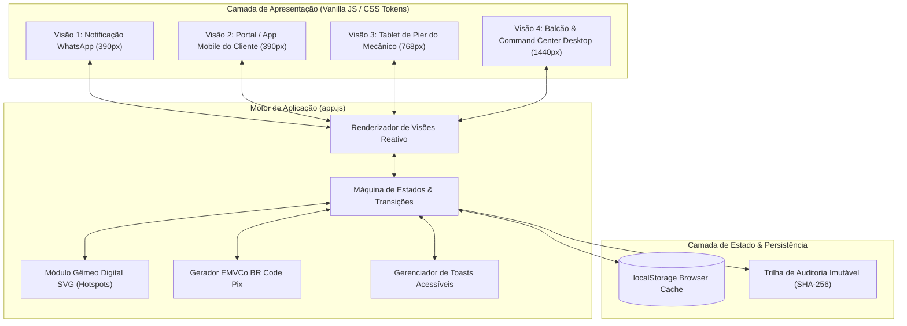

# 🏛️ Cais OS — Architecture & Technical Specifications

> **Padrão Arquitetural:** Vanilla Web App Reativo & Autônomo (Zero Runtime Dependencies)  
> **Metodologia de Entrega:** **PB-06 Lean 4-Stage Delivery (PIAOS)**  
> **Conformidade:** [`PIA-STACK-CLIENTE-001`](../../docs/standards/PIA-STACK-CLIENTE-001.md)

---

## 1. Visão Arquitetural Geral

O **Cais OS** foi projetado para operar como um aplicativo web hiper-leve, autônomo e de carregamento instantâneo no celular do cliente (otimizado para redes 4G/5G oscilantes em marinas e canais náuticos).

---

## 2. Componentes Centrais

### A. Gêmeo Digital Técnico (Digital Twin Blueprint SVG)
- **Implementação:** Desenho vetorial SVG técnico embutido no DOM sem assets de imagem pesados.
- **Hotspots Reativos:** Coordenadas normalizadas percentuais com botões táteis de 44px (`--cais-hit`), rótulos ARIA acessíveis e animações de pulsação CSS (`cais-ping`).
- **Painel Forense Dinâmico:** Atualização reativa de medição térmica e capacidade operacional ao clicar em cada sensor da lancha.

### B. Máquina de Estados Finita da Ordem de Serviço
A transição de estados segue integridade estrita para evitar queima de etapas operacionais:
1. `DRAFT / CREATED`: Ordem aberta pelo mecânico no píer.
2. `AWAITING_APPROVAL`: Laudo emitido e link público seguro gerado.
3. `APPROVED`: Cliente aprova o escopo (gera bloqueio de versão imutável `v1-approved`).
4. `SIGNAL_PAID`: Webhook confirma a liquidação do sinal Pix de 30% no banco.
5. `IN_PROGRESS`: Peças genuínas liberadas no estoque e ordem autorizada para a oficina.
6. `COMPLETED`: Teste no Rio Juqueriquerê concluído com sucesso e barco entregue na vaga.

### C. Módulo Pix EMVCo BR Code
- Geração determinística da string padrão oficial do Banco Central:
  `00020126580014br.gov.bcb.pix...5802BR5915MARINA IMPERIAL...`
- Renderização SVG nítida do QR Code sem dependência de bibliotecas de terceiros pesadas.
- Fallback automático para cópia de código em navegadores móveis sem suporte pleno à Clipboard API.
