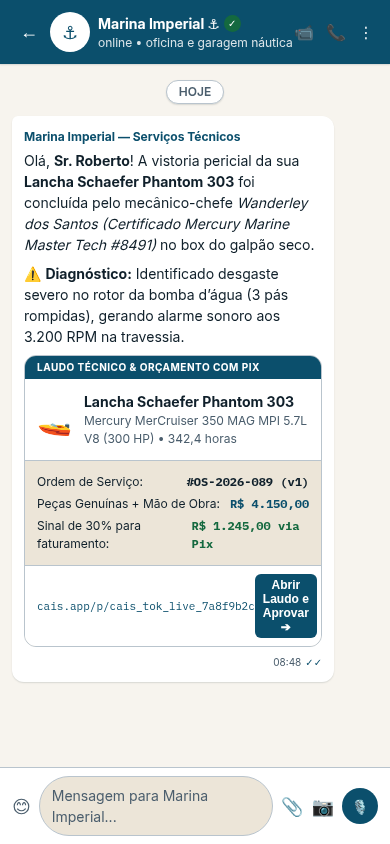
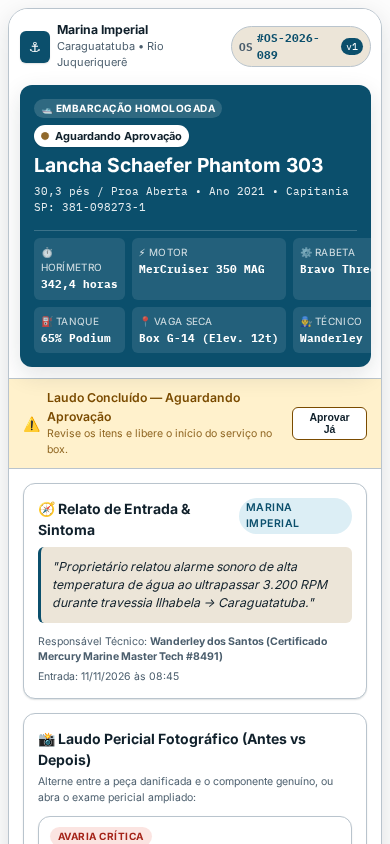
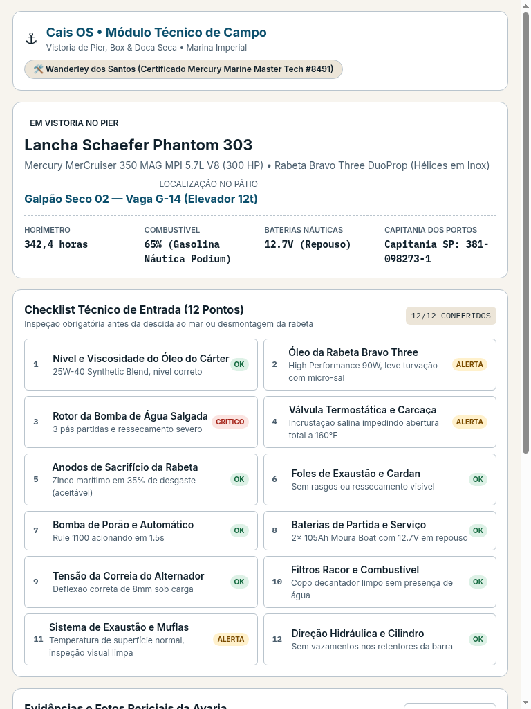
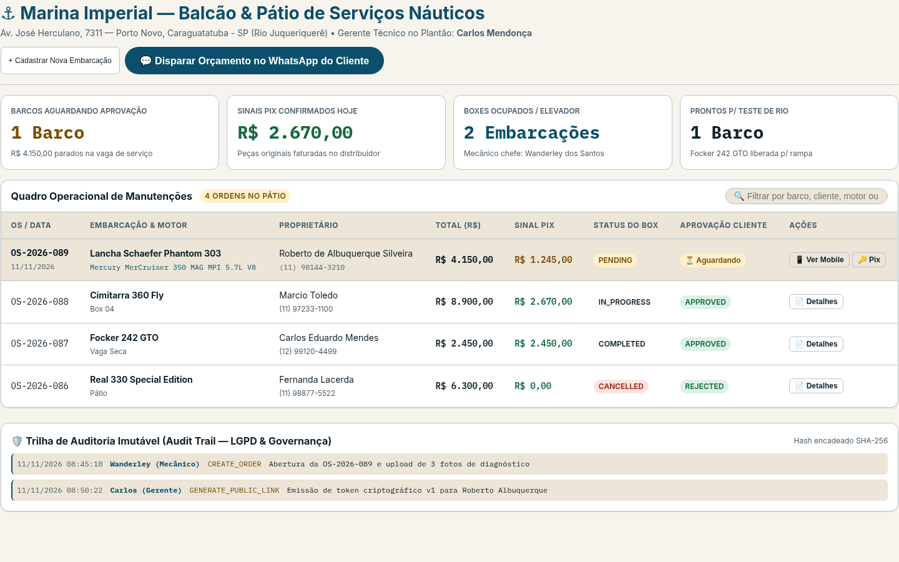
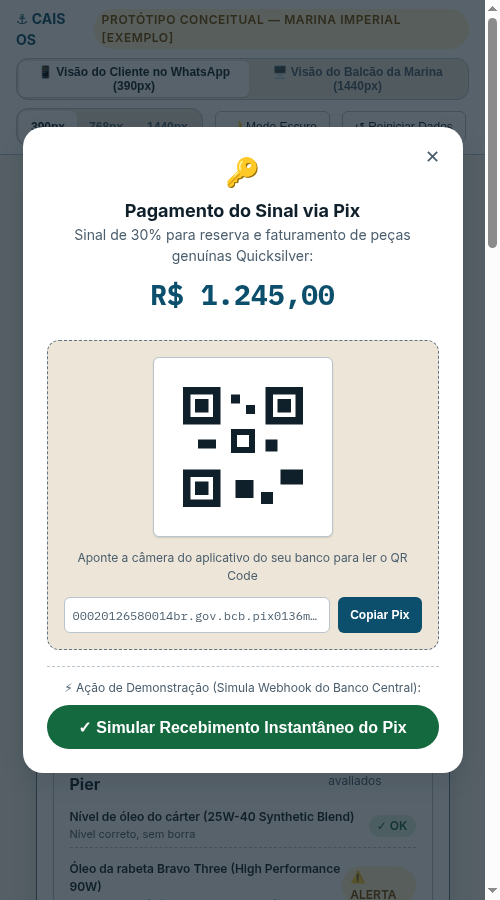
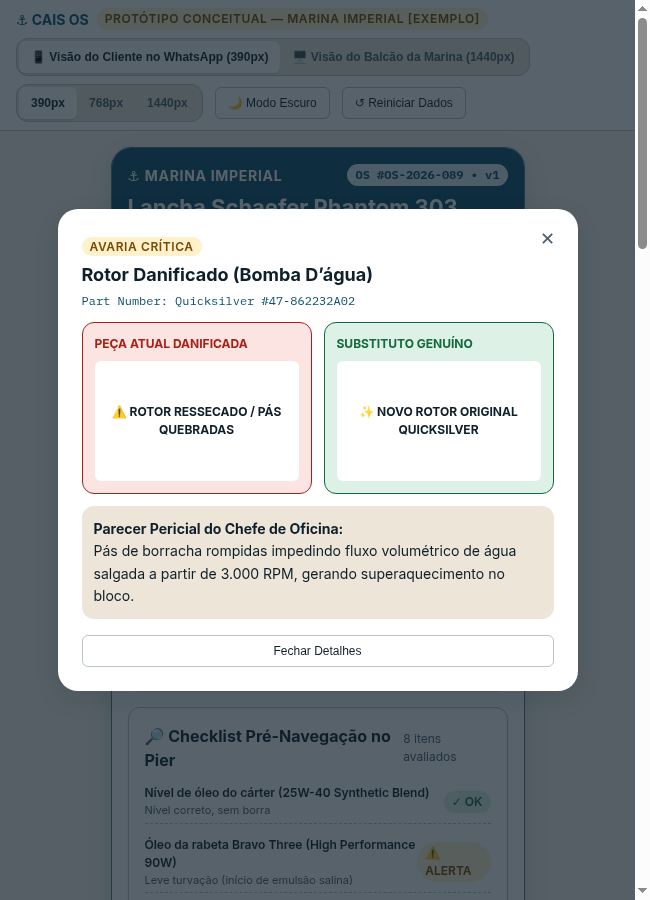
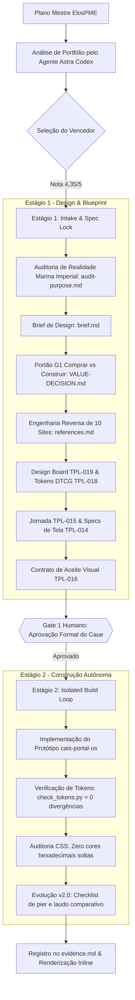

# ⚓ Cais OS — Portal de Ordem de Serviço & Aprovação Mobile com Pix

> **Sistema Operacional de Vistorias Náuticas, Orçamentos Transparentes e Liquidação Pix**  
> **Cliente-Exemplo de Demonstração:** [Marina Imperial](https://marinaimperial.com.br/) (Caraguatatuba - SP • Rio Juqueriquerê)  
> **Metodologia de Engenharia:** [1Bitpi Agent OS (PIAOS)](../../registry/workflows/README.md) • Protocolo Canônico **PB-06 Lean 4-Stage Delivery** ([ADR-0113](../../sdd/decisions/ADR-0113-pb06-lean-substitui-lifecycle-00-09.md))  
> **Normas de Governança:** [`PIA-DESIGN-STD-001`](../../docs/standards/PIA-DESIGN-STD-001.md) • [`PIA-STACK-CLIENTE-001`](../../docs/standards/PIA-STACK-CLIENTE-001.md) • [`PIA-VISUAL-REGRESSION-STD-001`](../../docs/standards/PIA-VISUAL-REGRESSION-STD-001.md)  
> **Change de Origem:** [`sdd/changes/portal-os-mobile-v1/`](../../sdd/changes/portal-os-mobile-v1/)

---

## 📚 Suíte Canônica de Documentação de Engenharia (PB-06 Lean)

O projeto Cais OS foi desenvolvido estritamente sob o protocolo **PB-06 Lean 4-Stage Delivery (PIAOS)** ([ADR-0113](../../sdd/decisions/ADR-0113-pb06-lean-substitui-lifecycle-00-09.md)). Abaixo está a suíte completa de especificações técnicas do produto:

| Documento | Foco & Descrição | Status |
|---|---|:---:|
| [📄 PRD (Product Requirements Document)](./PRD.md) | Requisitos do produto, dor de mercado, público-alvo e governança PB-06 Lean | ✅ Canônico |
| [🎨 DESIGN SYSTEM](./DESIGN-SYSTEM.md) | 110 tokens semânticos DTCG, paleta Obsidian Slate, tipografia, WCAG 2.2 AA | ✅ Canônico |
| [🏗️ ARCHITECTURE](./ARCHITECTURE.md) | Arquitetura reativa, DAG do PB-06, Gêmeo Digital SVG e máquina de estados da OS | ✅ Canônico |
| [💾 DATABASE](./DATABASE.md) | Modelagem financeira em centavos inteiros (`cents`), imutabilidade `v1-approved` | ✅ Canônico |
| [🔒 SECURITY](./SECURITY.md) | Validade jurídica tácita, carimbo de IP/User-Agent, SHA-256 e Pix EMVCo BR Code | ✅ Canônico |
| [📐 CODE STYLE](./CODE-STYLE.md) | Proibição de hex/rgba soltos, touch targets `>= 44px` (`--cais-hit`), zero `alert()` | ✅ Canônico |
| [🧪 TESTING](./TESTING.md) | Suíte determinística pytest (19 testes) e harness quantitativo (`eval_visao2.py`) | ✅ Canônico |
| [🤖 AGENT.md](./AGENT.md) | Instruções canônicas de contexto, mapa de arquivos e invariantes sagradas para IAs | ✅ Canônico |

---

## 📸 Galeria de Telas por Perfil & Dispositivo Real

| 📱 Visão 1: Cliente no WhatsApp (`390px`) | 📱 Visão 2: Cliente no Web App / Portal (`390px`) |
| :---: | :---: |
| **Para quem:** Proprietário da Embarcação<br>**Onde:** No aplicativo do WhatsApp oficial | **Para quem:** Proprietário da Embarcação<br>**Onde:** No navegador mobile ao abrir o link |
|  |  |

| 📟 Visão 3: Mecânico no Píer / Doca (`768px`) | 🖥️ Visão 4: Balcão & Gerência (`1440px`) |
| :---: | :---: |
| **Para quem:** Mecânico-chefe de campo<br>**Onde:** No tablet de vistoria no píer ou doca | **Para quem:** Gerência e Atendimento do Balcão<br>**Onde:** No computador da recepção e oficina |
|  |  |

| 🔑 Módulo Pix com Confirmação Instantânea | 🔍 Comparador Pericial de Peças (Antes vs Depois) |
| :---: | :---: |
|  |  |

---

## 1. O Que É o Projeto

O **Cais OS** é uma solução de software ágil e de alta conversão projetada para prestadores de serviços técnicos de alto ticket — com foco prioritário em **marinas, oficinas náuticas, centros automotivos premium, instaladores de energia solar e empresas de climatização**.

### O Problema Real de Negócio (A Dor Oculta)
Hoje, a grande maioria dessas empresas opera a comunicação de serviços pelo **WhatsApp**:
1. **Desconfiança e Demora:** O mecânico identifica uma peça desgastada, envia áudios e mensagens de texto confusas com valores avulsos. O cliente acha que a oficina está "inventando defeito" e demora dias para aprovar.
2. **Pátio Travado:** A embarcação ou o veículo fica parado ocupando a vaga seca, box de serviço ou elevador, gerando prejuízo operacional.
3. **Inadimplência de Peças:** A oficina encomenda peças caras sem cobrar sinal antecipado e assume o risco financeiro do fornecedor.
4. **Falta de Histórico e Segurança Jurídica:** Acordos verbais sem registro imutável geram atrito na entrega final quando o valor total é cobrado.

### A Solução "Cais OS"
O Cais transforma essa dinâmica sem exigir que o cliente baixe aplicativos ou crie logins burocráticos:
- O mecânico sobe fotos da avaria e gera a OS no balcão.
- O cliente recebe um **link seguro e único** no WhatsApp (`/p/[public_token]`).
- No celular (otimizado para leitura sob luz solar), o cliente visualiza:
  - Ficha da embarcação, horímetro e motor.
  - Laudo pericial com fotos comparativas da peça gasta vs peça nova.
  - Tabela discriminada separando mão de obra e peças genuínas.
  - Botão de **Aprovação em 1 Clique** (versão imutável v1).
  - Cobrança automática de **Sinal Pix de 30%** com QR Code e Copia-e-Cola.
- O balcão da marina recebe a confirmação do pagamento em tempo real via webhook e libera a ordem de compra de peças sem risco.

---

## 2. Como Utilizar e Rodar o Projeto

O protótipo foi construído com arquitetura autônoma e modular (Zero dependências externas obrigatórias para execução local).

### Opção A: Execução Direta no Navegador (Sem Instalação)
Basta abrir o arquivo [`index.html`](./index.html) diretamente no seu navegador preferido (Google Chrome, Edge, Safari, Firefox).

```bash
# Abrir no Linux / Ubuntu
google-chrome prototipos/cais-portal-os/index.html

# Ou simplesmente abrir via navegador padrão
xdg-open prototipos/cais-portal-os/index.html
```

### Opção B: Servidor HTTP Local Leve (Recomendado)
Para simulação idêntica ao ambiente de produção:

```bash
# Usando Python 3 (nativo em qualquer ambiente Linux/macOS)
cd prototipos/cais-portal-os
python3 -m http.server 8080

# Acessar no navegador:
# http://localhost:8080/
```

Alternativamente, via Node.js:
```bash
npx serve prototipos/cais-portal-os
```

### Opção C: Executar a Bateria de Testes Automatizados (Estágio 3)
Para auditar deterministicamente tokens, acessibilidade, regras de negócio e dimensões dos viewports:

```bash
pytest prototipos/cais-portal-os/tests/ -v
# 19 testes determinísticos aprovados (100% GREEN, 0 falhas em ~0.13s)
```

### Parâmetros de URL para Testes e Apresentações Rápidas
O protótipo suporta navegação direta via parâmetros de query string na URL:

| Parâmetro | URL de Exemplo | Perfil & O Que Exibe |
|---|---|---|
| **Cliente no WhatsApp** | `index.html?screen=whatsapp` | Visão autêntica do cliente recebendo a OS dentro do chat do WhatsApp |
| **Cliente no Web App** | `index.html?screen=client` | Portal mobile (390px) para conferência de laudo, aprovação e Pix |
| **Mecânico no Píer** | `index.html?screen=mechanic` | Tablet (768px) com checklist de 12 itens e captura de fotos de campo |
| **Balcão & Gerência** | `index.html?screen=admin` | Painel desktop (1440px) de gestão de pátio, faturamento e auditoria |
| **Modo Limpo (Sem Toolbar)** | `index.html?screen=whatsapp&pure=1` | Remove a barra de desenvolvedor para visualização e capturas 100% realistas |
| **Modal Pix Aberto** | `index.html?modal=pix` | Abre diretamente o QR Code e código Pix de R$ 1.245,00 |
| **Laudo Fotográfico** | `index.html?evidence=ev-1` | Abre o comparador pericial com fotos e part number da peça |
| **Modo Noturno** | `index.html?theme=dark` | Ativa a paleta escura de alto contraste náutico |

### Roteiro de Teste Interativo (Show, Don't Tell — 3 Minutos)
1. Abra a **Visão do Cliente** (`index.html`).
2. Role a página, toque em **"🔍 Detalhes"** em uma das fotos para ver o comparador de avaria da peça Quicksilver.
3. Observe o checklist pericial pré-navegação do Rio Juqueriquerê.
4. Clique no botão flutuante **"Aprovar e Liberar Peças"**.
5. O modal Pix abrirá com o sinal calculado de 30% (R$ 1.245,00).
6. Clique no botão **"✓ Simular Recebimento Instantâneo do Pix"** (simula o webhook do Banco Central).
7. Veja o status mudar imediatamente para **"Orçamento Aprovado & Sinal Liquidado"**.
8. Alterne para a aba **"🖥️ Visão do Balcão da Marina"** e observe a telemetria atualizada e o log na Trilha de Auditoria imutável!

---

## 3. Stack Tecnológica e Arquitetura

O projeto adota o **Arquétipo B** (SaaS / Web App com Autenticação e Multi-Tenant) da norma técnica [`PIA-STACK-CLIENTE-001`](../../docs/standards/PIA-STACK-CLIENTE-001.md):

```
┌─────────────────────────────────────────────────────────────────┐
│                     ARQUITETURA TÉCNICA CAIS OS                 │
└─────────────────────────────────────────────────────────────────┘
                                 │
     ┌───────────────────────────┴───────────────────────────┐
     ▼                                                       ▼
[ PORTAL PÚBLICO CLIENTE ]                         [ BALCÃO DA MARINA ]
- Rota: /p/[public_token]                          - Rota: /app/ordens
- Token Criptográfico 256 bits                     - Sessão Segura Better Auth
- No-Login / Mobile-First 390px                    - Desktop / Tablet 1440px
- Zero Fricção no WhatsApp                         - RBAC: Gerente / Mecânico
     │                                                       │
     └───────────────────────────┬───────────────────────────┘
                                 │
                                 ▼
                     [ DESIGN SYSTEM DE TOKENS ]
                     - tokens.css / tokens.json (W3C DTCG)
                     - 106 propriedades espelhadas (0 divergências)
                     - Zero Hex Solto (100% variáveis semânticas)
                     - WCAG 2.2 AA (Contraste texto > 6.0:1)
                                 │
                                 ▼
                    [ BACKEND & CAMADA DE DADOS ]
                     - Next.js 16 + React 19 + TypeScript
                     - PostgreSQL 17/18 + Drizzle ORM
                     - Row-Level Security (RLS) por company_id
                     - Webhooks Pix Idempotentes (HMAC SHA-256)
                     - Trilha de Auditoria Imutável (audit_logs)
```

### Componentes de Tecnologia
- **Frontend:** Next.js (App Router), React 19, TypeScript estrito.
- **Design Tokens:** W3C DTCG em [`tokens.json`](./tokens.json) e [`tokens.css`](./tokens.css), validados via script de integridade determinístico `tools/design/check_tokens.py`.
- **Tipografia:** `Inter` (família semântica display e interface) + `IBM Plex Mono` (valores monetários em reais, horímetros, part numbers e chaves Pix).
- **Banco de Dados Relacional:** PostgreSQL 17/18 com isolamento total multi-tenant garantido por Row-Level Security (`company_id`).
- **Autenticação:** Better Auth auto-hospedado (sessões em cookies `httpOnly`, sem vazamento de dados entre marinas).
- **Pagamentos & Pix:** Integração com gateway bancário (Asaas / Mercado Pago / Efí) com chave de idempotência (`idempotency_key`) para impedir baixa duplicada entre online e balcão.

---

## 4. Processo de Construção e Governança (Metodologia PIAOS)

O desenvolvimento deste produto seguiu rigorosamente o fluxo Lean do **1Bitpi Agent OS**:



### 1. Auditoria e Escolha do Produto (Agente Astra Codex)
A partir do plano de 7 produtos do documento ElosPME, o agente **Astra** realizou uma análise multicritério (Velocidade 35%, Retorno 30%, Venda Única 20%, Distribuição 15%). O **Portal de Orçamento/OS com Pix** venceu em 1º lugar com nota **4,35 de 5**, comprovando ser o menor ciclo de entrega com capacidade imediata de venda avulsa.

### 2. Estágio 1: Concepção, Design e Travamento (Gate 1)
- **Auditoria de Propósito (`audit-purpose.md`):** Realizada varredura pública no site da Marina Imperial (Caraguatatuba), identificando que a marina já oferece manutenção de motores, mas centraliza todo o contato em um único WhatsApp sem laudo nem formulário.
- **Portão G1 (`VALUE-DECISION.md`):** Comparativo do roteiro contra ferramentas de mercado (Auvo e Asaas), demonstrando que o Cais se posiciona na simplicidade (sem apps pesados para clientes, sem mensalidade por usuário e com marca própria da marina).
- **Design Board & Tokens (`DESIGN-BOARD.md`):** Definição da identidade náutica "Cais" com cálculo determinístico de contraste WCAG 2.2 AA (todas as combinações texto/superfície acima de 6:1 para leitura sob sol intenso).
- **Aprovação do Caue:** O decisor ratificou formalmente o escopo congelado (`SPEC-LOCK.md`) com a instrução literal: *"concordo com escopo e abrir estagio 2"*.

### 3. Estágio 2 & Evolução de Design: Build Isolado, Gêmeo Digital & Qualidade Enterprise
- Código HTML5/CSS3/JavaScript modular e limpo criado em `prototipos/cais-portal-os/`.
- Verificação automatizada confirmando **0 hexadecimais soltos** e **0 rgba hardcoded** (todo o layout consome variáveis semânticas do Design Board e do padrão W3C DTCG).
- Validação no `check_tokens.py` com **110 custom properties e 0 divergências**.
- **Gêmeo Digital Técnico (Digital Twin Blueprint SVG):** Silhueta vetorial da Schaefer Phantom 303 com calado (0.92m), linha d'água e hotspots pulsantes interativos vinculados aos componentes críticos e conformes.
- **Áreas de Toque Acessíveis (WCAG 2.2 AA):** Todos os alvos de interação e botões ajustados para o mínimo de 44px (`--cais-hit`).
- **Eliminação de Alertas Nativos:** Substituição integral de chamadas `alert()` pelo sistema unificado de notificações táteis `showToast()`.
- **Telemetria de Presença Náutica:** Régua ao vivo com maré, canal e rastreamento da sessão do cliente na visão do Balcão/Command Center.

---

## 5. Estrutura de Arquivos da Pasta

```
prototipos/cais-portal-os/
├── README.md                   # Esta documentação completa de produto, uso e governança
├── PRD.md                      # Product Requirements Document (Visão Executiva, Requisitos e ROI)
├── DESIGN-SYSTEM.md            # Especificação de 110 Tokens DTCG, Obsidian Slate e Acessibilidade
├── ARCHITECTURE.md             # Arquitetura de Software Vanilla, DAG PB-06 e Gêmeo Digital SVG
├── DATABASE.md                 # Modelagem Relacional, Centavos Inteiros e Imutabilidade
├── SECURITY.md                 # Validade Jurídica, Carimbo de IP, SHA-256 e EMVCo Pix
├── CODE-STYLE.md               # Diretrizes de Código: Zero Hex, 44px Hit Target, Sem Alert
├── TESTING.md                  # Estratégia de Testes Determinísticos e Harness Quantitativo
├── AGENT.md                    # Instruções Canônicas para Agentes Autônomos de IA
├── index.html                  # Interface operacional central (HTML5 autônomo com seletor de telas)
├── cais06-200k.html            # Benchmark de engenharia e acabamento visual de alto padrão ($200k)
├── preview-standalone.html     # Versão bundled inlined para visualização rápida no T3 Code
├── preview-visao2-mobile.html  # Preview dedicado da Visão 2 Mobile
├── app.css                     # Estilos 100% governados por tokens semânticos (--cais-*)
├── app.js                      # Motor reativo de dados, blueprint SVG, simulação de Pix e telemetria
├── tokens.css                  # Espelho CSS oficial de tokens do Design Board (110 tokens)
├── media/                      # Galeria de capturas reais em PNG para documentação
└── tests/                      # Suíte de testes automatizados determinísticos (19 testes)
```

---

## 6. Proposta Comercial & Próximos Passos (Show, Don't Tell)

Com este protótipo navegável e funcional, a abordagem comercial dispensa apresentações teóricas em PDF:

### Estratégia de Abordagem Direta (Fase 5 do Discovery Workflow)
Envia-se uma mensagem simples para o decisor da marina ou oficina:
> *"Olá! Notei que a Marina Imperial atende manutenção de lanchas via WhatsApp. Construímos uma demonstração interativa de como a aprovação de orçamentos e cobrança de sinal Pix pode operar no celular do cliente em 1 clique, com fotos da vistoria e sem trocar o sistema interno de vocês. Você pode testar ao vivo aqui no celular: [link do protótipo]."*

### Pacote Comercial Recomendado
- **Taxa de Setup / Implantação (Fixed-Price):** **R$ 7.500,00** (Brasil) ou **US$ 2.000,00** (Upwork / Clientes Internacionais).
  - Inclui personalização com a marca da marina, integração do gateway Pix, cadastro das tabelas de serviços e treinamento de 2 horas para a equipe de balcão.
- **Manutenção & Suporte Opcional:** **R$ 300,00/mês** (hospedagem de alta velocidade, backup diário e garantia contínua).
- **Sem Custos por Usuário:** A marina não paga licença por mecânico ou funcionário adicional.

---

*Documento gerado e auditado de acordo com o protocolo **1Bitpi Agent OS (PIAOS)** em 12/11/2026.*
