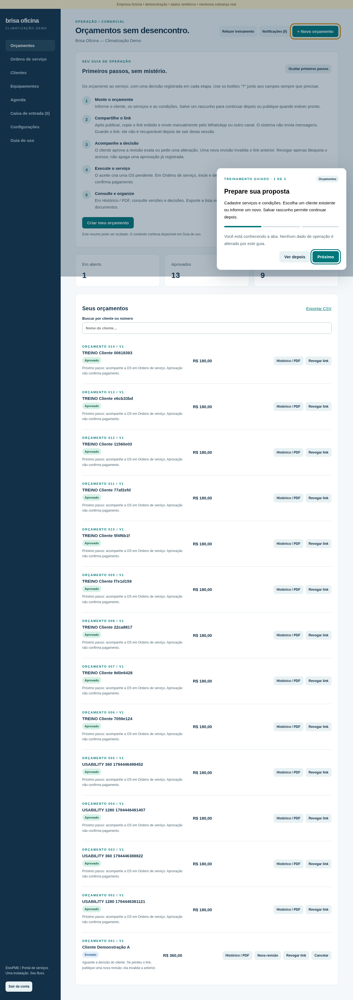
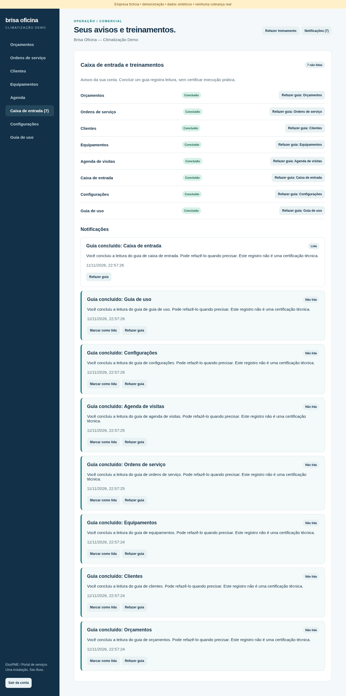
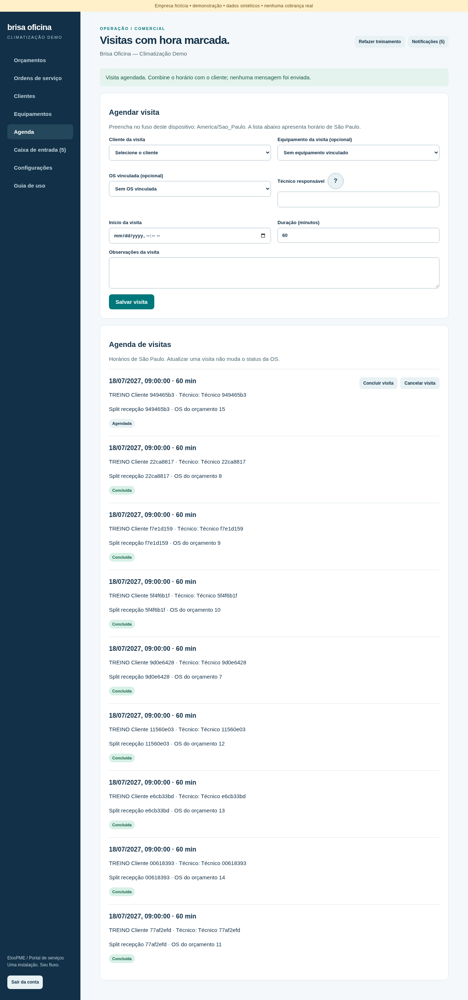
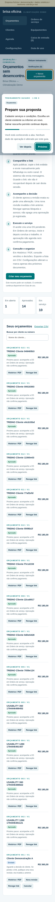
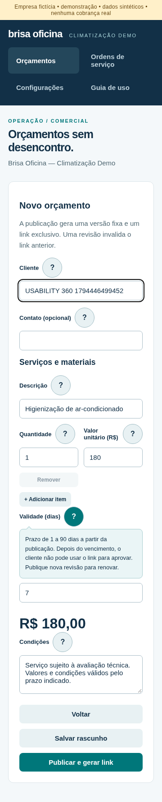

> **Código completo no showroom público.** Este diretório contém o app Next/PostgreSQL e sua documentação. GitHub Pages não executa esse backend. Origem: snapshot local `2833a4f`; instruções abaixo são executadas a partir desta pasta. [Índice técnico](docs/INDEX.md) · [Categoria](../README.md) · [Showroom](../../README.md). Não houve deploy do aplicativo com esta inclusão.

# ElosPME — portal de serviços para pequenas empresas

**Orçamentos, aprovação do cliente, ordens de serviço e visitas em uma aplicação web.**

O ElosPME organiza o atendimento de pequenas empresas de climatização: o operador prepara uma proposta, o cliente decide pelo celular e a equipe acompanha o serviço. Clientes, equipamentos, agenda e treinamento guiado complementam esse fluxo.

A demonstração usa **Brisa Oficina — Climatização Demo**, identidade fictícia com dados sintéticos. A versão atual funciona localmente, com banco real e uma empresa por instalação. A proposta comercial é licença da versão com implantação padronizada; preço, contrato e distribuição comercial ainda não foram validados.

[Como executar](#como-executar) · [Como usar](#como-usar) · [Imagens](#imagens-do-aplicativo) · [Stack](#stack-e-arquitetura) · [Desenvolvimento TSF](#processo-de-desenvolvimento-tsf) · [Testes](#testes-e-evidências) · [Documentação](#documentação-do-projeto)


## Entrega atual e revisão

A evolução Brisa inclui navegação mobile, busca global, filtros de orçamentos, Clientes em cards/modal, OS em lista/quadro e documentação consolidada. O app foi construído por adaptação **local e supervisionada do Tiny Software Factory (TSF/TFS) v2.0.0**; não é uma fábrica autônoma. [Fluxo e melhorias TSF](docs/TSF-WORKFLOW.md).

Comece pelo [índice de documentação](docs/INDEX.md), [PRD](docs/PRD.md) e [estado da entrega](STATUS.md). A [comparação executada](docs/COMPARISON-RESULTS.md) preserva A `225cdcc` e B `21a3a3d`: 24 execuções técnicas aprovadas, sem inferir produtividade humana ou aceite G1. [Protocolo humano](docs/comparison/protocolo.md).

Build reproduzível exige PostgreSQL pronto e ativo até o término: `node --env-file=.env.local --import tsx scripts/verified-build.ts`. Consulte [Testing](docs/TESTING.md) antes de executar scripts com portas/bancos específicos. As instâncias comparativas são temporárias; processo encerrado deve ser reiniciado conforme sua worktree, sem usar banco alheio. Publicação/merge/deploy não estão incluídos na entrega local.


## O que o aplicativo faz

| Aba                   | Operações disponíveis                                                                                                                                                                 |
| --------------------- | ------------------------------------------------------------------------------------------------------------------------------------------------------------------------------------- |
| **Orçamentos**        | Criar e editar rascunhos, selecionar cliente cadastrado, calcular totais, publicar revisões, copiar link, revogar acesso, cancelar propostas, consultar histórico/PDF e exportar CSV. |
| **Ordens de serviço** | Consultar a OS gerada pelo aceite e registrar início, conclusão ou cancelamento com motivo.                                                                                           |
| **Clientes**          | Cadastrar e editar nome, contato, endereço e observações; buscar e consultar quantidades de orçamentos/equipamentos.                                                                  |
| **Equipamentos**      | Vincular aparelho ao cliente, identificar modelo, BTU, série, local e data informada de próxima manutenção; consultar histórico de visitas.                                           |
| **Agenda**            | Agendar visitas com técnico, horário e duração; vincular equipamento e OS do mesmo cliente; concluir/cancelar visitas.                                                                |
| **Caixa de entrada**  | Consultar treinamentos concluídos, avisos não lidos e repetir guias. Informações separadas por usuário.                                                                               |
| **Configurações**     | Alterar nome e cor para próximas publicações, preservando documentos anteriores.                                                                                                      |
| **Guia de uso**       | Rever o fluxo de operação, dúvidas frequentes e orientações sobre as abas.                                                                                                            |

Na primeira visita a cada aba, um treinamento apresenta as etapas. **Ver depois** adia o guia; **Concluir treinamento** registra a leitura e cria uma notificação na conta. **Refazer treinamento** permite repetir sem duplicar avisos. Os botões **“?”** junto aos campos explicam conceitos e exemplos por toque ou teclado.

## Imagens do aplicativo

Capturas reais dos testes locais em desktop e celular. Todos os nomes, serviços e valores exibidos são de demonstração. As imagens registram a versão validada; os dados da instalação podem mudar durante testes.

### Treinamento ao entrar em uma aba



### Caixa de entrada e conclusão dos guias



### Agenda e operação de visitas



<details>
<summary>Ver treinamento e ajuda contextual no celular</summary>




</details>

## Como executar

### Copiar e colar no terminal desta máquina

Para o terminal mostrado na captura, a pasta é `/home/caueantonacci/1bitpi-labs/elos-pme-portal-codex`. Dependências, `.env.local` e build já estão preparados nesta instalação. Copie o bloco inteiro:

```bash
cd /home/caueantonacci/1bitpi-labs/elos-pme-portal-codex
export PATH="$PWD/node_modules/node/bin:$PATH"
docker compose -p elos-demo up -d --wait db

if curl --fail --silent --output /dev/null http://localhost:3017/login; then
  printf 'O aplicativo já está rodando. Abra http://localhost:3017\n'
else
  npm run start -- --port 3017
fi
```

Abra **http://localhost:3017** no navegador. O bloco usa o Node 22 local, inicia/confere o banco e evita tentar iniciar uma segunda cópia do site. Se ele iniciar o servidor, mantenha esse terminal aberto; `Ctrl+C` encerra essa instância. Se informar que já está rodando, o servidor está ativo em outro terminal/processo.

Não é necessário reinstalar dependências, executar seed ou resetar dados para abrir a versão atual. Para primeira instalação ou alterações de código, siga as etapas completas abaixo. Se aparecer `EADDRINUSE`, não force o encerramento de processos: confira a instância já aberta na porta 3017.

### 1. Pré-requisitos e diretório correto

- **Node.js 22 ou superior** e npm. O projeto exige Node >=22; uma dependência de autenticação não atende ao Node 20.
- **Docker Engine e Docker Compose**, com permissão para executar containers.
- **Python 3.11 ou superior** para o preparo de ambiente abaixo e o harness TSF. Pydantic só é necessário para verificar o harness.
- Porta **3017** livre para o aplicativo e **55439** para o PostgreSQL local.

Execute os comandos na pasta que contém este README e o `package.json`. Nesta máquina, o código implementado está na worktree:

```bash
cd /home/caueantonacci/1bitpi-labs/elos-pme-portal-codex
```

Branch de desenvolvimento: `codex/quote-portal`. A pasta `agent-os` guarda a coordenação do projeto, e a pasta-base `elos-pme-portal` mantém o checkout `main`; os comandos do aplicativo devem rodar no checkout que contém o código implementado.

### 2. Instalar dependências

```bash
npm ci
```

O `package-lock.json` fixa a árvore instalada. O pacote de desenvolvimento também inclui um Node 22 local. Se o sistema ainda estiver usando Node 20, após a instalação use:

```bash
export PATH="$PWD/node_modules/node/bin:$PATH"
node --version
```

Para uma instalação nova, prefira iniciar o próprio `npm ci` com Node >=22. O Node local não altera a versão global da máquina.

### 3. Preparar as variáveis locais

Se `.env.local` já existe, mantenha o arquivo atual. Para uma instalação nova, este comando usa o modelo versionado e gera segredos aleatórios sem imprimi-los:

```bash
python3 - <<'PY'
from pathlib import Path
import secrets

path = Path('.env.local')
if path.exists():
    raise SystemExit('.env.local já existe; arquivo preservado. Revise-o localmente.')

text = Path('.env.example').read_text()
text = text.replace('replace-with-at-least-32-random-characters', secrets.token_hex(32))
text += '\nDEMO_PASSWORD=' + secrets.token_urlsafe(18) + '\n'
with path.open('x') as file:
    file.write(text)
path.chmod(0o600)
print('Ambiente criado. Consulte a senha no arquivo privado .env.local.')
PY
```

| Variável                              | Finalidade                                                                      |
| ------------------------------------- | ------------------------------------------------------------------------------- |
| `DATABASE_URL`                        | Conexão PostgreSQL. O exemplo aponta para `127.0.0.1:55439/elos`.               |
| `BETTER_AUTH_URL`                     | Origem do app e validação de requisições: `http://localhost:3017`.              |
| `BETTER_AUTH_SECRET`                  | Segredo aleatório de autenticação, com pelo menos 32 caracteres.                |
| `DEMO_MODE`                           | `true` habilita os scripts locais de dados sintéticos.                          |
| `DEMO_PASSWORD`                       | Senha inicial de `operador@brisa.example`, com pelo menos 12 caracteres.        |
| `OPERATOR_EMAIL`, `OPERATOR_PASSWORD` | Somente para criação/recuperação administrativa de operador, quando necessário. |

O `.env.local` é privado e ignorado pelo Git. A senha do PostgreSQL em `compose.yaml` é exclusivamente de desenvolvimento local. As rotinas de teste/backup atuais usam o projeto Compose `elos-demo` e o banco/porta locais documentados; mudar a conexão para outro ambiente exige revisar também esses scripts.

### 4. Subir o banco e preparar a demonstração

```bash
docker compose -p elos-demo up -d --wait db
npm run db:migrate
npm run demo:seed
```

A migração prepara tabelas de autenticação e negócio. O seed cria o operador se ele não existir e um orçamento sintético se não houver orçamentos. **Executar o seed novamente não troca a senha de um operador existente.**

O PostgreSQL persiste no volume Docker `elos_pg`, prefixado pelo projeto Compose. Parar o container preserva os dados; não remova o volume para atualizar ou reiniciar o aplicativo.

### 5. Rodar em desenvolvimento

```bash
npm run dev -- --port 3017
```

Abra **[http://localhost:3017](http://localhost:3017)**. Entre com `operador@brisa.example` e a senha definida no arquivo privado `.env.local`.

Use `localhost` no navegador, conforme `BETTER_AUTH_URL`. Trocar apenas o endereço por `127.0.0.1` ou mudar a porta pode impedir login/mutações por diferença de origem.

### 6. Rodar a build local

Encerre a instância de desenvolvimento com `Ctrl+C` antes de construir e iniciar:

```bash
npm run build
npm run start -- --port 3017
```

`start` exige uma build existente em `.next`. A build local não publica o site nem configura infraestrutura de produção. Evite executar build/dev simultaneamente na mesma pasta.

### Reiniciar depois de fechar o terminal ou reiniciar o T3

Se a build e as variáveis já estão preparadas:

```bash
docker compose -p elos-demo up -d --wait db
npm run start -- --port 3017
```

O servidor fica em primeiro plano no terminal. Fechar ou cancelar o processo interrompe o site; nenhum serviço permanente foi instalado. Para desenvolvimento com alterações de código, use `npm run dev -- --port 3017`. Ao atualizar o código, faça backup, aplique migrações necessárias e gere uma nova build antes de iniciar a versão compilada.

## Como usar

1. **Conheça a aba:** percorra o treinamento ou escolha Ver depois. Ele pode ser refeito pelo cabeçalho.
2. **Cadastre o cliente:** registre dados mínimos em Clientes. Dados de contato são para organização interna, sem envio automático.
3. **Identifique os aparelhos:** em Equipamentos, vincule-os ao cliente e informe apenas dados técnicos conhecidos.
4. **Prepare a proposta:** em Orçamentos, selecione o cliente, informe itens/quantidades/preços, validade e condições. Salve rascunho ou publique.
5. **Compartilhe o link:** copie o endereço exibido após publicar e envie manualmente pelo canal combinado com o cliente.
6. **Receba a decisão:** no portal, o cliente aprova a revisão ou pede alteração. A aprovação gera uma única OS e não realiza cobrança.
7. **Organize a execução:** em Agenda, combine a visita e vincule cliente, equipamento e OS quando aplicável. Conflitos do mesmo técnico são recusados.
8. **Atualize o serviço:** em Ordens de serviço, registre início e conclusão. Concluir uma visita na Agenda não conclui a OS.
9. **Consulte os registros:** use Histórico / PDF, exportação CSV e Caixa de entrada para documentos e treinamentos.

### Regras que ajudam a evitar erros

- **Publicar fixa uma versão.** Uma revisão invalida o link anterior. Propostas aceitas preservam seus dados; outra proposta exige novo orçamento.
- **Guarde o link ao publicar.** O banco guarda seu hash, não o token recuperável. Se perder o link de uma proposta ainda revisável, publique uma nova revisão e envie o novo endereço.
- **Revogar bloqueia o acesso público**, preservando decisões e histórico. Cancelamento da proposta e cancelamento da OS são operações distintas.
- **Agenda é manual.** A entrada usa o fuso do dispositivo; a lista exibe São Paulo. O nome normalizado do técnico identifica conflitos: pessoas diferentes com nomes iguais precisam de identificações distintas.
- **Treinamento registra leitura**, não certificação técnica. Conclusão fica na conta; apenas a preferência de ocultar o resumo inicial fica no navegador.
- **PDF não é backup.** CSV exporta a lista de orçamentos; backup completo inclui as demais tabelas e autenticação.

O [manual de uso](docs/USAGE.md) detalha cada aba e os casos de dúvida.

## Stack e arquitetura

Versões abaixo correspondem ao código/lockfile da entrega; não são uma recomendação de atualizar para versões diferentes sem validação.

| Camada         | Tecnologia                                           | Papel                                                             |
| -------------- | ---------------------------------------------------- | ----------------------------------------------------------------- |
| Aplicação      | Next.js 16.4.6, React 19, TypeScript 5               | Interface e rotas de servidor na mesma aplicação.                 |
| Interface      | CSS próprio, componentes React e diálogo HTML nativo | Layout responsivo, ajuda contextual e treinamento.                |
| Banco          | PostgreSQL 17, driver `pg`                           | Persistência, transações, locks e constraints.                    |
| Autenticação   | Better Auth 1.7.21                                   | Login/sessões, hash de senha e limites de tentativas.             |
| Validação      | Zod 4                                                | Schemas estritos nas entradas.                                    |
| Documentos     | pdf-lib 1.17                                         | PDF gerado no servidor a partir do snapshot.                      |
| Harness TSF    | Python, Pydantic 2.12.5 e SQLite                     | Envelopes, snapshots, ledger e execução supervisionada de checks. |
| Testes         | Node test runner, tsx e Playwright                   | Regras de domínio, HTTP, navegador e regressões.                  |
| Ambiente local | Docker Compose                                       | PostgreSQL persistente e exposto apenas em loopback.              |

O navegador acessa a aplicação Next.js; as rotas autenticadas validam sessão, origem e payload antes de executar o domínio e gravar no PostgreSQL. O portal público acessa somente a revisão autorizada pelo token. O harness TSF verifica o repositório em um processo separado, sem fazer parte do fluxo do cliente.

### Estrutura do repositório

```text
src/
  app/
    api/                 # Auth, orçamentos, decisões, OS, operações, treinamento, PDF/CSV
    components/          # Ajuda, guias, caixa de entrada e formulários operacionais
    p/[token]/           # Portal público da proposta
    login/               # Login do operador
    dashboard.tsx        # Navegação e integração das abas
  lib/                   # Domínio, banco, autenticação, validações e conteúdo dos guias
scripts/                 # Migração, seed, manutenção, backup e smokes
tests/                   # Testes PostgreSQL/domínio
docs/                    # Especificações, decisões, manuais e evidências
.tsf/                    # Configuração, contratos e runner supervisionado
compose.yaml             # Banco local
package-lock.json        # Dependências resolvidas
```

### Dados e garantias implementadas

Clientes se relacionam a orçamentos, equipamentos e visitas. Cada orçamento publicado tem revisões imutáveis, itens/total em centavos, links públicos revogáveis e decisão vinculada à revisão. O aceite e a criação da OS ocorrem na mesma transação, com proteção contra repetição/concorrência. Visitas têm vínculos de cliente/equipamento/OS validados e lock por técnico para impedir sobreposição.

Treinamentos e notificações são vinculados ao usuário autenticado. Repetir conclusão não duplica aviso; marcar como lido não altera o treinamento. Triggers preservam revisões e eventos contra alteração pela aplicação, mas não impedem ações de um administrador do banco.

## Processo de desenvolvimento TSF

O desenvolvimento seguiu uma adaptação **local e supervisionada** do playbook Tiny Software Factory v2.0.0. O estado implementado e os limites estão descritos em [DEVELOPMENT.md](docs/DEVELOPMENT.md).

1. **Descoberta:** recorte de um produto demonstrável para climatização, pesquisa de operações e identidade fictícia.
2. **Spec e aprovação:** requisitos/aceites documentados; operador aprovou G0 e, depois, os incrementos de usabilidade e operações.
3. **Isolamento:** repositório de produto separado do Agent OS, branch e worktree exclusivas.
4. **Implementação incremental:** tarefas delimitadas; produto, migração e manutenção de testes tratados com permissões próprias.
5. **Verificação por código:** testes determinísticos, banco real, navegador, build e restauração; saídas estruturadas validadas com Pydantic.
6. **Feedback e revisão:** problemas encontrados viraram correções/testes; execução e artefatos registrados para revisão humana.

O runner compara hashes/permissões de arquivos, aplica allowlists, usa locks/timeout e mantém SQLite local. Os testes financeiros usam **provedor simulado**; não comprovam cobrança limitada de API real. Modelos pagos, crons, daemon 24h e promoção para autonomia permanecem desativados. Não foram concluídos dez ciclos humanos qualificantes nem ratificada uma promoção No-loop.

## Testes e evidências

Resultados registrados na entrega funcional `3b5c62d`, antes desta revisão documental:

| Verificação        | Resultado registrado                                                                         |
| ------------------ | -------------------------------------------------------------------------------------------- |
| Domínio/PostgreSQL | 22 testes, incluindo aceite concorrente, notificações privadas/idempotentes e agenda.        |
| Harness TSF        | 13 testes de contratos, permissões, timeout, leases e orçamento simulado.                    |
| Navegador          | 64 verificações em 360 e 1280 pixels, com contas temporárias e persistência entre contextos. |
| TypeScript e build | Aprovados.                                                                                   |
| Backup/restore     | Banco vazio restaurado; hashes comparados em sete tabelas.                                   |

Esses registros não são uma certificação de segurança/acessibilidade nem prova de funcionamento em produção. A revisão documental valida comandos, links e coerência; não pressupõe reexecução automática de todos os smokes.

```bash
npm run typecheck
npm test
npm run build
```

`npm test` prepara **elos_test**, separado do banco demo, usando o Compose/porta locais. Para o harness, prepare Python/Pydantic:

```bash
python3 -m venv "$HOME/.venvs/elos-pme-tsf"
. "$HOME/.venvs/elos-pme-tsf/bin/activate"
python3 -m pip install -r requirements-tsf.txt
npm run test:tsf
python3 .tsf/verify.py
```

O ambiente Python fica fora do checkout para evitar sua inclusão na varredura de arquivos do runner. Veja o [guia de desenvolvimento](docs/DEVELOPMENT.md#ambiente-python-do-harness).

Com o site ligado, os smokes podem ser executados por:

```bash
node --env-file=.env.local --import tsx scripts/http-smoke.ts
node --env-file=.env.local --import tsx scripts/browser-smoke.ts
node --env-file=.env.local --import tsx scripts/usability-smoke.ts
node --env-file=.env.local --import tsx scripts/training-operations-smoke.ts
```

Os testes de navegador usam Chrome em `/usr/bin/google-chrome`; adapte o caminho no script se necessário. Smokes escrevem dados sintéticos e screenshots no ambiente demo; o de treinamento remove suas contas temporárias, mas preserva os cadastros/visitas identificados com TREINO. Não execute smokes em uma instalação com dados reais. O teste de login respeita Retry-After; não desabilite a proteção para fazê-lo passar.

## Operação e manutenção

### Backup e restore

```bash
npm run backup
```

O dump é criado em `backups/`, fora do Git, e contém dados e credenciais de autenticação. Proteja/cifre o arquivo antes de transportar. Para ensaiar recuperação, escolha um **nome de banco novo** e use o caminho exato do dump:

```bash
docker compose -p elos-demo exec -T db createdb -U elos elos_restore_manual
docker compose -p elos-demo exec -T db pg_restore \
  -U elos -d elos_restore_manual --exit-on-error < backups/ARQUIVO.dump
```

Não restaure sobre o banco em uso para testar. Compare dados, vínculos e hashes/totais com a origem. Os scripts atuais são orientados ao Compose local; produção exige um plano próprio de backup/restore e rollback.

### Operador e recuperação de senha

Cadastro público está desabilitado. Configure `OPERATOR_EMAIL` e `OPERATOR_PASSWORD` no ambiente privado e execute:

```bash
node --env-file=.env.local --import tsx scripts/operator.ts
```

O script cria o operador ou troca a senha e revoga sessões anteriores. Não coloque senhas em comandos, prints ou documentos. Remova a variável temporária de senha após o uso.

### Limpeza e reset

```bash
node --env-file=.env.local --import tsx scripts/maintenance.ts
```

Remove links expirados e contadores antigos; preserva documentos. Nenhum timer foi instalado.

**Somente para descartar dados da demo**, após conferir o banco e fazer backup:

```bash
npm run demo:reset
npm run demo:seed
```

O reset trunca dados de negócio, incluindo equipamentos/visitas por cascata, e reinicia sequências. Ele recusa `NODE_ENV=production` ou ausência de `DEMO_MODE=true`. Contas e progresso de treinamento não são redefinidos por essa rotina. Não é procedimento de manutenção de um cliente real.

### Problemas comuns

| Sintoma                          | Conferir                                                                                  |
| -------------------------------- | ----------------------------------------------------------------------------------------- |
| Site não abre                    | Terminal do app ativo, porta 3017 livre e banco saudável; reinicie com os comandos acima. |
| Erro de versão do Node           | `node --version`, Node >=22 e PATH do terminal.                                           |
| Login ou POST falha por origem   | Acesse `localhost:3017`, igual a `BETTER_AUTH_URL`.                                       |
| Senha do seed não funciona       | Seed não troca senha existente; use recuperação administrativa.                           |
| Muitas tentativas / HTTP 429     | Aguarde o intervalo informado antes de tentar novamente.                                  |
| `start` pede build               | Execute `npm run build` com o dev encerrado.                                              |
| Banco indisponível               | `docker compose -p elos-demo ps`, porta 55439 e `DATABASE_URL`.                           |
| Chrome não encontrado nos smokes | Verifique o caminho de executável nos scripts de navegador.                               |
| Link público indisponível        | Validade, revogação ou nova revisão; gere outro link quando a proposta permitir revisão.  |

## Conclusões e próximos passos

O projeto demonstrou um fluxo funcional de proposta a serviço com persistência real, revisão protegida, decisões concorrentes e operações básicas de climatização. O feedback do operador conduziu a evolução de ajuda estática para treinamento guiado com registro por usuário e, depois, ampliação das abas operacionais.

A escolha de uma aplicação e um banco por instalação reduz a complexidade inicial. A contrapartida é precisar padronizar instalação, suporte, atualizações e operação antes de distribuir comercialmente. O aproveitamento de cadastro, o refresh das decisões e as evidências de treinamento foram validados tecnicamente; disposição a pagar, economia de tempo e aquisição de clientes ainda precisam de piloto comercial.

A próxima etapa é homologar o incremento atual com o operador e definir o piloto. Exposição pública depende dos gates de staging/produção, revisão independente de release, infraestrutura/TLS, backups protegidos, retenção de dados reais e responsabilidades de suporte. Não há publicação, pagamentos integrados, WhatsApp API, ERP, estoque, laudo PMOC, assinatura certificada, multi-tenancy ou faturamento de assinaturas nesta versão.

## Documentação do projeto

Documentos consolidados: [Índice](docs/INDEX.md) · [PRD](docs/PRD.md) · [Design System](docs/DESIGN-SYSTEM.md) · [Architecture](docs/ARCHITECTURE.md) · [Database](docs/DATABASE.md) · [Security](docs/SECURITY.md) · [Code Style](docs/CODE-STYLE.md) · [Testing](docs/TESTING.md).

Rastreabilidade: [AGENTS.md](AGENTS.md), [inventário/hashes](docs/APP-FILES.md), [protótipo original](docs/prototype/brisa-oficina-reference.html) e [guia de revisão](docs/REVIEW-HANDOFF.md). O protótipo contém simulações e não constitui integração funcional.

| Documento                                                             | Conteúdo                                                             |
| --------------------------------------------------------------------- | -------------------------------------------------------------------- |
| [STATUS.md](STATUS.md)                                                | Estado da entrega e histórico de incrementos; referência de status.  |
| [Manual de uso](docs/USAGE.md)                                        | Jornadas, abas e dúvidas operacionais.                               |
| [Desenvolvimento](docs/DEVELOPMENT.md)                                | Construção, arquitetura, processo TSF e reprodução das verificações. |
| [Especificação](docs/spec.md)                                         | Requisitos e critérios de aceite aprovados.                          |
| [Proposta e identidade demo](docs/proposal.md)                        | Problema, recorte comercial e referências.                           |
| [Plano TSF](docs/tsf-plan.md)                                         | Plano original, etapas e controles esperados.                        |
| [Decisão de arquitetura](docs/ADR-0001.md)                            | Stack e isolamento por instalação.                                   |
| [Evidências iniciais](docs/IMPLEMENTATION-EVIDENCE.md)                | Primeiro MVP e limites de validação.                                 |
| [Usabilidade](docs/changes/usability-contextual-help.md)              | Incremento UX01–UX07 e evidências.                                   |
| [Treinamento e operações](docs/changes/guided-training-operations.md) | Incremento O01–O07, pesquisa e verificações.                         |

**Licença:** termos de uso, redistribuição e comercialização ainda não definidos. Este repositório não concede licença aberta ou redistribuição por ausência de um arquivo de licença. Brisa Oficina é uma identidade fictícia, sem disponibilidade comercial de marca/domínio verificada.
