# 🏛️ 1Bitpi Labs — Showroom Comercial & Portfólio de Sistemas (Agent OS)

Bem-vindo ao **Showroom Oficial da 1Bitpi Labs**!  
Esta pasta reúne **todos os sites e plataformas operacionais criadas com a arquitetura AetherForge + PIAOS**, devidamente **separados e categorizados por modelo de negócio**, com **vídeos demonstrativos, fotos em alta resolução, especificações técnicas de features e casos de uso reais** para empresas que desejam comprar, licenciar ou contratar uma solução sob medida.

[-f26a4b?style=for-the-badge)](https://raw.githack.com/1bitpi-labs/showroom/main/player.html?id=vitrine)

---

## 🧭 Mapa de Categorias do Showroom (Portfólio Pronto para Contratação)

Clique na pasta da categoria desejada para ver a **Ficha Comercial exclusiva** daquele segmento ou clique em **Abrir Ao Vivo** para interagir com o sistema real no seu navegador:

| Cat. | Pasta da Categoria | Produto / Marca Modelo | Segmentos Empresariais Atendidos | Demonstração & Ficha Comercial |
| :---: | :--- | :--- | :--- | :--- |
| **🏆 Vitrine Geral** | [`showroom/index.html`](./index.html) | Hub Comparativo Multi-Empresas | Todas as 7 Verticais | [🚀 **Abrir Vitrine Ao Vivo**](https://raw.githack.com/1bitpi-labs/showroom/main/index.html) · [🎬 **Vídeo MP4**](https://raw.githack.com/1bitpi-labs/showroom/main/player.html?id=vitrine) |
| **00** | [`00-core-enterprise-os/`](./00-core-enterprise-os/) | **1BitpiOS & PIAOS — Coastal Tech Edition** | Engenharia de Software, Operações de IA, Consultorias de Tecnologia & DevSecOps | [🚀 **Abrir Ao Vivo**](https://raw.githack.com/1bitpi-labs/showroom/main/00-core-enterprise-os/00-1bitpios-piaos.html) · [🎬 **Vídeo MP4**](https://raw.githack.com/1bitpi-labs/showroom/main/player.html?id=00) · [📄 **Ficha & Casos de Uso**](./00-core-enterprise-os/README.md) |
| **01** | [`01-hospitalidade-e-turismo/`](./01-hospitalidade-e-turismo/) | **Maré Alta Resort — Hotel Boutique & Beach Resort** | Pousadas de Charme, Hotéis Boutique, Resorts Costeiros, Eco-Lodges & Aluguel de Temporada Premium | [🚀 **Abrir Ao Vivo**](https://raw.githack.com/1bitpi-labs/showroom/main/01-hospitalidade-e-turismo/01-pousada-boutique-litoral.html) · [🎬 **Vídeo MP4**](https://raw.githack.com/1bitpi-labs/showroom/main/player.html?id=01) · [📄 **Ficha & Casos de Uso**](./01-hospitalidade-e-turismo/README.md) |
| **02** | [`02-gastronomia-e-beach-clubs/`](./02-gastronomia-e-beach-clubs/) | **Brasa & Maré Gastrobar — Culinary OS** | Restaurantes Autorais, Gastrobares, Beach Clubs, Parrillas, Adegas & Dark Kitchens Premium | [🚀 **Abrir Ao Vivo**](https://raw.githack.com/1bitpi-labs/showroom/main/02-gastronomia-e-beach-clubs/02-gastronomia-beach-club.html) · [🎬 **Vídeo MP4**](https://raw.githack.com/1bitpi-labs/showroom/main/player.html?id=02) · [📄 **Ficha & Casos de Uso**](./02-gastronomia-e-beach-clubs/README.md) |
| **03** | [`03-saude-clinicas-e-wellness/`](./03-saude-clinicas-e-wellness/) | **AuraMed Clínica — Medicina Integrativa & Longevidade** | Clínicas Médicas, Consultórios Odontológicos, Dermatologia, Estética Avançada, Nutrologia & Spas Médicos | [🚀 **Abrir Ao Vivo**](https://raw.githack.com/1bitpi-labs/showroom/main/03-saude-clinicas-e-wellness/03-clinica-saude-wellness.html) · [🎬 **Vídeo MP4**](https://raw.githack.com/1bitpi-labs/showroom/main/player.html?id=03) · [📄 **Ficha & Casos de Uso**](./03-saude-clinicas-e-wellness/README.md) |
| **04** | [`04-juridico-contabil-e-b2b/`](./04-juridico-contabil-e-b2b/) | **Vértice Advisory — Advocacia, Contabilidade & Consultoria Corporativa** | Escritórios de Advocacia, Bancas de Contabilidade Consultiva, Auditorias, Consultorias Financeiras & B2B | [🚀 **Abrir Ao Vivo**](https://raw.githack.com/1bitpi-labs/showroom/main/04-juridico-contabil-e-b2b/04-escritorio-servicos-b2b.html) · [🎬 **Vídeo MP4**](https://raw.githack.com/1bitpi-labs/showroom/main/player.html?id=04) · [📄 **Ficha & Casos de Uso**](./04-juridico-contabil-e-b2b/README.md) |
| **05** | [`05-imobiliario-e-arquitetura/`](./05-imobiliario-e-arquitetura/) | **Horizonte Design — Imobiliária Boutique & Studio de Arquitetura** | Imobiliárias de Alto Padrão, Incorporadoras, Construtoras, Estúdios de Arquitetura & Interiores | [🚀 **Abrir Ao Vivo**](https://raw.githack.com/1bitpi-labs/showroom/main/05-imobiliario-e-arquitetura/05-imobiliaria-arquitetura.html) · [🎬 **Vídeo MP4**](https://raw.githack.com/1bitpi-labs/showroom/main/player.html?id=05) · [📄 **Ficha & Casos de Uso**](./05-imobiliario-e-arquitetura/README.md) |
| **06** | [`06-oficinas-e-servicos-tecnicos/`](./06-oficinas-e-servicos-tecnicos/) | **TorqueLab Service — Centro Técnico Automotivo & Oficina Premium** | Oficinas Mecânicas Premium, Estética Automotiva (Detailing), Concessionárias, Náutica & Energia Solar | [🚀 **Abrir Ao Vivo**](https://raw.githack.com/1bitpi-labs/showroom/main/06-oficinas-e-servicos-tecnicos/06-oficina-servicos-tecnicos.html) · [🎬 **Vídeo MP4**](https://raw.githack.com/1bitpi-labs/showroom/main/player.html?id=06) · [📄 **Ficha & Casos de Uso**](./06-oficinas-e-servicos-tecnicos/README.md) |

---

## 🏆 Vitrine Executiva Multi-Empresas (`showroom/index.html`)

Antes de explorar cada pasta individual, você pode abrir a **Vitrine Executiva Comparativa**, que apresenta todos os modelos de negócios lado a lado:

- **Link Ao Vivo**: [**🚀 Abrir Vitrine Executiva Completa Ao Vivo**](https://raw.githack.com/1bitpi-labs/showroom/main/index.html)
- **Player de Vídeo HD**: [**🎬 Assistir Vídeo da Vitrine no Cinema Player (MP4)**](https://raw.githack.com/1bitpi-labs/showroom/main/player.html?id=vitrine) · [**⬇ Download Direto MP4**](https://raw.githack.com/1bitpi-labs/showroom/main/media-vitrine/vitrine-executiva.mp4)

| Vista Geral da Vitrine Executiva | Catálogo de Verticais de Negócio |
| :---: | :---: |
| 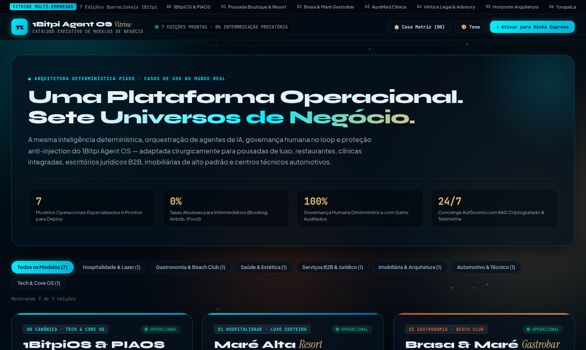 | 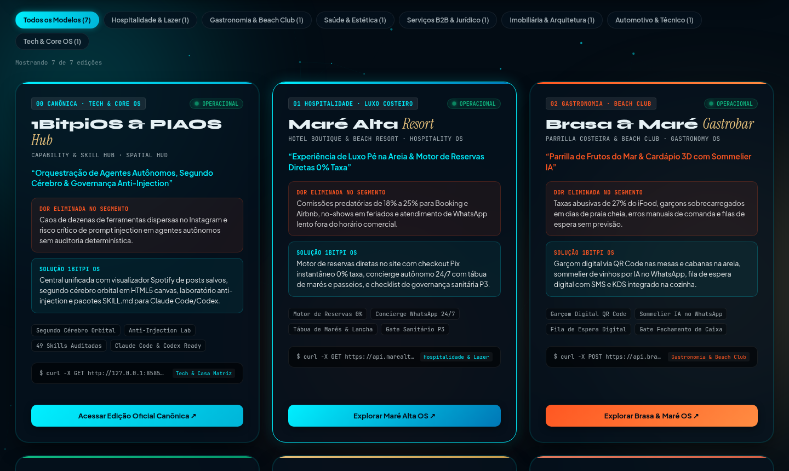 |

---

## ⚙️ As 8 Features de Engenharia Presentes em Todos os Sites do Portfólio

Diferente de templates comuns ou sites institucionais estáticos, cada sistema deste Showroom é construído sobre a engine **1Bitpi Agent OS + AetherForge Elite Design Suite**:

1. **💿 3D Vinyl Sleeve Spotlight com Carrossel Multi-Slide**: Ao clicar em qualquer item, suíte, prato, imóvel ou serviço do catálogo, o destaque superior exibe uma capa física 3D inclinada com navegador de múltiplos slides (`‹` / `›`), indicadores e contador real.
2. **🪐 Grafo de Topologia Orbital HTML5 (`PIA-EXP-06`)**: Mapa interativo renderizado em `<canvas>` a 60fps que conecta o agente central (`π`) a todas as áreas operacionais da empresa, permitindo filtrar o catálogo clicando nas órbitas.
3. **🛡️ Matriz LED de Conformidade, Segurança & Qualidade**: Painel de telemetria com indicadores luminosos que comprovam auditoria (Anti-Prompt Injection, LGPD, Governança Sanitária, Controle de CMV ou Checklist Mecânico).
4. **🤖 Palco Holográfico do Assistente `pibit`**: Barra operacional inferior sempre ativa com atalhos de atendimento no WhatsApp, perguntas frequentes contextualizadas por setor e gerador de comandos/API em 1 clique.
5. **🎧 Busca Instantânea & Prateleiras Horizontais Estilo Spotify**: Pesquisa em tempo real por palavra-chave, tags ou código operacional, organizada em prateleiras temáticas de alta conversão.
6. **⚖️ Fila de Governança Humana (Gate Operacional P6)**: Demonstração prática de controle executivo onde ações críticas (liberação de suíte, laudo médico, minuta jurídica, medição de obra ou entrega de veículo) exigem aprovação do responsável.
7. **🎨 Design Tokens Dinâmicos por Identidade de Marca**: Cada categoria possui sua própria atmosfera cromática, tipografia editorial (*Instrument Serif* + *Plus Jakarta Sans* + *JetBrains Mono*) e micro-interações.
8. **⚡ Arquitetura Self-Contained de Alta Performance**: Carregamento instantâneo sem dependências externas pesadas, pronto para rodar em qualquer servidor, GitHub Pages, Vercel/Cloudflare ou embutido em sistemas existentes.

---

## 📁 Categoria 00: [00 · Core Enterprise & Agent OS (1BitpiOS & PIAOS)](./00-core-enterprise-os/)

> **Marca Modelo**: **1BitpiOS & PIAOS — Coastal Tech Edition**  
> **Setor / Público**: Engenharia de Software, Operações de IA, Consultorias de Tecnologia & DevSecOps  
> **Proposta**: *Hub Operacional de Agentes, Auditoria Anti-Prompt Injection e Catálogo Visual de Skills*

[**🚀 ABRIR SITE AO VIVO**](https://raw.githack.com/1bitpi-labs/showroom/main/00-core-enterprise-os/00-1bitpios-piaos.html) · [**🎬 ASSISTIR VÍDEO HD (MP4)**](https://raw.githack.com/1bitpi-labs/showroom/main/player.html?id=00) · [**📂 Entrar na Pasta da Categoria (`00-core-enterprise-os/`)**](./00-core-enterprise-os/) · [**📋 Ficha Técnica Completa**](./00-core-enterprise-os/README.md)

Design oficial da **1Bitpi Labs** para o ecossistema **1BitpiOS / PIAOS**. Transforma coleções técnicas, repositórios GitHub e automações corporativas em uma central visual estilo Spotify + Apple Spatial UI, com inspeção de segurança contra Prompt Injection e orquestração via agente `pibit`.

- **Principais Features do Site**:
  - **3D Vinyl Sleeve Spotlight & Carrossel Multi-Slide**: Capa estilo álbum de vinil com inclinação física 3D e navegador integrado de todos os slides técnicos de cada capacidade.
  - **Grafo de Topologia Orbital HTML5 (`PIA-EXP-06`)**: Mapa interativo de 60fps conectando o núcleo `π pibit` aos 6 domínios arquitetônicos (Memória, Orquestração, Segurança, Execução, Especialistas e Experiência).
  - **Matriz LED de Segurança Anti-Prompt Injection**: Painel de auditoria em tempo real que escaneia repositórios e prompts em busca de exfiltração de credenciais, comandos destrutivos ou jailbreaks.
  - **Palco Holográfico `pibit` com Terminal de Instalação**: Barra de comando persistente com gerador de comandos CLI (`git clone`, `npx skills add`, `mcp install`) prontos para copiar em 1 clique.
- **Casos de Uso Práticos para Empresas (Exemplos Reais)**:
  1. **Curadoria e Auditoria de Ferramentas de IA para Times de Engenharia**: O pipeline extrai automaticamente os links salvos, localiza os repositórios GitHub originais via OCR/heurística, executa a varredura Anti-Prompt Injection e publica apenas os pacotes aprovados no Hub visual. *(Ex: O CTO salva um post sobre `ai-design-skills` no Instagram → O extrator identifica `github.com/elayadesign/ai-design-skills` → O scanner valida 100/100 em segurança → A equipe instala em 1 clique pelo painel do `pibit`.)*
  2. **Central de Comando Multi-Agentes (Claude, Codex, AGY, Hermes)**: O Grafo Orbital (`PIA-EXP-06`) mapeia visualmente cada capacidade ao seu domínio e exibe a fila de Governança P6 para aprovação rápida. *(Ex: Durante a daily técnica, o Tech Lead abre a vista Orbital, filtra por `PIA-GOV-02` e aprova a entrada de 3 novos conectores MCP auditados.)*
  3. **Portal de Onboarding Técnico & Catálogo Interno de Automação**: O Hub funciona como um 'Spotify de Capacidades Internas' onde qualquer colaborador busca por tarefa (ex: 'Design', 'Scraping', 'Segurança') e copia o comando exato de execução. *(Ex: Um novo engenheiro precisa configurar o design system da empresa, pesquisa `UI` na barra superior, abre os 5 slides visuais do pacote e roda o comando gerado pelo `pibit`.)*
- **Métricas de Retorno (ROI)**: Redução de **80% no tempo de triagem e homologação** de bibliotecas e agentes open-source. · **Zero incidentes de Prompt Injection** ou execução de código malicioso vindo de skills externas não auditadas. · Padronização de **100% do catálogo de ferramentas de IA** em uma interface única e auditável.

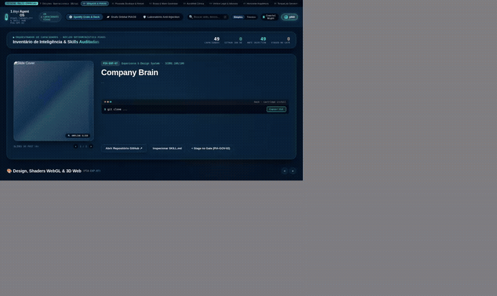

| Foto 1: 3D Vinyl Sleeve & Catálogo Interativo | Foto 2: Grafo Orbital (`PIA-EXP-06`) & Palco `pibit` |
| :---: | :---: |
| 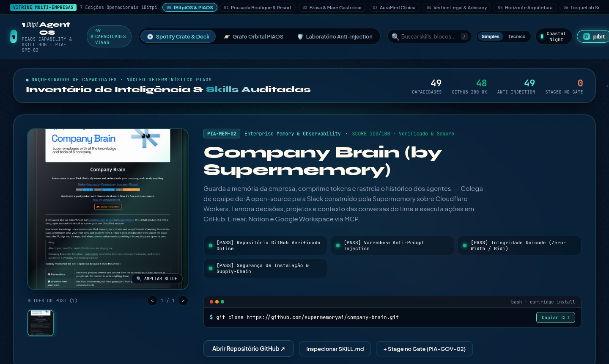 | 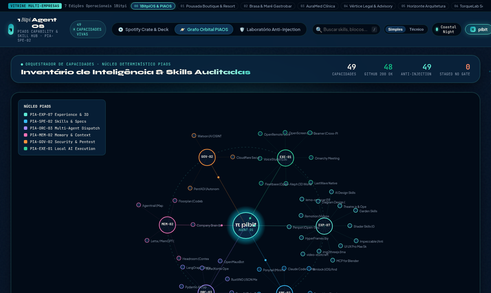 |

---

## 📁 Categoria 01: [01 · Hospitalidade, Pousadas Boutique & Turismo (Hospitality OS)](./01-hospitalidade-e-turismo/)

> **Marca Modelo**: **Maré Alta Resort — Hotel Boutique & Beach Resort**  
> **Setor / Público**: Pousadas de Charme, Hotéis Boutique, Resorts Costeiros, Eco-Lodges & Aluguel de Temporada Premium  
> **Proposta**: *Motor de Reservas Diretas 0% OTA, Concierge WhatsApp 24/7 e Governança de Suítes*

[**🚀 ABRIR SITE AO VIVO**](https://raw.githack.com/1bitpi-labs/showroom/main/01-hospitalidade-e-turismo/01-pousada-boutique-litoral.html) · [**🎬 ASSISTIR VÍDEO HD (MP4)**](https://raw.githack.com/1bitpi-labs/showroom/main/player.html?id=01) · [**📂 Entrar na Pasta da Categoria (`01-hospitalidade-e-turismo/`)**](./01-hospitalidade-e-turismo/) · [**📋 Ficha Técnica Completa**](./01-hospitalidade-e-turismo/README.md)

Solução completa para **pousadas, hotéis boutique e resorts** que desejam eliminar a dependência de 15% a 20% de comissão das OTAs (Booking/Airbnb), oferecendo uma vitrine sensorial de suítes e experiências costeiras integrada a um Concierge de IA 24/7 no WhatsApp.

- **Principais Features do Site**:
  - **Vitrine Sensorial 3D de Suítes & Bangalôs**: Apresentação estilo capa de álbum com carrossel de fotos reais da suíte, vista da varanda, piscina privativa e amenidades.
  - **Motor de Reserva Direta (0% Comissão OTA)**: Botão de checkout direto integrado ao WhatsApp/Pix/Cartão com cálculo imediato de pacotes e estadias.
  - **Concierge IA 24/7 (`π Concierge Maré Alta`)**: Assistente virtual que responde em menos de 2 segundos sobre disponibilidade, tábua de marés, passeios de lancha e jantar pé na areia.
  - **Precificação Dinâmica por Clima e Feriados**: Painel de regras que ajusta tarifas automaticamente conforme previsão de sol, feriados prolongados e taxa de ocupação.
- **Casos de Uso Práticos para Empresas (Exemplos Reais)**:
  1. **Conversão de Hóspedes do Instagram Direto para Reserva sem Taxa do Booking**: O link na bio abre o Showroom interativo da pousada com tour visual pelos bangalôs e botão de reserva direta com benefício exclusivo (ex: passeio de caiaque ou welcome drink cortesia). *(Ex: Um casal clica no link do Instagram às 23h30, navega pelas fotos do *Bangalô Master*, pergunta ao Concierge IA se aceita pet e fecha 4 diárias no Pix sem nenhuma taxa de intermediação.)*
  2. **Venda Automática de Experiências Extras (Upsell de Lancha, Spa e Jantar)**: A prateleira de experiências no site e o Concierge no WhatsApp oferecem proativamente passeios conforme a previsão de tempo e maré do dia seguinte. *(Ex: Na véspera de um dia de sol sem vento, o sistema envia mensagem aos hóspedes alojados sugerindo a *Saída de Lancha para as Ilhas às 9h*, preenchendo 100% das vagas da embarcação.)*
  3. **Padronização de Limpeza e Inspeção Fotográfica de Suítes (Governança P6)**: A camareira envia 4 fotos padronizadas pelo celular e a governanta aprova no Gate Operacional P6 antes de o sistema notificar que a suíte está pronta para o hóspede. *(Ex: Hóspede solicita early check-in às 12h → Governanta valida o checklist fotográfico no painel → Sistema envia a chave digital e boas-vindas automaticamente.)*
- **Métricas de Retorno (ROI)**: Economia imediata de **15% a 20% em comissões de OTAs** nas reservas migradas para o canal direto. · Aumento de **+32% na receita extra por hóspede (RevPAR/TRevPAR)** com venda automatizada de passeios e gastronomia. · Tempo médio de resposta no WhatsApp reduzido de **45 minutos para menos de 2 segundos** (24 horas por dia).

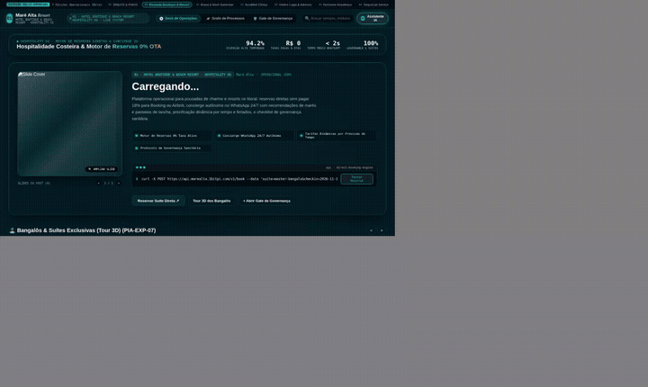

| Foto 1: 3D Vinyl Sleeve & Catálogo Interativo | Foto 2: Grafo Orbital (`PIA-EXP-06`) & Palco `pibit` |
| :---: | :---: |
| 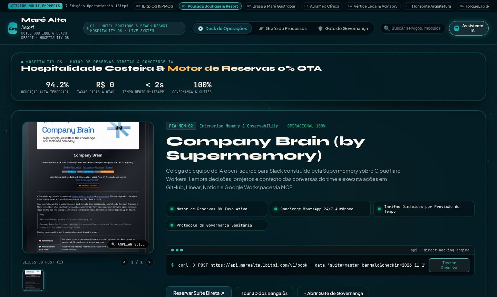 | 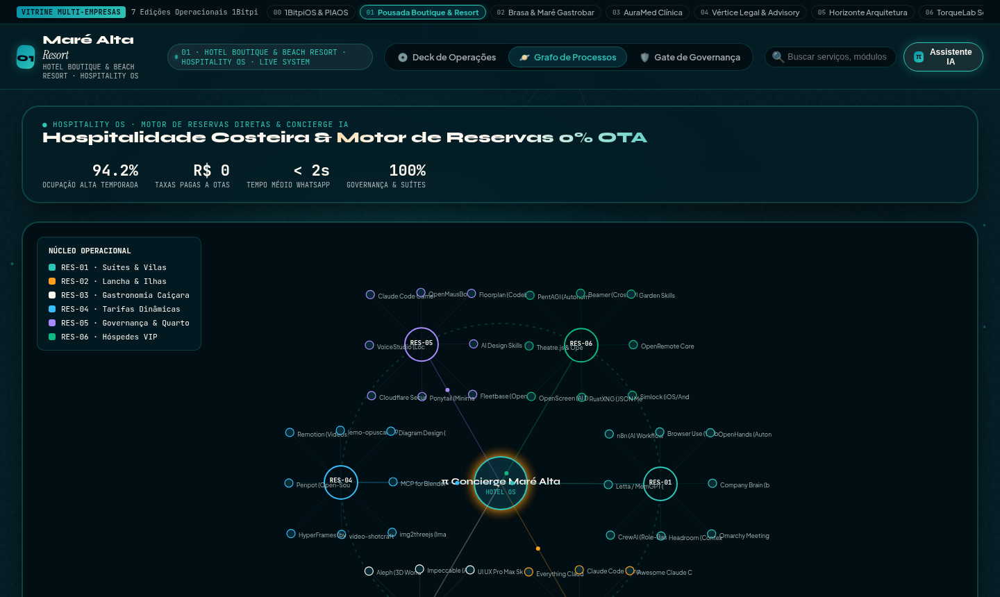 |

---

## 📁 Categoria 02: [02 · Gastronomia, Restaurantes & Beach Clubs (Culinary OS)](./02-gastronomia-e-beach-clubs/)

> **Marca Modelo**: **Brasa & Maré Gastrobar — Culinary OS**  
> **Setor / Público**: Restaurantes Autorais, Gastrobares, Beach Clubs, Parrillas, Adegas & Dark Kitchens Premium  
> **Proposta**: *Cardápio 3D Tátil, Sommelier Virtual no WhatsApp, Fila Inteligente e Controle de CMV*

[**🚀 ABRIR SITE AO VIVO**](https://raw.githack.com/1bitpi-labs/showroom/main/02-gastronomia-e-beach-clubs/02-gastronomia-beach-club.html) · [**🎬 ASSISTIR VÍDEO HD (MP4)**](https://raw.githack.com/1bitpi-labs/showroom/main/player.html?id=02) · [**📂 Entrar na Pasta da Categoria (`02-gastronomia-e-beach-clubs/`)**](./02-gastronomia-e-beach-clubs/) · [**📋 Ficha Técnica Completa**](./02-gastronomia-e-beach-clubs/README.md)

Plataforma gastronômica desenhada para **restaurantes, gastrobares e beach clubs** que querem substituir cardápios em PDF estáticos por uma experiência visual apetitosa em 3D, aumentar o ticket médio com harmonização por IA e acabar com a desistência de clientes na fila de espera.

- **Principais Features do Site**:
  - **Cardápio Tátil 3D com Carrossel de Pratos e Drinks**: Cada prato assinatura exibe múltiplas fotos de alta resolução, notas de preparo na brasa, ingredientes e alertas de alérgenos.
  - **Sommelier & Hostess IA (`π Chef & Hostess`)**: Recomenda automaticamente o vinho ou drink autoral perfeito para acompanhar o prato selecionado pelo cliente.
  - **Fila de Espera Inteligente Pé na Areia**: O cliente entra na fila pelo celular, pede drinks enquanto aguarda na praia ou no bar e recebe alerta no WhatsApp quando a mesa está pronta.
  - **Giro de Salão & Reserva de Lounges VIP**: Mapa orbital integrando Parrilla, Coquetelaria, Adega, Lounges na Praia, Delivery Próprio e Compras.
- **Casos de Uso Práticos para Empresas (Exemplos Reais)**:
  1. **Aumento de Ticket Médio com Harmonização Automática de Vinhos e Drinks**: Ao abrir o cardápio interativo na mesa (via QR Code ou link no WhatsApp), o Sommelier IA sugere instantaneamente a harmonização ideal para cada prato. *(Ex: O cliente seleciona o *Polvo Grelhado na Brasa* → O painel destaca na hora o vinho *Albariño Rías Baixas* em taça ou garrafa e a entrada de *Ostras Frescas*, elevando o ticket da mesa em +28%.)*
  2. **Zero Desistência na Fila de Espera em Finais de Semana de Sol**: O cliente escaneia o QR Code na recepção, entra na fila digital e já recebe no WhatsApp um cupom para pedir o primeiro drink no bar/areia enquanto aguarda sua mesa. *(Ex: Grupo de 6 pessoas entra na fila virtual → Faz o pedido de 6 caipirinhas autorais direto pelo celular → Recebe notificação automática no WhatsApp assim que a mesa 14 é liberada.)*
  3. **Reserva Antecipada de Lounges e Day-Use com Sinal via Pix**: O sistema exige confirmação automática com pré-pagamento de consumação mínima via Pix direto pelo assistente no WhatsApp. *(Ex: Cliente solicita reserva de Lounge VIP para sábado → O agente envia o mapa dos lounges, cobra R$ 500 de consumação antecipada via Pix e emite o voucher QR Code automaticamente.)*
- **Métricas de Retorno (ROI)**: Elevação de **+22% a +35% no ticket médio por pessoa** com sugestões ativas de harmonização e entradas. · **0% de clientes perdidos na fila de espera**, transformando o tempo de espera em consumo ativo de bebidas. · Redução do **CMV para a faixa meta de 26%–28%** com fichas técnicas auditadas no Gate do Chef.

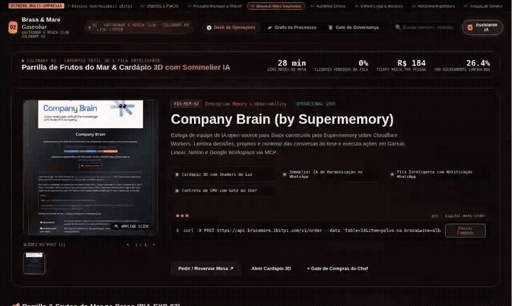

| Foto 1: 3D Vinyl Sleeve & Catálogo Interativo | Foto 2: Grafo Orbital (`PIA-EXP-06`) & Palco `pibit` |
| :---: | :---: |
| 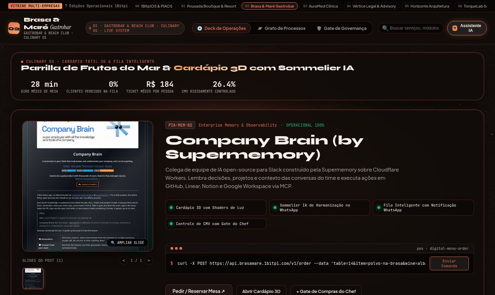 | 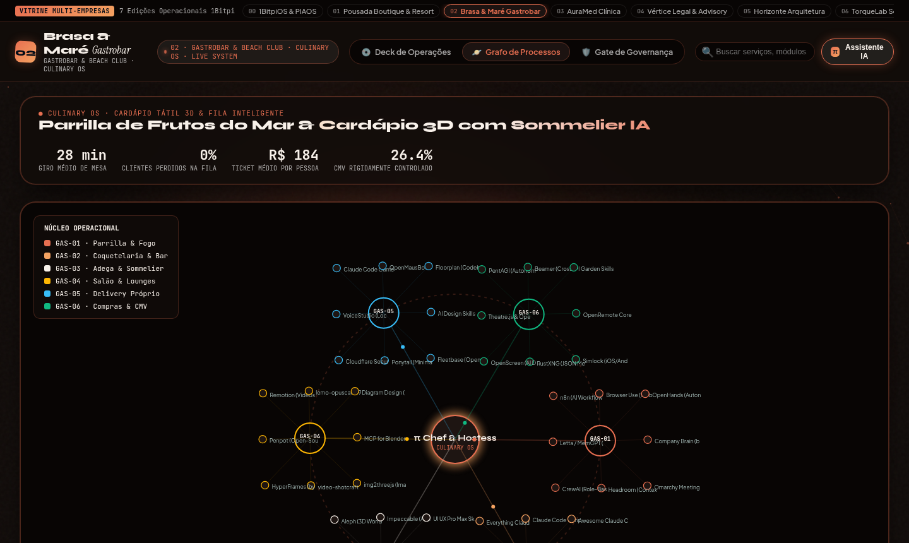 |

---

## 📁 Categoria 03: [03 · Saúde, Clínicas Médicas, Odonto & Wellness (Health OS)](./03-saude-clinicas-e-wellness/)

> **Marca Modelo**: **AuraMed Clínica — Medicina Integrativa & Longevidade**  
> **Setor / Público**: Clínicas Médicas, Consultórios Odontológicos, Dermatologia, Estética Avançada, Nutrologia & Spas Médicos  
> **Proposta**: *Triagem Pré-Consulta com IA, Agenda Anti-Falta (No-Show Zero) e Prontuário LGPD*

[**🚀 ABRIR SITE AO VIVO**](https://raw.githack.com/1bitpi-labs/showroom/main/03-saude-clinicas-e-wellness/03-clinica-saude-wellness.html) · [**🎬 ASSISTIR VÍDEO HD (MP4)**](https://raw.githack.com/1bitpi-labs/showroom/main/player.html?id=03) · [**📂 Entrar na Pasta da Categoria (`03-saude-clinicas-e-wellness/`)**](./03-saude-clinicas-e-wellness/) · [**📋 Ficha Técnica Completa**](./03-saude-clinicas-e-wellness/README.md)

Plataforma digital para **clínicas médicas, odontológicas e centros de estética/longevidade** que desejam encantar pacientes de alto padrão, realizar a pré-anamnese automatizada pelo WhatsApp antes da consulta e reduzir drasticamente as faltas (no-show) na agenda dos especialistas.

- **Principais Features do Site**:
  - **Vitrine de Protocolos Clínicos & Especialidades**: Apresentação ética, clara e sofisticada de check-ups, procedimentos estéticos, implantes e programas de longevidade.
  - **Triagem Pré-Consulta Inteligente (`π Triagem & Acolhimento`)**: Coleta histórico, sintomas e exames anteriores pelo WhatsApp e entrega o resumo pronto para o médico antes de o paciente entrar na sala.
  - **Automação Anti-Falta (No-Show Killer)**: Confirmação ativa em 48h e 24h via WhatsApp com reagendamento em 1 clique e preenchimento automático de horários vagos via lista de espera.
  - **Conformidade e Auditoria LGPD Nativa**: Painel de segurança garantindo isolamento de dados sensíveis de saúde e rastreabilidade de acesso a laudos.
- **Casos de Uso Práticos para Empresas (Exemplos Reais)**:
  1. **Anamnese Prévia no WhatsApp Economizando 15 Minutos por Consulta**: Um dia antes da consulta, o assistente da clínica envia um link conversacional acolhedor onde o paciente informa queixas, medicamentos em uso e anexa exames em PDF. *(Ex: O paciente agenda avaliação de Longevidade → Responde 5 perguntas no WhatsApp em 3 minutos → O médico abre o painel e já vê o resumo clínico estruturado e os biomarcadores destacados.)*
  2. **Eliminação de Horários Ociosos por Falta de Paciente (No-Show)**: O motor Anti-Falta confirma a presença 48h antes; se o paciente precisar remarcar, o sistema aciona automaticamente o primeiro paciente da lista de espera para ocupar a vaga. *(Ex: Paciente de quinta às 15h clica em 'Preciso reagendar' na quarta-feira → O sistema oferece nova data para a semana seguinte e preenche o horário das 15h em 4 minutos com outro paciente.)*
  3. **Acompanhamento Pós-Procedimento e Renovação de Protocolos Recorrentes**: Réguas de cuidado contínuo enviam orientações pós-consulta e avisam automaticamente quando chega o período de manutenção semestral/anual. *(Ex: 5 meses após aplicação dermatológica, a paciente recebe mensagem personalizada com o histórico do seu protocolo e agenda o retorno em 2 cliques.)*
- **Métricas de Retorno (ROI)**: Queda da taxa de **No-Show (faltas) de ~18% para menos de 3.8%**. · Ganho de **12 a 15 minutos por atendimento**, permitindo atender mais pacientes com muito mais qualidade humana. · Aumento de **+40% na taxa de retorno e recorrência** de procedimentos preventivos e estéticos.

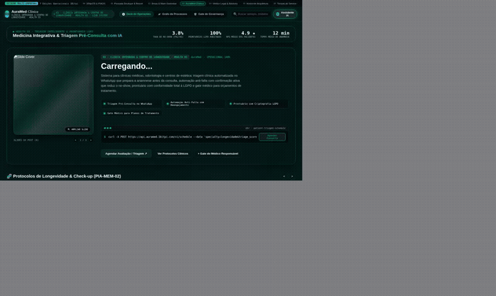

| Foto 1: 3D Vinyl Sleeve & Catálogo Interativo | Foto 2: Grafo Orbital (`PIA-EXP-06`) & Palco `pibit` |
| :---: | :---: |
| 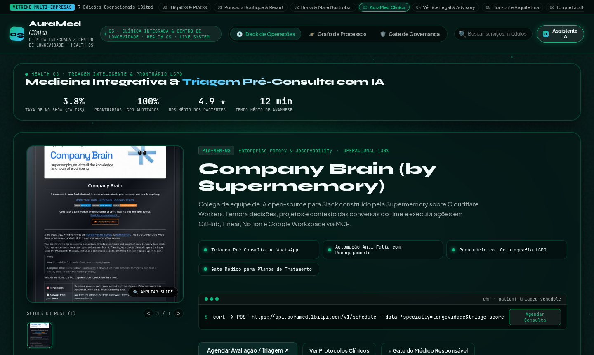 | 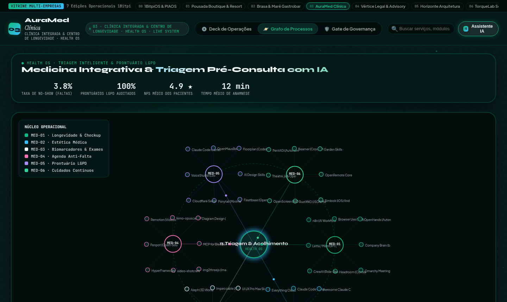 |

---

## 📁 Categoria 04: [04 · Advocacia, Contabilidade & Consultoria B2B (Legal & Advisory OS)](./04-juridico-contabil-e-b2b/)

> **Marca Modelo**: **Vértice Advisory — Advocacia, Contabilidade & Consultoria Corporativa**  
> **Setor / Público**: Escritórios de Advocacia, Bancas de Contabilidade Consultiva, Auditorias, Consultorias Financeiras & B2B  
> **Proposta**: *Cofre de Contratos com Varredura de Riscos por IA, Controle de Prazos e Agente Paralegal*

[**🚀 ABRIR SITE AO VIVO**](https://raw.githack.com/1bitpi-labs/showroom/main/04-juridico-contabil-e-b2b/04-escritorio-servicos-b2b.html) · [**🎬 ASSISTIR VÍDEO HD (MP4)**](https://raw.githack.com/1bitpi-labs/showroom/main/player.html?id=04) · [**📂 Entrar na Pasta da Categoria (`04-juridico-contabil-e-b2b/`)**](./04-juridico-contabil-e-b2b/) · [**📋 Ficha Técnica Completa**](./04-juridico-contabil-e-b2b/README.md)

Ambiente executivo de alta credibilidade para **escritórios de advocacia, contabilidades consultivas e empresas de assessoria B2B**. Combina apresentação institucional de portfólio societário/tributário com automação de auditoria contratual (Due Diligence), pesquisa paralegal privada e portal transparente para clientes corporativos.

- **Principais Features do Site**:
  - **Cofre de Contratos & Scanner Anti-Risco**: Varredura automatizada de minutas contratuais apontando cláusulas abusivas, multas desproporcionais, riscos trabalhistas e brechas de LGPD.
  - **Agente Paralegal & Consultor Fiscal (`π Sócio Gestor`)**: Responde dúvidas preliminares de clientes no WhatsApp/Portal e pesquisa jurisprudência e normas fiscais com RAG isolado (air-gapped).
  - **Monitoramento 24/7 de Prazos Fatais e Obrigações Fiscais**: Painel de conformidade com alerta antecipado de publicações judiciais e vencimentos tributários.
  - **Grafo Orbital de Áreas de Prática**: Conexão visual entre Societário/M&A, Contratos, Tributário, Contencioso Estratégico, Paralegal IA e Portal do Cliente.
- **Casos de Uso Práticos para Empresas (Exemplos Reais)**:
  1. **Pré-Auditoria de Contratos (Due Diligence) em Segundos para Clientes Corporativos**: O Agente Paralegal faz a primeira leitura em 15 segundos, destaca as 3 cláusulas críticas em vermelho e entrega o quadro comparativo pronto para o advogado apenas validar no Gate do Sócio. *(Ex: Cliente envia um contrato de prestação de serviços de 25 páginas → O sistema detecta multa rescisória unilateral de 50% e ausência de foro → O sócio aprova o parecer revisado em 5 minutos.)*
  2. **Captação e Qualificação Executiva de Novos Clientes B2B (Planejamento Tributário / M&A)**: O Showroom apresenta teses tributárias, cases anonimizados e ferramentas interativas onde o empresário entende imediatamente o valor da banca e solicita diagnóstico. *(Ex: Diretor Financeiro visita o site da Vértice, interage com o módulo de *Recuperação de Créditos Tributários*, simula o enquadramento pelo assistente e agenda reunião com o sócio.)*
  3. **Portal do Cliente sem 'Juridiquês' no WhatsApp (Redução de Ligações de Status)**: O assistente traduz movimentações processuais e contábeis para linguagem executiva simples e entrega documentos auditados sob demanda. *(Ex: O cliente pergunta pelo andamento da alteração contratual na Junta Comercial → O assistente informa a etapa atual e envia o protocolo em PDF instantaneamente.)*
- **Métricas de Retorno (ROI)**: Redução de **85% no tempo operacional de triagem e revisão inicial de minutas**. · **Zero prazos judiciais ou fiscais perdidos** com monitoramento redundante automatizado. · Aumento na **conversão de propostas de honorários B2B** pela demonstração prática de governança e tecnologia.

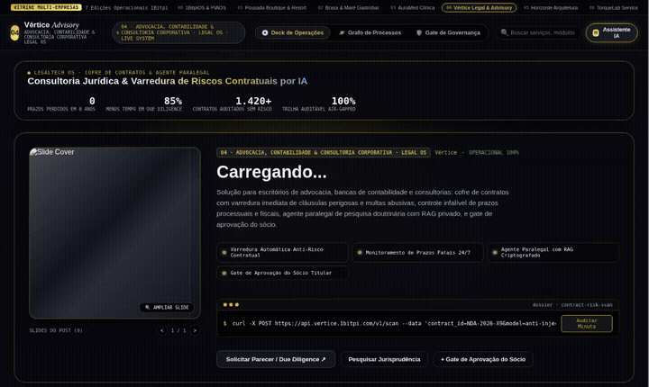

| Foto 1: 3D Vinyl Sleeve & Catálogo Interativo | Foto 2: Grafo Orbital (`PIA-EXP-06`) & Palco `pibit` |
| :---: | :---: |
| 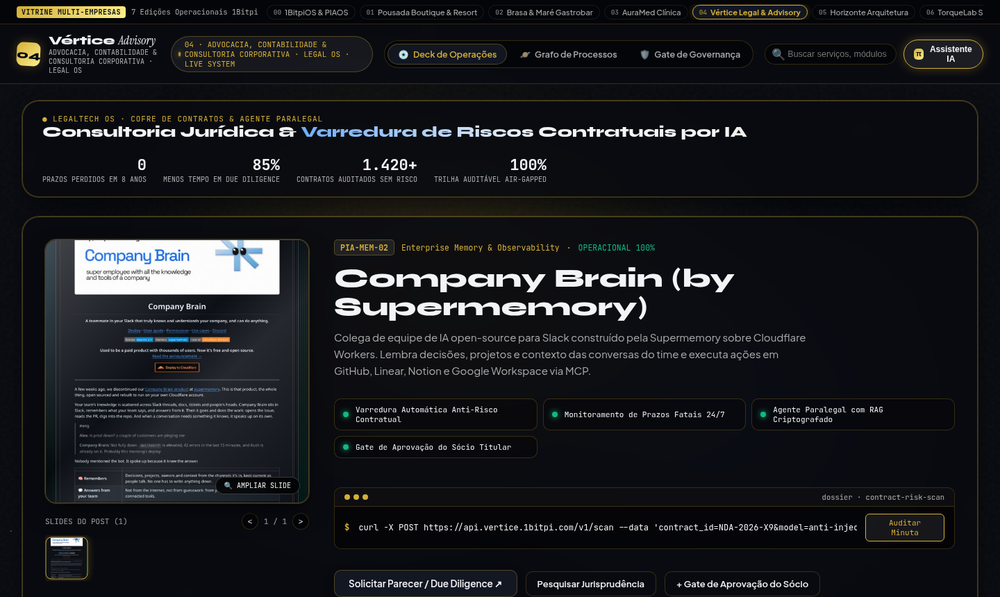 | 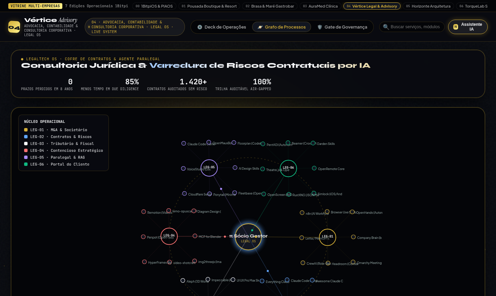 |

---

## 📁 Categoria 05: [05 · Imobiliárias Boutique, Incorporadoras & Arquitetura (Spatial OS)](./05-imobiliario-e-arquitetura/)

> **Marca Modelo**: **Horizonte Design — Imobiliária Boutique & Studio de Arquitetura**  
> **Setor / Público**: Imobiliárias de Alto Padrão, Incorporadoras, Construtoras, Estúdios de Arquitetura & Interiores  
> **Proposta**: *Vitrine de Imóveis e Projetos Autorais, Plantas 3D, Qualificador VIP e Diário de Obra*

[**🚀 ABRIR SITE AO VIVO**](https://raw.githack.com/1bitpi-labs/showroom/main/05-imobiliario-e-arquitetura/05-imobiliaria-arquitetura.html) · [**🎬 ASSISTIR VÍDEO HD (MP4)**](https://raw.githack.com/1bitpi-labs/showroom/main/player.html?id=05) · [**📂 Entrar na Pasta da Categoria (`05-imobiliario-e-arquitetura/`)**](./05-imobiliario-e-arquitetura/) · [**📋 Ficha Técnica Completa**](./05-imobiliario-e-arquitetura/README.md)

Plataforma espacial e comercial para **imobiliárias boutique, corretores private, estúdios de arquitetura e construtoras**. Une a apresentação cinematográfica de residências e plantas baixas com qualificação automática de investidores e acompanhamento físico-financeiro de obras.

- **Principais Features do Site**:
  - **Galeria Cinematográfica 3D de Imóveis e Projetos Autorais**: Capas interativas com carrossel de fachadas, interiores, plantas humanizadas e memorial descritivo.
  - **Consultor Espacial & Qualificador de Investidores (`π Diretor de Projetos`)**: Identifica o perfil de compra/investimento no WhatsApp, calcula rentabilidade estimada (yield) e agenda visitas.
  - **Diário de Obra & Cronograma Físico-Financeiro**: Acompanhamento transparente de etapas construtivas, marcenaria e medições de empreiteiros.
  - **Grafo Orbital do Ecossistema Imobiliário**: Integra Residencial Alto Padrão, Plantas 3D, Obras & Medições, Investidores VIP, Due Diligence Fundiária e Marcenaria.
- **Casos de Uso Práticos para Empresas (Exemplos Reais)**:
  1. **Qualificação Automática de Compradores e Investidores de Alto Padrão 24/7**: O Consultor IA atende instantaneamente, apresenta as plantas e fotos detalhadas, responde sobre documentação/rentabilidade de locação e filtra apenas os compradores reais para visita presencial. *(Ex: Investidor vê anúncio de uma mansão pé na areia no domingo à noite → Interage com o Showroom, consulta o yield projetado de 12% a.a. em locação de temporada e agenda visita com o corretor sênior.)*
  2. **Apresentação de Projetos de Arquitetura que Encanta e Fecha Contratos Executivos**: O escritório entrega ao cliente um Showroom exclusivo com os estudos preliminares, referências de materiais, simulação de insolação e cronograma claro de etapas. *(Ex: Cliente abre o link do estúdio em reunião, navega pelos slides de cada ambiente projetado e aprova o avanço para o Projeto Executivo na mesma hora.)*
  3. **Transparência Total no Acompanhamento de Obra para Clientes à Distância**: Toda sexta-feira o engenheiro valida a medição fotográfica no Gate P6 e o proprietário visualiza o progresso exato pelo painel. *(Ex: Etapa de fundação e estrutura concluída → Engenheiro aprova o checklist fotográfico no Gate P6 → Cliente recebe o relatório visual no celular e autoriza a liberação da parcela.)*
- **Métricas de Retorno (ROI)**: Aumento de **3.2x na conversão de leads qualificados** para visitas presenciais e propostas de compra. · Redução de **60% em visitas improdutivas**, focando a equipe comercial em clientes com real potencial de fechamento. · **100% de rastreabilidade nas medições de obra**, eliminando aditivos surpresa e retrabalho.

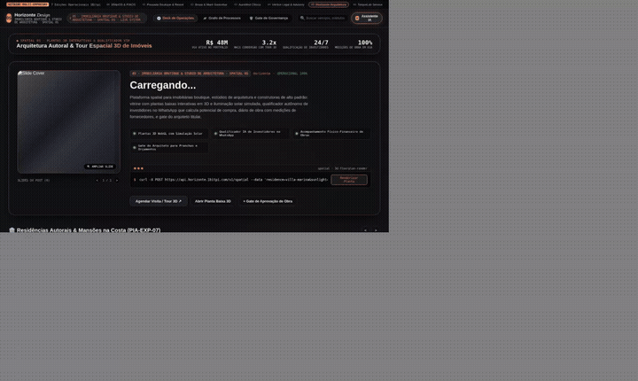

| Foto 1: 3D Vinyl Sleeve & Catálogo Interativo | Foto 2: Grafo Orbital (`PIA-EXP-06`) & Palco `pibit` |
| :---: | :---: |
| 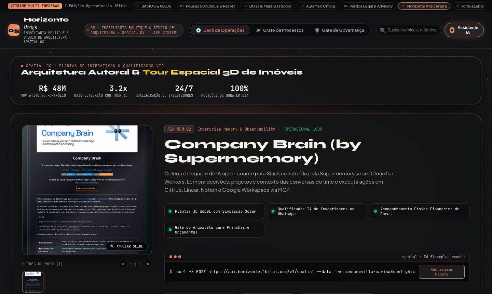 | 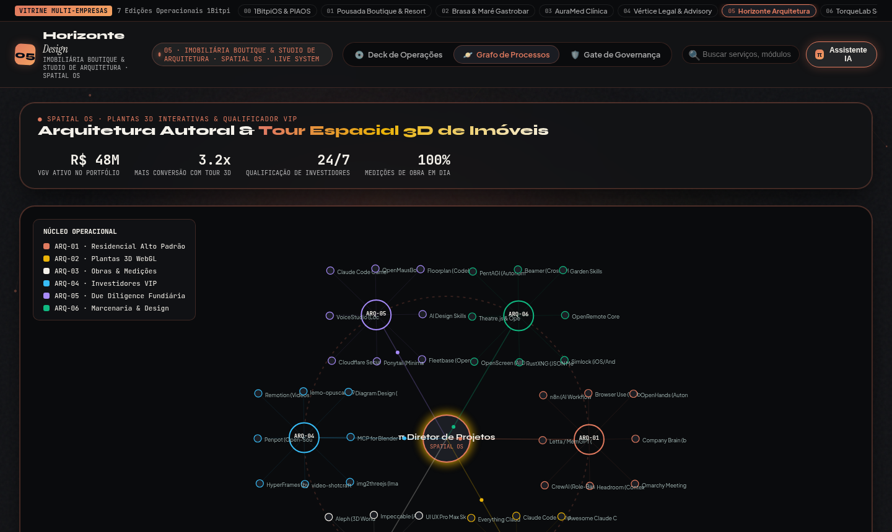 |

---

## 📁 Categoria 06: [06 · Centros Técnicos Automotivos, Oficinas Premium & Serviços (Service OS)](./06-oficinas-e-servicos-tecnicos/)

> **Marca Modelo**: **TorqueLab Service — Centro Técnico Automotivo & Oficina Premium**  
> **Setor / Público**: Oficinas Mecânicas Premium, Estética Automotiva (Detailing), Concessionárias, Náutica & Energia Solar  
> **Proposta**: *Checklist Fotográfico de Entrada, Pit-Stop Orbital dos Boxes ao Vivo e Orçamento em 1 Clique*

[**🚀 ABRIR SITE AO VIVO**](https://raw.githack.com/1bitpi-labs/showroom/main/06-oficinas-e-servicos-tecnicos/06-oficina-servicos-tecnicos.html) · [**🎬 ASSISTIR VÍDEO HD (MP4)**](https://raw.githack.com/1bitpi-labs/showroom/main/player.html?id=06) · [**📂 Entrar na Pasta da Categoria (`06-oficinas-e-servicos-tecnicos/`)**](./06-oficinas-e-servicos-tecnicos/) · [**📋 Ficha Técnica Completa**](./06-oficinas-e-servicos-tecnicos/README.md)

Sistema de transparência radical e alta conversão para **oficinas mecânicas premium, centros de estética automotiva (detailing), manutenção náutica e integradores técnicos**. Elimina a desconfiança do cliente através de evidências fotográficas e acompanhamento ao vivo do veículo no box.

- **Principais Features do Site**:
  - **Catálogo Visual de Serviços & Pacotes de Revisão**: Apresentação clara de diagnóstico por scanner, revisão de freios/suspensão, câmbio automático e vitrificação cerâmica com fotos do antes/depois.
  - **Pit-Stop Orbital (Telemetria de Boxes ao Vivo)**: Grafo interativo mostrando em qual etapa o veículo está (Diagnóstico, Motor/Câmbio, Freios, Estética, Peças ou Pronto para Entrega).
  - **Orçamento Transparente com Evidência Fotográfica**: O cliente visualiza no celular a foto da peça desgastada ao lado da peça nova original e aprova o orçamento em 1 clique no WhatsApp.
  - **Consultor Técnico IA (`π Chefe de Oficina`)**: Tira dúvidas sobre sintomas do carro, agenda revisões e envia alertas preditivos de troca de óleo/correia por quilometragem.
- **Casos de Uso Práticos para Empresas (Exemplos Reais)**:
  1. **Aprovação Rápida de Orçamentos pelo WhatsApp com Fotos da Peça (Fim da Desconfiança)**: O mecânico sobe 3 fotos/vídeo curto da peça gasta no carrossel da OS; o cliente recebe o link visual no WhatsApp separando mão de obra e peças e clica em 'Aprovar Serviço'. *(Ex: Durante revisão de uma BMW, o técnico identifica pastilha de freio no limite → Envia o card visual com foto real da pastilha → O cliente aprova o adicional de R$ 1.450 em 3 minutos pelo celular.)*
  2. **Status ao Vivo do Veículo ('Uber da Oficina') Reduzindo Ligações na Recepção**: A cada mudança de fase no Box, o cliente pode consultar o assistente ou receber notificação automática (Em Diagnóstico → Aguardando Peça → Em Montagem → Em Teste de Rua → Lavado e Pronto). *(Ex: O cliente clica em 'Status do meu carro na oficina' no WhatsApp e recebe na hora: *Box 3 — Troca concluída, iniciando teste de rodagem final*.)*
  3. **CRM Preditivo de Manutenção Preventiva (Retorno Garantido da Frota)**: O sistema calcula a média mensal de km rodados daquele veículo e envia um lembrete automático 15 dias antes do vencimento da revisão preventiva. *(Ex: 6 meses após a revisão, o proprietário recebe mensagem do `TorqueLab` avisando que atingiu a janela estimada de 10.000 km e oferecendo agendamento prioritário para terça-feira.)*
- **Métricas de Retorno (ROI)**: Taxa de **aprovação de orçamentos adicionais de 98.6%** graças à transparência fotográfica. · Giro **35% mais rápido dos elevadores/boxes** com aprovação de orçamento em menos de 15 minutos. · Aumento de **+45% na recorrência de clientes** através dos alertas automáticos de revisão preditiva.

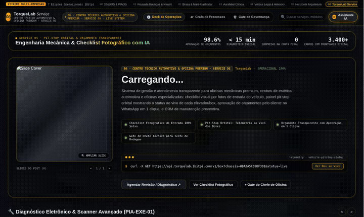

| Foto 1: 3D Vinyl Sleeve & Catálogo Interativo | Foto 2: Grafo Orbital (`PIA-EXP-06`) & Palco `pibit` |
| :---: | :---: |
| 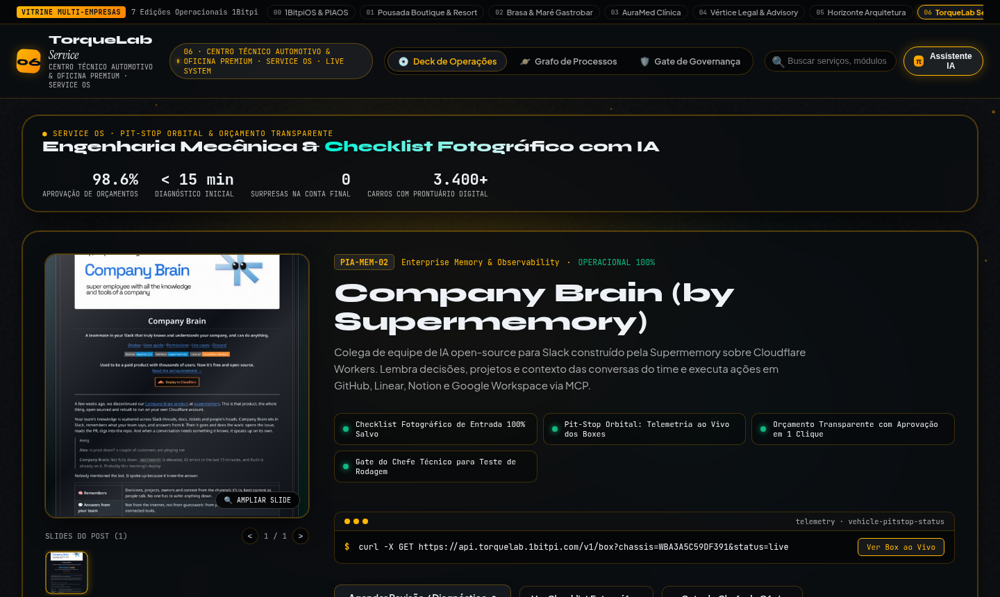 | 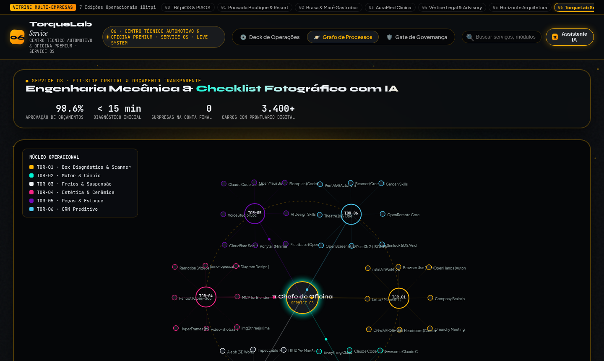 |

---

## 💼 Modelos Comerciais: Como Comprar, Licenciar ou Contratar

Se você visitou este Showroom e deseja implantar um desses sistemas na sua empresa (ou encomendar uma vertical exclusiva para o seu negócio), oferecemos **3 formatos comerciais**:

| Plano / Modalidade | O que está incluso | Prazo Médio | Ideal Para |
| :--- | :--- | :---: | :--- |
| **1. Turnkey White-Label (Site Operacional + Catálogo 3D)** | Adaptação completa de qualquer modelo do Showroom com sua marca, paleta de cores, fotos, vídeos, catálogo de produtos/serviços e botões diretos para o seu WhatsApp. | **5 a 7 dias úteis** | Pousadas, Restaurantes, Clínicas, Escritórios, Imobiliárias e Oficinas que querem presença digital premium imediata. |
| **2. Agent OS Business (Site + Agente `pibit` no WhatsApp)** | Tudo do plano Turnkey + configuração do Assistente de IA no WhatsApp da empresa (triagem, respostas 24/7, pré-orçamento, reserva direta ou qualificação de leads) + Gate P6. | **10 a 15 dias úteis** | Empresas que desejam automatizar atendimento, reduzir faltas (no-show) e vender 24/7 sem comissões de intermediários. |
| **3. Custom Enterprise & Multi-Vertical (Sob Medida)** | Desenvolvimento de vertical inédita, integração via API/MCP com ERP, CRM, prontuário ou sistema jurídico interno, auditoria Anti-Prompt Injection e treinamento da equipe. | **Sob consulta** | Redes de franquias, incorporadoras, bancas jurídicas/contábeis de médio/grande porte e operações de tecnologia. |

### 📞 Como Solicitar um Orçamento ou Demonstração Guiada
1. Escolha a **Categoria (`00` a `06`)** que mais se aproxima do seu modelo de negócio na tabela acima.
2. Abra a pasta da categoria e leia os **Casos de Uso** para identificar quais fluxos deseja ativar primeiro.
3. Entre em contato com a **1Bitpi Labs** informando o código da categoria (ex: `Showroom 01 - Hospitalidade` ou `Showroom 04 - Jurídico/B2B`) para receber uma proposta personalizada.
