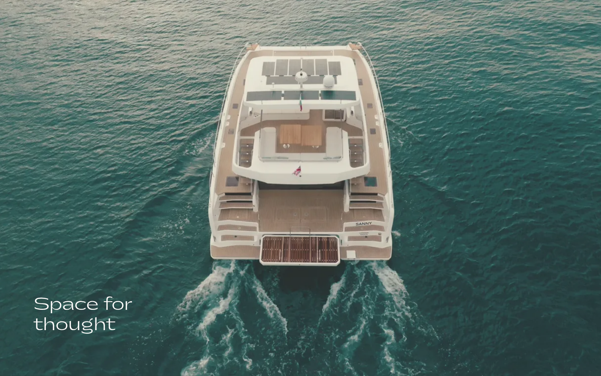
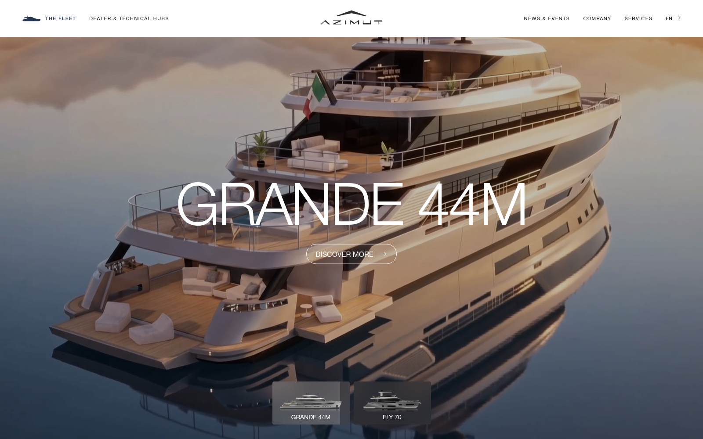
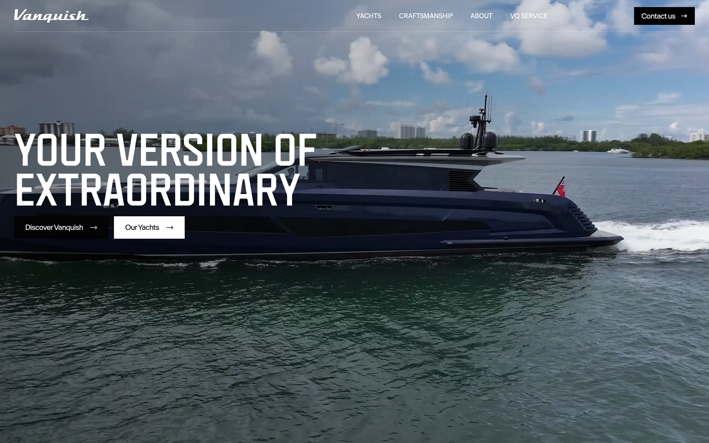
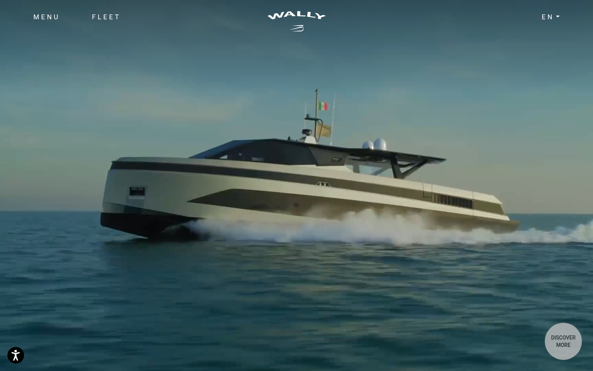
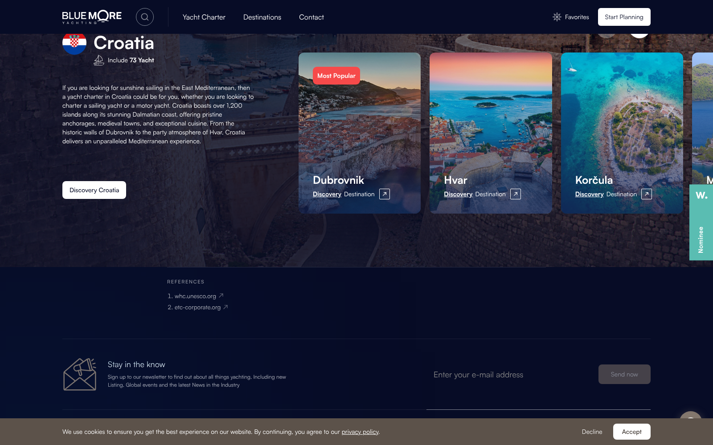
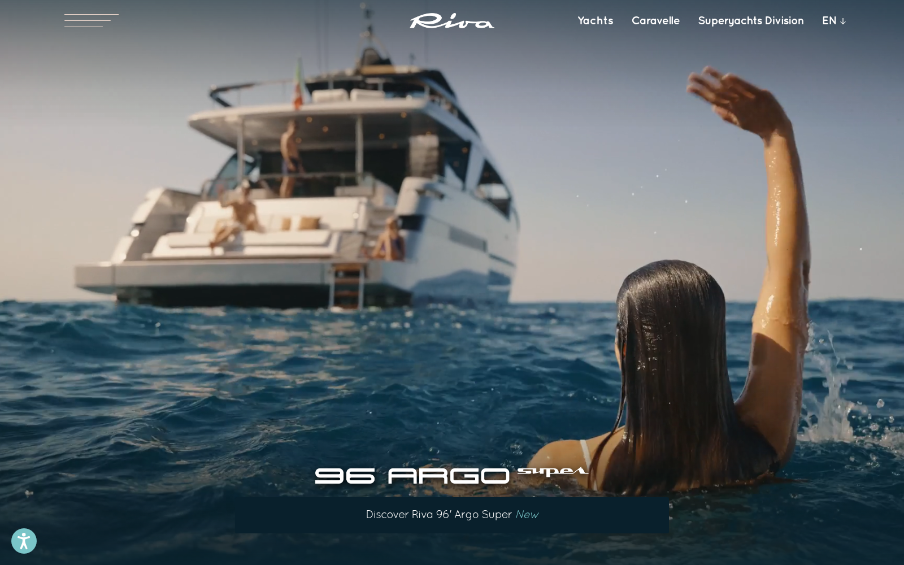

# Benchmarks Náuticos & Marinas de Luxo — Estética Cinematográfica (Awwwards / FWA)

Este relatório compila **7 sites de referência mundial** no universo de **clubes náuticos, marinas e superiates**, premiados no **Awwwards** e no **The FWA**, reconhecidos por sua direção de arte cinematográfica, tecnologia imersiva (vídeo full-bleed, WebGL 3D, scrollytelling fluido) e sofisticação visual (*Quiet Luxury*).

Para cada site, foram capturadas **3 telas em alta resolução** cobrindo a entrada triunfal (*Hero*), o detalhamento de frota/ambiente e o elemento de experiência/conversão.

---

## Tabela Comparativa de Benchmarks

| Site & URL | Reconhecimento & Vibe | Fotos Capturadas (3 por site) | Efeitos Visuais & Tecnologia | Conclusões & Lições de Design |
|:---|:---|:---|:---|:---|
| **1. OMAYA Yachts** [omaya-yachts.com](https://www.omaya-yachts.com) | **Awwwards Honorable Mention** *Catamarãs de Superluxo e Vida ao Ar Livre* | • [Hero / Concha de Teca](./screens/01_omaya_1.png) • [Vista Aérea Drone Popa](./screens/01_omaya_2.png) • [Pôr do Sol & Cockpit](./screens/01_omaya_3.png) | • **Abertura Orgânica:** Vídeo macro focado na textura da madeira teca antes de abrir para o oceano. • **Drone Lento:** Enquadramentos aéreos sem cortes rápidos, transmitindo serenidade. • **Paleta Sunset:** Transição de tons do dourado ao azul profundo. | **Lição para o Clube Náutico:** Começar a experiência pelo detalhe e pelo tato (o convés, o deck da marina) cria conexão sensorial imediata antes de exibir o clube inteiro. |
| **2. Vanquish Yachts** [vanquish-yachts.com](https://www.vanquish-yachts.com) | **Awwwards Site of the Day** *Alta Performance Holandesa em Alumínio* | • [Hero Superyacht](./screens/02_vanquish_1.png) • [Linha de Modelos](./screens/02_vanquish_2.png) • [Lifestyle & Cockpit](./screens/02_vanquish_3.png) | • **Vídeo Dinâmico de Casco:** O iate corta a água em alta velocidade gerando esteira realista. • **Tipografia Monumental:** Letras garrafais brancas sobrepostas diretamente ao vídeo (*"Your Version of Extraordinary"*). • **Dark Glassmorphism:** Menus flutuantes com desfoque de fundo. | **Lição para a Marina:** Tipografia de grande impacto aliada a imagens com contraste forte comunica liderança, exclusividade e poder náutico moderno. |
| **3. Azimut Yachts** [azimutyachts.com](https://azimutyachts.com) | **Awwwards Nominee** *Ícone Italiano de Arquitetura Náutica* | • [Hero Grande 44M](./screens/03_azimut_1.png) • [Deck de Popa ao Entardecer](./screens/03_azimut_2.png) • [Seletor Interativo de Modelos](./screens/03_azimut_3.png) | • **Iluminação de Cinema:** Cenas renderizadas em 3D e filmadas no crepúsculo com reflexos espelhados na água calma. • **Dock Flutuante de Miniaturas:** Carrossel no rodapé para trocar de embarcação sem recarregar a tela. • **Composição Simétrica:** Enquadramentos frontais e de popa rigorosamente alinhados. | **Lição para o Clube Náutico:** A arquitetura dos píeres e lounges da marina deve ser fotografada na "hora de ouro" (*golden hour*) com reflexos na água espelhada para evocar elegância atemporal. |
| **4. AB Yachts** [abyachts.com](https://www.abyachts.com) | **Awwwards Honorable Mention** *Superyachts de Alta Octanagem e Estilo Agressivo* | • [Subaquático com Luz Solar](./screens/04_ab_1.png) • [A New Era of Luxury](./screens/04_ab_2.png) • [Proa Cortando a Água](./screens/04_ab_3.png) | • **Abertura Subaquática:** O visitante entra "debaixo d'água" com raios de sol refratando na superfície antes de emergir. • **Efeito Hidrodinâmico:** Micro-animações que imitam bolhas e ondas suaves na transição de seções. • **Cores Esmeralda e Petróleo:** Paleta rica que foge do azul marinho padrão. | **Lição para a Marina:** O elemento aquático pode ser usado como textura atmosférica em transições e loaders, criando uma identidade imersiva inesquecível. |
| **5. Wally Yachts** [wally.com](https://www.wally.com) | **Ícone Mundial do Design Náutico (Ferretti Group)** *Minimalismo Futurista e Veleiros Ultrarrápidos* | • [Hero Wallypower Widescreen](./screens/05_wally_1.png) • [Navegação Minimalista Motor](./screens/05_wally_2.png) • [Divisão Sail / Veleiros](./screens/05_wally_3.png) | • **Minimalismo Radical:** UI quase invisível (apenas logo icônico, menu sutil e botão circular "Discover More"). • **Enquadramento 21:9 Cinema:** Sensação de tela de cinema com barco ocupando o horizonte marítimo limpo. • **Zero Poluição Visual:** Nenhum banner, texto em excesso ou botões coloridos brigando com a cena. | **Lição para o Clube Náutico:** Menos é mais. Deixar os espaços de convivência e a beleza do mar respirarem na tela atrai o público Ultra-High-Net-Worth (UHNW). |
| **6. Blue More Yachting** [bluemoreyachting.com](https://www.bluemoreyachting.com) | **Awwwards Nominee** *Charter de Superluxo no Mediterrâneo* | • [Hero Veleiro Clássico](./screens/06_bluemore_1.png) • [Buscador Náutico Flutuante](./screens/06_bluemore_2.png) • [Destinos Náuticos / Ilhas](./screens/06_bluemore_3.png) | • **Buscador Concierge Elegante:** Barra de busca flutuante arredondada com campos limpos (Tipo de barco, País, Orçamento, Hóspedes). • **Cards de Destinos Cinematográficos:** Imagens aéreas de enseadas cristalinas e cidades medievais com micro-zoom ao passar o mouse. • **Tipografia Sofisticada:** Títulos em *bold* mesclados com tipografia fina em uma mesma frase (*"Your Private Horizon **Luxury**"*). | **Lição para a Marina:** A área de agendamento de vagas, locação de vagas secas/molhadas e experiências de gastronomia da marina deve ter um widget de reserva tão refinado quanto a fotografia. |
| **7. Riva Yacht** [riva-yacht.com](https://www.riva-yacht.com) | **Lenda Viva da Náutica Mundial (desde 1842)** *Glamour da Riviera Italiana e Cinema Europeu* | • [Hero Estilo Cinema Italiano](./screens/07_riva_1.png) • [Caravelle & Tradição de Mogno](./screens/07_riva_2.png) • [Superyachts & Acabamento](./screens/07_riva_3.png) | • **Cinematografia Dolce Vita:** Cenas com atores reais nadando na água cristalina enquanto o iate repousa ao fundo. • **Texturas Nobres:** Destaque para o mogno polido, o verniz espelhado e os estofados em couro aquamarine clássico da Riva. • **Navegação com Menu Hamburguer Minimalista:** Deixa 98% da tela livre para a fotografia. | **Lição para o Clube Náutico:** Humanizar o clube mostrando membros reais aproveitando um almoço na marina ou um mergulho no fim de tarde eleva o desejo muito além de fotos vazias da infraestrutura. |

---

## Galeria Visual Consolidada (Amostras Reais)

### OMAYA Yachts & Azimut

*OMAYA Yachts: Linhas limpas e foco na experiência ao ar livre.*

*Azimut Yachts: Pôr do sol, iluminação sutil de cabine e reflexos na água.*

### Vanquish & Wally

*Vanquish: Tipografia monumental sobre vídeo de alta velocidade.*

*Wally Yachts: Formas geométricas futuristas e horizonte limpo.*

### Blue More & Riva

*Blue More Yachting: Cards de ilhas e ancoragens de luxo no Mediterrâneo.*

*Riva Yacht: Estilo cinematográfico italiano com atores reais e luz natural dramática.*
